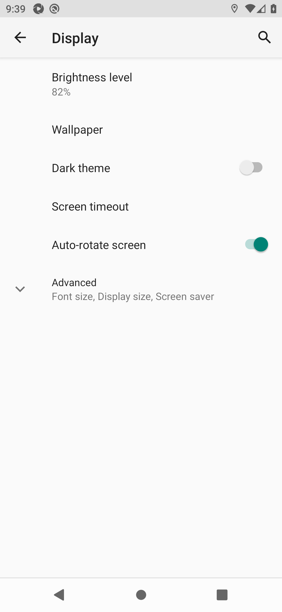
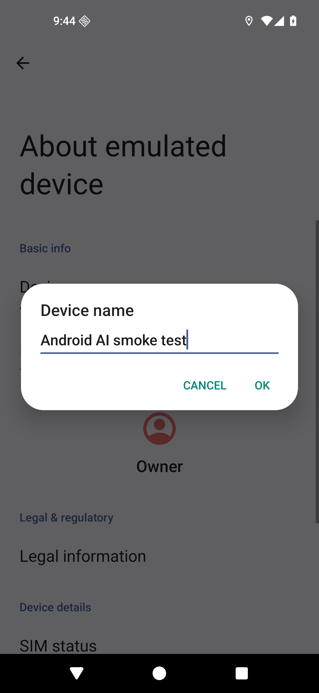

# 安卓AI验收环境配置记录

> 日期：2026-10-09，Asia/Shanghai；用户已授权安装并接受所选Google Android SDK许可。  
> 结论：API29、API36模拟器启动及Appium原生控制链路均PASS；应用工程、APK与产品验收仍NOT_RUN。  
> [初次安装结果](review/android-ai-environment/环境配置结果.json) · [初次API29报告](review/android-ai-environment/automation-api29.json) · [本轮就绪复核](review/android-ai-environment/continuation/就绪复核结果.json) · [本轮API36操作报告](review/android-ai-environment/continuation/automation-api36.json)

## 1. 已安装与配置

工具根目录：`D:\xiang\CX_application\1_Configuration_Files\Android-AI`。SDK、AVD、Appium、独立Node、npm缓存及日志均放在这里。现有JDK复用`D:\xiang\CX_application\1_Configuration_Files\JAVA\jdk-17.0.1`，java/javac检查通过。

| 工具 | 实际版本 | 用途 |
| --- | --- | --- |
| Node / npm | 24.21.0 / 11.19.0 | 项目开发与自动化运行时 |
| pnpm | 10.28.2 | 后续应用依赖管理，已放入独立工具目录 |
| JDK | 17.0.1 | SDK工具及后续Gradle运行；应用编译仍需单独验证 |
| Android Command Line Tools | 22.0 | SDK与AVD管理，无需完整Studio即可准备模拟器 |
| Platform Tools / ADB | 37.0.1 / 1.0.41 | 安装、启动、设备连接 |
| Emulator | 37.2.12 | WHPX＋host GPU；稳定通道 |
| Build Tools / Platform | 36.0.0 / API36 revision2 | 后续应用编译基础 |
| AOSP x86_64镜像 | API29 revision8；API36 revision2 | 安卓10、安卓16兼容验证 |
| Appium / UiAutomator2 | 3.8.0 / 8.7.0 | 原生元素操作、界面树、输入及截图 |

[环境加载脚本](scripts/Use-AndroidAI.ps1)仅设置当前PowerShell及其子进程的PATH、JAVA_HOME、ANDROID_HOME、ANDROID_USER_HOME、ANDROID_AVD_HOME、APPIUM_HOME及工具缓存。系统全局Node保持原值；后续在本项目终端先加载脚本。Appium是独立验收工具，不进入APK依赖。

Node ZIP及CLI工具ZIP已核对官方SHA-256，摘要见配置结果。Google SDK许可接受范围为[SDK包清单](scripts/android-sdk-packages.txt)所需许可，原始许可及安装日志在工具目录logs中。未执行全库许可接受。SDK清单包含滚动组件ID；已装版本以本次配置结果为基线，后续升级需重新记录，不能把再次执行SDK安装命令视为冻结版本复现。

SDK管理采用CLI；官方已将sdkmanager/avdmanager标记为弃用，但22.0仍提供且本机安装、创建已成功。今后工具升级需评估新`android`CLI。参考[CLI工具](https://developer.android.com/studio#command-tools)、[SDK管理](https://developer.android.com/tools/sdkmanager)、[Appium驱动](https://github.com/appium/appium-uiautomator2-driver)。

## 2. 实际验证结果

| 检查 | API29 | API36 | 证据 |
| --- | --- | --- | --- |
| 专用AVD启动、ADB=device、boot_completed=1 | PASS | PASS | [29启动信息](review/android-ai-environment/boot-api29.json)、[36启动信息](review/android-ai-environment/boot-api36.json) |
| WHPX已安装且可用 | PASS | PASS | [accel-check](review/android-ai-environment/acceleration.txt) |
| Appium健康、UiAutomator2原生会话 | PASS | PASS | 两份操作报告 |
| 设置界面树、Display元素点击与目标页断言 | PASS | PASS | XML及截图 |
| Android Back返回设置首页 | PASS | PASS | 页面内容断言及截图 |
| 设备名称输入、精确回读 | PASS | PASS | 输入截图；实际输入`Android AI smoke test` |
| 取消输入、原设备名称保留 | PASS | PASS | 原值仍存在、测试文字消失的断言 |
| 本应用AT01–AT28、性能、独立APK | NOT_RUN | NOT_RUN | 尚无应用及APK |

两套AVD均配置4核、4096MiB内存、1080×2340px、440dpi，逻辑宽约392.73dp，即393dp基线；字号设为1.0。端口分别5560/5562，仅串行启动一个。360dp、200%字号、TalkBack及导航组合留待应用矩阵验收。本次未测应用启动或页面性能，不能以Appium请求耗时替代应用计时。

续配发现原模拟器时区为GMT；现已将运行中的API36设置为Asia/Shanghai并回读确认，后续两套AVD启动参数均显式指定该IANA时区。设备时区基线与本会话一致，应用仍需首次使用时保存自己的固定时区，不能以AVD配置替代应用的固定时区规则。[本轮启动信息](review/android-ai-environment/continuation/boot-api36.json)

UiAutomator2 Doctor报告0项必需修复；可选缺项为bundletool、ffmpeg、GStreamer，对当前原生APK、界面树和截图范围无阻碍。AAB、录像或流媒体测试另行准备。[Doctor原始日志](review/android-ai-environment/doctor-after-sdk.txt)

检查脚本使用系统设置的标准Intent及元素定位，等待目标页面后断言；设备名称输入后取消，不保存设置。初次检查中发现页面切换时序及设置搜索任务残留，已改为显式打开设置首页和关于设备页面，最终两套报告均PASS。只对命名匹配的本项目AVD运行。

## 3. 截图与断言一起查看

| 安卓10：点击后的Display页 | 安卓16：输入后的设备名称对话框 |
| --- | --- |
|  |  |
| 断言出现Brightness/Dark theme/Font size等目标内容；随后Back回首页。 | 断言输入框文字准确相等；随后点击取消并核对原设备名称。 |

本轮API36截图及操作报告另存[续配证据目录](review/android-ai-environment/continuation/)，包括[点击页](review/android-ai-environment/continuation/automation-api36-display.png)、[输入页](review/android-ai-environment/continuation/automation-api36-input.png)和一键停止/重启/复用结果。截图生成于时区修正前，截图中的系统时钟不能用于应用业务日期验收。

这些是系统设置测试截图；Pen设计及应用功能对应截图仍见PRD/图文对照。

## 4. 下次启动与复核

从项目根目录一键启动。脚本加载任务环境、启动或复用本项目Appium、启动或复用指定AVD，等待双方就绪；加`-VerifyControl`执行系统设置控制检查。串行运行一套AVD，切换API前先停止现有设备。

```powershell
.\resource\scripts\Start-AndroidAIValidation.ps1 -Api 36 -VerifyControl
# 日常启动可省略-VerifyControl；只启动环境，不运行系统设置检查。
# 使用结束后关闭指定AVD和本项目Appium：
.\resource\scripts\Stop-AndroidAIValidation.ps1 -Api 36
```

[一键启动脚本](scripts/Start-AndroidAIValidation.ps1) · [一键停止脚本](scripts/Stop-AndroidAIValidation.ps1)。保留Appium时停止脚本加`-KeepAppium`。服务进程核对Node路径及Appium入口；已有指定AVD时复用，未重复创建。运行状态写工具目录logs/runtime-state.json，未来启动/停止后的实时状态以该文件及ADB/服务健康检查为准。

默认后台无窗口启动，Appium仅监听`127.0.0.1:4723`。需要查看模拟器窗口时显式使用`Start-AndroidAIEmulator.ps1 -Api 36 -Visible`。API29将参数改为29，对应设备为emulator-5560。两套AVD已创建，只有重新准备环境时才运行[AVD初始化脚本](scripts/Initialize-AndroidAIAvds.ps1)，它保留既有AVD。

初次安装检查后曾关闭两套AVD和服务。本轮继续配置已重新启动API36与Appium，验证一键启动和系统设置操作，检查结束时保留后台运行，便于后续接入应用。检查结果写工具目录logs，初次交付证据为review/android-ai-environment中的历史快照；本轮证据另存其continuation子目录，不覆盖初次报告。

## 5. 应用实施仍需满足的条件

初次安装结束时F盘只有0.84GiB空闲。用户随后删除指定归档文件，本轮重新采样C盘37.33GiB、D盘10.82GiB、F盘36.60GiB空闲，原F盘容量阻碍已解除。工具和AVD继续放D盘，应用源码/依赖/原生构建可在现有F盘项目目录准备；NDK/Gradle缓存的新增占用在原生工程准备时重查。内存总31.71GiB，启动前空闲6.57GiB，保持单个4GiB AVD，编译时重查可用内存。

本次没有创建应用工程、安装33项应用依赖、生成签名或构建APK。NDK/CMake留待实际原生工程按依赖版本准备。SDK57的Gradle9.3.1/AGP8.12组合仍需Debug/Release实际构建；SQLite、Intl时区、字体、动画/金属视觉、离线包及覆盖升级仍需P1和产品验收提供证据。[技术草案](技术设计文档-计划打卡-Android-v1.md)
