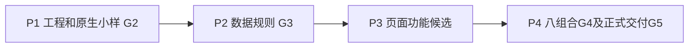

# 计划打卡 Android V1｜实施计划 checklist

> 版本1.0 执行基线；用户于2026-10-10授权按实施与验收计划开始开发。依据PRD/UI 1.1及技术0.8。[实时进度与证据](progress/开发进度.md)。

共30个实施项，关联120个BDD场景、281个场景/参数实例（设备矩阵另乘）。[打开BDD验收 checklist](BDD验收-checklist-计划打卡-Android-v1.md)。

优先使用[图文浏览页](acceptance/浏览.html)查看任务与场景；长退出清单默认折叠，点击具体AC进入主题分册。

## 使用与完成规则

任务状态采用NOT_STARTED/IN_PROGRESS/BLOCKED/DONE；验收采用NOT_RUN/PASS/FAIL/BLOCKED。任务代码写完不等于DONE：产物、实现检查和本任务退出场景的全部参数及本任务规定范围通过且证据齐全后才能勾选。仅贡献实现的端到端关联项由P3主责验收，不反向要求P2先完成UI。BLOCKED注明具体依赖、已有证据和解除条件，不标通过。

G0文档与G1控制环境的已有证据复用，P1–P4按依赖拓扑执行；当前状态见实时进度。任务DONE仅在退出验收范围和证据齐全后记录。

范围固定为免登录离线的三类计划、今日确认、文字备注、合法补记、日历/全部历史。账号/同步/备份恢复/提醒/照片/社交不进首版；发布到应用商店另行规划。真实设备检查单列，不能以模拟器声称所有厂商已通过。

## 实施依赖与阶段门槛

| 阶段 | 实施项 | 退出条件 |
| --- | --- | --- |
| P1 | IP01–IP05 | 实际严格安装/构建/两API模块小样和隔离测试驱动通过；不得跳过Gradle组合与停机载入链路小样；正式性能夹具执行在IP28 |
| P2 | IP06–IP16 | 日期、9表/迁移、单连接、权限、11命令、生命周期和统计/查询测试通过 |
| P3 | IP17–IP25 | 23画板对应页面/状态及未画错误态，三类闭环、日历筛选、管理与只读通过 |
| P4 | IP26–IP30 | 全部必需场景/参数/设备行、离线正式包、性能、升级和证据归档通过 |

阶段退出只使用该阶段可执行的独立场景：IP02先AC117检查生成配置，IP03再AC002核对最终APK；P2使用AC108–AC116及独立DOMAIN/NATIVE场景，无截图前置；IP08用AC010/119验执行器原语，生产命令AC104在IP12；IP17用AC118组件展示，完整页面AC090在IP27。端到端场景由P3主责，原P2仅为实现贡献项。

核心AC在P3主责及IP26的退出范围仅API29/36、393dp/font1；IP27追加M1–M8，IP30要求完整范围。提前完成基础范围不勾AC父项，父项等全矩阵齐全才PASS；任务按下表本项范围勾选。SEMANTIC只验标签/语义树，真实TalkBack由AC094；正式资源/性能和升级由IP28/IP29，不给P3提前强加后续报告。

不预设日历工期。各项开始时记录实际负责人/开始日/阻碍，完成时绑定源码快照和验收报告；范围或预算变更走原需求/技术决策记录，不能修改期望迁就实现。

## 总 checklist

- [ ] [IP01｜建立应用工程与冻结依赖](#ip01) — P1，IN_PROGRESS
- [x] [IP02｜原生身份、备份排除与可重建配置](#ip02) — P1，DONE
- [ ] [IP03｜签名与Debug/Release原生编译](#ip03) — P1，IN_PROGRESS
- [x] [IP04｜最小原生模块与视觉小样](#ip04) — P1，DONE
- [x] [IP05｜测试驱动、隔离夹具与证据采集](#ip05) — P1，DONE
- [ ] [IP06｜业务日期和固定时区适配器](#ip06) — P2，IN_PROGRESS
- [ ] [IP07｜9表Schema、引用与全链迁移](#ip07) — P2，IN_PROGRESS
- [ ] [IP08｜唯一连接执行器、快照与revision](#ip08) — P2，IN_PROGRESS
- [ ] [IP09｜字段规则版本与合法编辑](#ip09) — P2，IN_PROGRESS
- [ ] [IP10｜生命周期、阶段与离线对账](#ip10) — P2，IN_PROGRESS
- [ ] [IP11｜普通、补记、只读权限](#ip11) — P2，IN_PROGRESS
- [ ] [IP12｜命令信封、幂等、冲突和稳定错误](#ip12) — P2，IN_PROGRESS
- [ ] [IP13｜固定统计、区间与连续](#ip13) — P2，IN_PROGRESS
- [ ] [IP14｜每周目标、完整周与连续](#ip14) — P2，IN_PROGRESS
- [ ] [IP15｜一次性日期、终态和归档](#ip15) — P2，IN_PROGRESS
- [ ] [IP16｜今日、月历、列表、详情查询投影](#ip16) — P2，IN_PROGRESS
- [ ] [IP17｜主题、金属组件与弹性布局](#ip17) — P3，IN_PROGRESS
- [ ] [IP18｜初始化、路由和会话边界](#ip18) — P3，IN_PROGRESS
- [ ] [IP19｜三类型新建与运行中编辑表单](#ip19) — P3，IN_PROGRESS
- [ ] [IP20｜今日四分区与保存反馈](#ip20) — P3，IN_PROGRESS
- [ ] [IP21｜记录、修正、补记与只读页面](#ip21) — P3，IN_PROGRESS
- [ ] [IP22｜全局日历与状态筛选](#ip22) — P3，IN_PROGRESS
- [ ] [IP23｜三类详情、全部历史与只读入口](#ip23) — P3，IN_PROGRESS
- [ ] [IP24｜计划列表与两阶段删除管理](#ip24) — P3，IN_PROGRESS
- [ ] [IP25｜本机设置、隐私与错误反馈](#ip25) — P3，IN_PROGRESS
- [ ] [IP26｜全功能BDD执行与缺陷回归](#ip26) — P4，IN_PROGRESS
- [ ] [IP27｜八组合、视觉和无障碍验收](#ip27) — P4，IN_PROGRESS
- [ ] [IP28｜独立release与性能预算](#ip28) — P4，IN_PROGRESS
- [ ] [IP29｜覆盖升级、备份关闭与故障验收](#ip29) — P4，NOT_STARTED
- [ ] [IP30｜发布证据归档与完整交付](#ip30) — P4，NOT_STARTED

## 逐项实施与退出 checklist

### IP01｜建立应用工程与冻结依赖

阶段：P1；状态：IN_PROGRESS；前置：已确认技术0.8；当前项目目录

需求关联：[FR32](设计需求文档-计划打卡-Android-v1.md#fr32)

实现 checklist：

- [x] IP01.W1 — 在当前目录生成app/src/assets/plugins/tests，保留resource
- [x] IP01.W2 — 按技术0.8清单精确安装33项依赖与pnpm
- [x] IP01.W3 — strict peer、hoisted、TypeScript strict和移动/Node测试tsconfig分离
- [x] IP01.W4 — Expo版本检查与Android bundle
- [x] IP01.W5 — 首个实际应用锁文件固定摘要，不复制评审锁后宣称已安装

产物 checklist：

- [x] IP01.D1 — 应用package.json/lockfile/tsconfig/Babel/Metro
- [x] IP01.D2 — 真实安装与Expo检查原始日志
- [x] IP01.D3 — 工作区快照和版本清单

验收关联（点击到具体场景；主责项与汇总消费项分开）：

主责场景：[AC001](acceptance/scenarios/01-工程准入.md#ac001)

实现贡献关联（此项不以其完整UI执行作为退出前置）：无

展开全部退出场景与范围（1项）

| 退出AC | 本实施项必须完成的范围 |
| --- | --- |
| [AC001](acceptance/scenarios/01-工程准入.md#ac001) | Windows本机构建；APK输出再做静态身份验证 |

- [x] IP01.V1 — 每个退出场景的全部Examples与上表本项范围PASS，assertions/evidence完整；贡献关联在对应主责项验收，AC父项等待全范围齐全。
- [x] IP01.V2 — 实现/产物/验收报告与同一源码及构建摘要关联；失败修复已回归，无必需NOT_RUN/BLOCKED。

执行记录：负责人Codex；开始2026-10-10T05:17:47.674Z；完成2026-10-10T09:26:05.059Z；[实时进度及证据](progress/开发进度.md)。

### IP02｜原生身份、备份排除与可重建配置

阶段：P1；状态：DONE；前置：[IP01](#ip01)

需求关联：[FR30](设计需求文档-计划打卡-Android-v1.md#fr30)、[FR32](设计需求文档-计划打卡-Android-v1.md#fr32)

实现 checklist：

- [x] IP02.W1 — 配置计划打卡、正式com.xiang.plancheckin及开发.dev
- [x] IP02.W2 — min29/compile36/target36
- [x] IP02.W3 — 插件生成旧/新XML，禁云备份和设备迁移
- [x] IP02.W4 — 实际file/SQLite及所有使用域排除
- [x] IP02.W5 — 重复prebuild保留配置
- [x] IP02.W6 — 不请求通知/照片/定位权限，不接远程OTA

产物 checklist：

- [x] IP02.D1 — app.config.ts/config plugins
- [x] IP02.D2 — 最终manifest/XML及合并报告
- [x] IP02.D3 — 重复生成差异证据

验收关联（点击到具体场景；主责项与汇总消费项分开）：

主责场景：[AC117](acceptance/scenarios/01-工程准入.md#ac117)

实现贡献关联（此项不以其完整UI执行作为退出前置）：[AC002](acceptance/scenarios/01-工程准入.md#ac002)

展开全部退出场景与范围（1项）

| 退出AC | 本实施项必须完成的范围 |
| --- | --- |
| [AC117](acceptance/scenarios/01-工程准入.md#ac117) | Windows生成配置两次，尚无APK；最终APK验证留AC002 |

- [x] IP02.V1 — 每个退出场景的全部Examples与上表本项范围PASS，assertions/evidence完整；贡献关联在对应主责项验收，AC父项等待全范围齐全。
- [x] IP02.V2 — 实现/产物/验收报告与同一源码及构建摘要关联；失败修复已回归，无必需NOT_RUN/BLOCKED。

执行记录：负责人Codex；开始2026-10-10T08:08:50.771Z；完成2026-10-10T09:26:05.934Z；[实时进度及证据](progress/开发进度.md)。

### IP03｜签名与Debug/Release原生编译

阶段：P1；状态：IN_PROGRESS；前置：[IP01](#ip01)、[IP02](#ip02)

需求关联：[FR32](设计需求文档-计划打卡-Android-v1.md#fr32)

实现 checklist：

- [x] IP03.W1 — 任务终端加载Node24/JDK17/SDK，重查容量并按生成工程准备NDK
- [x] IP03.W2 — 保存Wrapper/AGP/Kotlin/SDK解析版本
- [x] IP03.W3 — 验证Gradle9.3.1与AGP8.12实际构建
- [x] IP03.W4 — 正式签名密钥仓库外保护，Gradle安全读取，versionCode递增
- [x] IP03.W5 — 生成development与非debuggable长期签名release，验证证书和APK摘要

产物 checklist：

- [x] IP03.D1 — Debug/Release构建原始日志
- [x] IP03.D2 — apksigner验证/证书摘要
- [x] IP03.D3 — build-manifest和APK，不交付私钥

验收关联（点击到具体场景；主责项与汇总消费项分开）：

主责场景：[AC002](acceptance/scenarios/01-工程准入.md#ac002)、[AC003](acceptance/scenarios/01-工程准入.md#ac003)

实现贡献关联（此项不以其完整UI执行作为退出前置）：无

展开全部退出场景与范围（2项）

| 退出AC | 本实施项必须完成的范围 |
| --- | --- |
| [AC002](acceptance/scenarios/01-工程准入.md#ac002) | Windows本机构建；APK输出再做静态身份验证 |
| [AC003](acceptance/scenarios/01-工程准入.md#ac003) | Windows本机构建；APK输出再做静态身份验证 |

- [x] IP03.V1 — 每个退出场景的全部Examples与上表本项范围PASS，assertions/evidence完整；贡献关联在对应主责项验收，AC父项等待全范围齐全。
- [x] IP03.V2 — 实现/产物/验收报告与同一源码及构建摘要关联；失败修复已回归，无必需NOT_RUN/BLOCKED。

执行记录：负责人Codex；开始2026-10-10T08:10:39.074Z；完成2026-10-11T04:43:07.431Z；[实时进度及证据](progress/开发进度.md)。

### IP04｜最小原生模块与视觉小样

阶段：P1；状态：DONE；前置：[IP03](#ip03)

需求关联：[FR14](设计需求文档-计划打卡-Android-v1.md#fr14)、[FR32](设计需求文档-计划打卡-Android-v1.md#fr32)

实现 checklist：

- [x] IP04.W1 — 两API验证SQLite版本/路径/wal/2/1、单连接事务
- [x] IP04.W2 — Hermes Intl上海/纽约和日期运算
- [x] IP04.W3 — Router/Worklets原生匹配
- [x] IP04.W4 — 嵌入静态字体400/600/700及OFL
- [x] IP04.W5 — 渐变/金属高光/内外阴影、安全区/键盘
- [x] IP04.W6 — 关Metro验证release资源

产物 checklist：

- [x] IP04.D1 — 原生小样源码
- [x] IP04.D2 — API29/36技术断言日志和实测截图
- [x] IP04.D3 — 字体文件摘要/许可
- [x] IP04.D4 — G2报告

验收关联（点击到具体场景；主责项与汇总消费项分开）：

主责场景：[AC004](acceptance/scenarios/01-工程准入.md#ac004)、[AC005](acceptance/scenarios/01-工程准入.md#ac005)

实现贡献关联（此项不以其完整UI执行作为退出前置）：无

展开全部退出场景与范围（2项）

| 退出AC | 本实施项必须完成的范围 |
| --- | --- |
| [AC004](acceptance/scenarios/01-工程准入.md#ac004) | API29/36原生.dev数据库集成；标DOMAIN的断言另做规则测试 |
| [AC005](acceptance/scenarios/01-工程准入.md#ac005) | 全Examples在API29/36/393dp/font1；DOMAIN部分独立规则测试 |

- [x] IP04.V1 — 每个退出场景的全部Examples与上表本项范围PASS，assertions/evidence完整；贡献关联在对应主责项验收，AC父项等待全范围齐全。
- [x] IP04.V2 — 实现/产物/验收报告与同一源码及构建摘要关联；失败修复已回归，无必需NOT_RUN/BLOCKED。

执行记录：负责人Codex；开始2026-10-10T09:27:29.409Z；完成2026-10-11T04:14:58.111Z；[实时进度及证据](progress/开发进度.md)。

### IP05｜测试驱动、隔离夹具与证据采集

阶段：P1；状态：DONE；前置：[IP03](#ip03)

需求关联：[FR10](设计需求文档-计划打卡-Android-v1.md#fr10)、[FR32](设计需求文档-计划打卡-Android-v1.md#fr32)

实现 checklist：

- [x] IP05.W1 — 复用已有Appium/AVD脚本，验证正确设备和包身份
- [x] IP05.W2 — .dev才编译Clock/seed/故障入口，正式包排除
- [x] IP05.W3 — 固定testID与自然中文accessibilityLabel
- [x] IP05.W4 — 准备F01–F08合法数据及性能夹具
- [x] IP05.W5 — P1验证可丢弃AOSP AVD的root/私有目录载入链路
- [x] IP05.W6 — 建立assertions/evidence报告与哈希清单，不触碰个人库

产物 checklist：

- [x] IP05.D1 — 测试目录/夹具生成器/版本摘要
- [x] IP05.D2 — 设备读回与载入链路证据
- [x] IP05.D3 — 逐场景执行报告模板

验收关联（点击到具体场景；主责项与汇总消费项分开）：

主责场景：[AC006](acceptance/scenarios/01-工程准入.md#ac006)

实现贡献关联（此项不以其完整UI执行作为退出前置）：无

展开全部退出场景与范围（1项）

| 退出AC | 本实施项必须完成的范围 |
| --- | --- |
| [AC006](acceptance/scenarios/01-工程准入.md#ac006) | API29/36隔离AVD与.dev入口；正式性能载入链路另测 |

- [x] IP05.V1 — 每个退出场景的全部Examples与上表本项范围PASS，assertions/evidence完整；贡献关联在对应主责项验收，AC父项等待全范围齐全。
- [x] IP05.V2 — 实现/产物/验收报告与同一源码及构建摘要关联；失败修复已回归，无必需NOT_RUN/BLOCKED。

执行记录：负责人Codex；开始2026-10-10T09:27:29.409Z；完成2026-10-11T04:01:11.484Z；[实时进度及证据](progress/开发进度.md)。

### IP06｜业务日期和固定时区适配器

阶段：P2；状态：IN_PROGRESS；前置：[IP04](#ip04)、[IP05](#ip05)

需求关联：[FR14](设计需求文档-计划打卡-Android-v1.md#fr14)

实现 checklist：

- [ ] IP06.W1 — 品牌类型区分BusinessDate与UTC毫秒
- [ ] IP06.W2 — 首次IANA验证并原子保存，无效阻断
- [ ] IP06.W3 — 公历/周一/严格下周一
- [ ] IP06.W4 — 合法日期往返解析
- [ ] IP06.W5 — DST日历加减而非24h
- [ ] IP06.W6 — 统一Clock快照、午夜计时与AppState对账

产物 checklist：

- [ ] IP06.D1 — DateAdapter/Clock实现
- [ ] IP06.D2 — 上海/纽约/DST/闰年/跨月年规则测试

验收关联（点击到具体场景；主责项与汇总消费项分开）：

主责场景：[AC014](acceptance/scenarios/02-日期与时区.md#ac014)、[AC108](acceptance/scenarios/12-数据与规则准入.md#ac108)

实现贡献关联（此项不以其完整UI执行作为退出前置）：[AC012](acceptance/scenarios/02-日期与时区.md#ac012)、[AC013](acceptance/scenarios/02-日期与时区.md#ac013)、[AC015](acceptance/scenarios/02-日期与时区.md#ac015)

展开全部退出场景与范围（2项）

| 退出AC | 本实施项必须完成的范围 |
| --- | --- |
| [AC014](acceptance/scenarios/02-日期与时区.md#ac014) | 纯领域测试全Examples；DateAdapter/Intl另做两API原生小样 |
| [AC108](acceptance/scenarios/12-数据与规则准入.md#ac108) | API29/36原生.dev数据库集成；标DOMAIN的断言另做规则测试 |

- [ ] IP06.V1 — 每个退出场景的全部Examples与上表本项范围PASS，assertions/evidence完整；贡献关联在对应主责项验收，AC父项等待全范围齐全。
- [ ] IP06.V2 — 实现/产物/验收报告与同一源码及构建摘要关联；失败修复已回归，无必需NOT_RUN/BLOCKED。

执行记录：负责人Codex；开始2026-10-10T08:40:10.306Z；完成未完成；[实时进度及证据](progress/开发进度.md)。

### IP07｜9表Schema、引用与全链迁移

阶段：P2；状态：IN_PROGRESS；前置：[IP04](#ip04)、[IP05](#ip05)

需求关联：[FR11](设计需求文档-计划打卡-Android-v1.md#fr11)、[FR13](设计需求文档-计划打卡-Android-v1.md#fr13)、[FR16](设计需求文档-计划打卡-Android-v1.md#fr16)、[FR29](设计需求文档-计划打卡-Android-v1.md#fr29)、[FR32](设计需求文档-计划打卡-Android-v1.md#fr32)

实现 checklist：

- [x] IP07.W1 — 实现9表STRICT及索引、真实FK与唯一约束
- [x] IP07.W2 — due版本同计划延迟复合FK
- [x] IP07.W3 — 一次性actual/business关系
- [x] IP07.W4 — 全体待迁移一次事务，user_version末尾设置，foreign_key_check和不变量
- [x] IP07.W5 — 高schema阻断，失败保留库/WAL/SHM

产物 checklist：

- [x] IP07.D1 — v1迁移/类型化SQL访问
- [x] IP07.D2 — API29/36约束/级联/迁移失败报告
- [x] IP07.D3 — 无自动清库路径

验收关联（点击到具体场景；主责项与汇总消费项分开）：

主责场景：[AC007](acceptance/scenarios/01-工程准入.md#ac007)、[AC008](acceptance/scenarios/01-工程准入.md#ac008)、[AC009](acceptance/scenarios/01-工程准入.md#ac009)、[AC103](acceptance/scenarios/01-工程准入.md#ac103)

实现贡献关联（此项不以其完整UI执行作为退出前置）：无

展开全部退出场景与范围（4项）

| 退出AC | 本实施项必须完成的范围 |
| --- | --- |
| [AC007](acceptance/scenarios/01-工程准入.md#ac007) | API29/36原生.dev数据库集成；标DOMAIN的断言另做规则测试 |
| [AC008](acceptance/scenarios/01-工程准入.md#ac008) | API29/36原生.dev数据库集成；标DOMAIN的断言另做规则测试 |
| [AC009](acceptance/scenarios/01-工程准入.md#ac009) | API29/36原生.dev数据库集成；标DOMAIN的断言另做规则测试 |
| [AC103](acceptance/scenarios/01-工程准入.md#ac103) | API29/36原生.dev数据库集成；标DOMAIN的断言另做规则测试 |

- [x] IP07.V1 — 每个退出场景的全部Examples与上表本项范围PASS，assertions/evidence完整；贡献关联在对应主责项验收，AC父项等待全范围齐全。
- [x] IP07.V2 — 实现/产物/验收报告与同一源码及构建摘要关联；失败修复已回归，无必需NOT_RUN/BLOCKED。

执行记录：负责人Codex；开始2026-10-10T08:41:09.139Z；完成2026-10-11T04:46:02.291Z；[实时进度及证据](progress/开发进度.md)。

### IP08｜唯一连接执行器、快照与revision

阶段：P2；状态：IN_PROGRESS；前置：[IP06](#ip06)、[IP07](#ip07)

需求关联：[FR10](设计需求文档-计划打卡-Android-v1.md#fr10)、[FR16](设计需求文档-计划打卡-Android-v1.md#fr16)、[FR32](设计需求文档-计划打卡-Android-v1.md#fr32)

实现 checklist：

- [ ] IP08.W1 — 所有读写/验证/checkpoint走唯一队列与原生连接
- [ ] IP08.W2 — 事务上下文不嵌套排队
- [ ] IP08.W3 — 事务外读回WAL/FULL/FK
- [ ] IP08.W4 — plan/record/rule/dataRevision单调分配与CAS
- [ ] IP08.W5 — 查询同读事务一致快照
- [ ] IP08.W6 — commit后才发布revision和成功反馈

产物 checklist：

- [ ] IP08.D1 — DatabaseExecutor及revision策略
- [ ] IP08.D2 — 并发/回滚/单连接/快照验证报告

验收关联（点击到具体场景；主责项与汇总消费项分开）：

主责场景：[AC010](acceptance/scenarios/01-工程准入.md#ac010)、[AC119](acceptance/scenarios/01-工程准入.md#ac119)

实现贡献关联（此项不以其完整UI执行作为退出前置）：[AC104](acceptance/scenarios/01-工程准入.md#ac104)

展开全部退出场景与范围（2项）

| 退出AC | 本实施项必须完成的范围 |
| --- | --- |
| [AC010](acceptance/scenarios/01-工程准入.md#ac010) | API29/36原生.dev数据库集成；标DOMAIN的断言另做规则测试 |
| [AC119](acceptance/scenarios/01-工程准入.md#ac119) | API29/36原生.dev数据库集成；标DOMAIN的断言另做规则测试 |

- [ ] IP08.V1 — 每个退出场景的全部Examples与上表本项范围PASS，assertions/evidence完整；贡献关联在对应主责项验收，AC父项等待全范围齐全。
- [ ] IP08.V2 — 实现/产物/验收报告与同一源码及构建摘要关联；失败修复已回归，无必需NOT_RUN/BLOCKED。

执行记录：负责人Codex；开始2026-10-10T08:41:09.139Z；完成未完成；[实时进度及证据](progress/开发进度.md)。

### IP09｜字段规则版本与合法编辑

阶段：P2；状态：IN_PROGRESS；前置：[IP06](#ip06)、[IP08](#ip08)

需求关联：[FR02](设计需求文档-计划打卡-Android-v1.md#fr02)、[FR03](设计需求文档-计划打卡-Android-v1.md#fr03)、[FR04](设计需求文档-计划打卡-Android-v1.md#fr04)、[FR05](设计需求文档-计划打卡-Android-v1.md#fr05)、[FR16](设计需求文档-计划打卡-Android-v1.md#fr16)、[FR23](设计需求文档-计划打卡-Android-v1.md#fr23)

实现 checklist：

- [ ] IP09.W1 — 按kind验证JSON与星期位/N/结束/截止
- [ ] IP09.W2 — 初始版本创建日生效，资格受startsOn限制
- [ ] IP09.W3 — 星期明天、N严格下周一、结束/截止立即
- [ ] IP09.W4 — T7替代保留旧版本，T12回当前值取消，未触及字段保留
- [ ] IP09.W5 — 暂停/归档/终态截止及不可变字段拒绝
- [ ] IP09.W6 — 无变化不制造修改

产物 checklist：

- [ ] IP09.D1 — resolveRule/EditPlan/CreatePlan规则
- [ ] IP09.D2 — 历史/待生效/跨日确认测试

验收关联（点击到具体场景；主责项与汇总消费项分开）：

主责场景：[AC109](acceptance/scenarios/12-数据与规则准入.md#ac109)

实现贡献关联（此项不以其完整UI执行作为退出前置）：[AC023](acceptance/scenarios/03-创建与编辑.md#ac023)、[AC057](acceptance/scenarios/06-规则版本.md#ac057)、[AC058](acceptance/scenarios/06-规则版本.md#ac058)、[AC059](acceptance/scenarios/06-规则版本.md#ac059)、[AC060](acceptance/scenarios/06-规则版本.md#ac060)、[AC061](acceptance/scenarios/06-规则版本.md#ac061)

展开全部退出场景与范围（1项）

| 退出AC | 本实施项必须完成的范围 |
| --- | --- |
| [AC109](acceptance/scenarios/12-数据与规则准入.md#ac109) | API29/36原生.dev数据库集成；标DOMAIN的断言另做规则测试 |

- [ ] IP09.V1 — 每个退出场景的全部Examples与上表本项范围PASS，assertions/evidence完整；贡献关联在对应主责项验收，AC父项等待全范围齐全。
- [ ] IP09.V2 — 实现/产物/验收报告与同一源码及构建摘要关联；失败修复已回归，无必需NOT_RUN/BLOCKED。

执行记录：负责人Codex；开始2026-10-10T08:41:09.139Z；完成未完成；[实时进度及证据](progress/开发进度.md)。

### IP10｜生命周期、阶段与离线对账

阶段：P2；状态：IN_PROGRESS；前置：[IP06](#ip06)、[IP08](#ip08)、[IP09](#ip09)

需求关联：[FR24](设计需求文档-计划打卡-Android-v1.md#fr24)、[FR25](设计需求文档-计划打卡-Android-v1.md#fr25)、[FR26](设计需求文档-计划打卡-Android-v1.md#fr26)、[FR27](设计需求文档-计划打卡-Android-v1.md#fr27)、[FR28](设计需求文档-计划打卡-Android-v1.md#fr28)

实现 checklist：

- [ ] IP10.W1 — 暂停/恢复次日业务午夜、生效前取消
- [ ] IP10.W2 — 半开阶段与startsOn交集
- [ ] IP10.W3 — 即时归档/自然末日/普通终态/补报四种边界
- [ ] IP10.W4 — 长离线真实边界与source_key去重
- [ ] IP10.W5 — 同边界归档优先
- [ ] IP10.W6 — 对账独立事务，不因拒绝用户保存撤销合法到期

产物 checklist：

- [ ] IP10.D1 — state/stage/reconcile函数和事件命令
- [ ] IP10.D2 — 边界/重启/同刻优先级报告

验收关联（点击到具体场景；主责项与汇总消费项分开）：

主责场景：[AC110](acceptance/scenarios/12-数据与规则准入.md#ac110)

实现贡献关联（此项不以其完整UI执行作为退出前置）：[AC045](acceptance/scenarios/05-生命周期.md#ac045)、[AC046](acceptance/scenarios/05-生命周期.md#ac046)、[AC047](acceptance/scenarios/05-生命周期.md#ac047)、[AC048](acceptance/scenarios/05-生命周期.md#ac048)、[AC050](acceptance/scenarios/05-生命周期.md#ac050)、[AC051](acceptance/scenarios/05-生命周期.md#ac051)、[AC053](acceptance/scenarios/05-生命周期.md#ac053)、[AC054](acceptance/scenarios/05-生命周期.md#ac054)、[AC055](acceptance/scenarios/05-生命周期.md#ac055)

展开全部退出场景与范围（1项）

| 退出AC | 本实施项必须完成的范围 |
| --- | --- |
| [AC110](acceptance/scenarios/12-数据与规则准入.md#ac110) | API29/36原生.dev数据库集成；标DOMAIN的断言另做规则测试 |

- [ ] IP10.V1 — 每个退出场景的全部Examples与上表本项范围PASS，assertions/evidence完整；贡献关联在对应主责项验收，AC父项等待全范围齐全。
- [ ] IP10.V2 — 实现/产物/验收报告与同一源码及构建摘要关联；失败修复已回归，无必需NOT_RUN/BLOCKED。

执行记录：负责人Codex；开始2026-10-10T08:41:09.139Z；完成未完成；[实时进度及证据](progress/开发进度.md)。

### IP11｜普通、补记、只读权限

阶段：P2；状态：IN_PROGRESS；前置：[IP09](#ip09)、[IP10](#ip10)

需求关联：[FR07](设计需求文档-计划打卡-Android-v1.md#fr07)、[FR08](设计需求文档-计划打卡-Android-v1.md#fr08)、[FR09](设计需求文档-计划打卡-Android-v1.md#fr09)、[FR11](设计需求文档-计划打卡-Android-v1.md#fr11)、[FR12](设计需求文档-计划打卡-Android-v1.md#fr12)、[FR13](设计需求文档-计划打卡-Android-v1.md#fr13)

实现 checklist：

- [ ] IP11.W1 — 当前合法普通首次/当日修正
- [ ] IP11.W2 — 当前阶段合法历史空日补记一次立即锁
- [ ] IP11.W3 — 暂停/归档/未来/旧阶段拒绝
- [ ] IP11.W4 — 恢复不解锁旧阶段
- [ ] IP11.W5 — 业务日与entry_kind不变，不撤回/单条删除
- [ ] IP11.W6 — 首次原值只保留一次
- [ ] IP11.W7 — 所有入口应用服务重验

产物 checklist：

- [ ] IP11.D1 — 统一getRecordPermission及记录命令
- [ ] IP11.D2 — 权限矩阵和原值测试

验收关联（点击到具体场景；主责项与汇总消费项分开）：

主责场景：[AC111](acceptance/scenarios/12-数据与规则准入.md#ac111)

实现贡献关联（此项不以其完整UI执行作为退出前置）：[AC027](acceptance/scenarios/04-确认与记录.md#ac027)、[AC028](acceptance/scenarios/04-确认与记录.md#ac028)、[AC029](acceptance/scenarios/04-确认与记录.md#ac029)、[AC030](acceptance/scenarios/04-确认与记录.md#ac030)、[AC031](acceptance/scenarios/04-确认与记录.md#ac031)

展开全部退出场景与范围（1项）

| 退出AC | 本实施项必须完成的范围 |
| --- | --- |
| [AC111](acceptance/scenarios/12-数据与规则准入.md#ac111) | API29/36原生.dev数据库集成；标DOMAIN的断言另做规则测试 |

- [ ] IP11.V1 — 每个退出场景的全部Examples与上表本项范围PASS，assertions/evidence完整；贡献关联在对应主责项验收，AC父项等待全范围齐全。
- [ ] IP11.V2 — 实现/产物/验收报告与同一源码及构建摘要关联；失败修复已回归，无必需NOT_RUN/BLOCKED。

执行记录：负责人Codex；开始2026-10-10T08:41:09.139Z；完成未完成；[实时进度及证据](progress/开发进度.md)。

### IP12｜命令信封、幂等、冲突和稳定错误

阶段：P2；状态：IN_PROGRESS；前置：[IP08](#ip08)、[IP10](#ip10)、[IP11](#ip11)

需求关联：[FR10](设计需求文档-计划打卡-Android-v1.md#fr10)、[FR29](设计需求文档-计划打卡-Android-v1.md#fr29)、[FR31](设计需求文档-计划打卡-Android-v1.md#fr31)、[FR32](设计需求文档-计划打卡-Android-v1.md#fr32)

实现 checklist：

- [ ] IP12.W1 — 11命令冻结ID/issuedAt/payload、确定性摘要
- [ ] IP12.W2 — 同ID同内容返回已提交成功、复用不同内容拒绝
- [ ] IP12.W3 — 7×24h窗口和每批200清理
- [ ] IP12.W4 — CAS/同日唯一/一次性唯一
- [ ] IP12.W5 — 永久删除receipt墓碑防重建
- [ ] IP12.W6 — DAY_CHANGED与CONFIRMATION_STALE
- [ ] IP12.W7 — 草稿会话重试，重启读取事实不自动重提

产物 checklist：

- [ ] IP12.D1 — CommandService/Result错误码
- [ ] IP12.D2 — 双击/冲突/过期/删除重放/中断测试

验收关联（点击到具体场景；主责项与汇总消费项分开）：

主责场景：[AC042](acceptance/scenarios/04-确认与记录.md#ac042)、[AC102](acceptance/scenarios/04-确认与记录.md#ac102)、[AC104](acceptance/scenarios/01-工程准入.md#ac104)、[AC112](acceptance/scenarios/12-数据与规则准入.md#ac112)

实现贡献关联（此项不以其完整UI执行作为退出前置）：[AC032](acceptance/scenarios/04-确认与记录.md#ac032)、[AC033](acceptance/scenarios/04-确认与记录.md#ac033)、[AC034](acceptance/scenarios/04-确认与记录.md#ac034)、[AC039](acceptance/scenarios/04-确认与记录.md#ac039)、[AC040](acceptance/scenarios/04-确认与记录.md#ac040)、[AC041](acceptance/scenarios/04-确认与记录.md#ac041)、[AC043](acceptance/scenarios/04-确认与记录.md#ac043)、[AC044](acceptance/scenarios/04-确认与记录.md#ac044)

展开全部退出场景与范围（4项）

| 退出AC | 本实施项必须完成的范围 |
| --- | --- |
| [AC042](acceptance/scenarios/04-确认与记录.md#ac042) | API29/36原生.dev数据库集成；标DOMAIN的断言另做规则测试 |
| [AC102](acceptance/scenarios/04-确认与记录.md#ac102) | API29/36原生.dev数据库集成；标DOMAIN的断言另做规则测试 |
| [AC104](acceptance/scenarios/01-工程准入.md#ac104) | API29/36原生.dev数据库集成；标DOMAIN的断言另做规则测试 |
| [AC112](acceptance/scenarios/12-数据与规则准入.md#ac112) | API29/36原生.dev数据库集成；标DOMAIN的断言另做规则测试 |

- [ ] IP12.V1 — 每个退出场景的全部Examples与上表本项范围PASS，assertions/evidence完整；贡献关联在对应主责项验收，AC父项等待全范围齐全。
- [ ] IP12.V2 — 实现/产物/验收报告与同一源码及构建摘要关联；失败修复已回归，无必需NOT_RUN/BLOCKED。

执行记录：负责人Codex；开始2026-10-10T08:41:09.139Z；完成未完成；[实时进度及证据](progress/开发进度.md)。

### IP13｜固定统计、区间与连续

阶段：P2；状态：IN_PROGRESS；前置：[IP09](#ip09)、[IP10](#ip10)、[IP11](#ip11)

需求关联：[FR17](设计需求文档-计划打卡-Android-v1.md#fr17)、[FR18](设计需求文档-计划打卡-Android-v1.md#fr18)

实现 checklist：

- [ ] IP13.W1 — S含过去合法应执行与今天已有记录
- [ ] IP13.W2 — skip排除率分母并单列，unknown计分母
- [ ] IP13.W3 — T13显示期间与分母分开/零分母/未开始
- [ ] IP13.W4 — 当前连续按应执行次数，失败/skip/过去unknown/实际暂停中断，今日pending保留旧值

产物 checklist：

- [ ] IP13.D1 — fixedStatistics/currentStreak/period DTO
- [ ] IP13.D2 — 精确分子分母及时间轴断言

验收关联（点击到具体场景；主责项与汇总消费项分开）：

主责场景：[AC113](acceptance/scenarios/12-数据与规则准入.md#ac113)

实现贡献关联（此项不以其完整UI执行作为退出前置）：[AC062](acceptance/scenarios/07-统计回顾.md#ac062)、[AC063](acceptance/scenarios/07-统计回顾.md#ac063)、[AC064](acceptance/scenarios/07-统计回顾.md#ac064)、[AC065](acceptance/scenarios/07-统计回顾.md#ac065)

展开全部退出场景与范围（1项）

| 退出AC | 本实施项必须完成的范围 |
| --- | --- |
| [AC113](acceptance/scenarios/12-数据与规则准入.md#ac113) | API29/36原生.dev数据库集成；标DOMAIN的断言另做规则测试 |

- [ ] IP13.V1 — 每个退出场景的全部Examples与上表本项范围PASS，assertions/evidence完整；贡献关联在对应主责项验收，AC父项等待全范围齐全。
- [ ] IP13.V2 — 实现/产物/验收报告与同一源码及构建摘要关联；失败修复已回归，无必需NOT_RUN/BLOCKED。

执行记录：负责人Codex；开始2026-10-10T08:41:09.139Z；完成未完成；[实时进度及证据](progress/开发进度.md)。

### IP14｜每周目标、完整周与连续

阶段：P2；状态：IN_PROGRESS；前置：[IP09](#ip09)、[IP10](#ip10)、[IP11](#ip11)

需求关联：[FR04](设计需求文档-计划打卡-Android-v1.md#fr04)、[FR19](设计需求文档-计划打卡-Android-v1.md#fr19)

实现 checklist：

- [ ] IP14.W1 — 每业务日最多1，4/3保留实际，bar封顶
- [ ] IP14.W2 — 自然周完整区间覆盖与周一N
- [ ] IP14.W3 — 历史仅结束完整周
- [ ] IP14.W4 — 部分周/整周暂停排除率分母，周结束才切连续
- [ ] IP14.W5 — 日曜即时归档与周日自然结束区分
- [ ] IP14.W6 — 不生成周空日失败

产物 checklist：

- [ ] IP14.D1 — weeklyStatistics及部分原因
- [ ] IP14.D2 — 完整/部分/暂停/N变更时间轴测试

验收关联（点击到具体场景；主责项与汇总消费项分开）：

主责场景：[AC114](acceptance/scenarios/12-数据与规则准入.md#ac114)

实现贡献关联（此项不以其完整UI执行作为退出前置）：[AC066](acceptance/scenarios/07-统计回顾.md#ac066)、[AC067](acceptance/scenarios/07-统计回顾.md#ac067)、[AC068](acceptance/scenarios/07-统计回顾.md#ac068)、[AC069](acceptance/scenarios/07-统计回顾.md#ac069)、[AC070](acceptance/scenarios/07-统计回顾.md#ac070)

展开全部退出场景与范围（1项）

| 退出AC | 本实施项必须完成的范围 |
| --- | --- |
| [AC114](acceptance/scenarios/12-数据与规则准入.md#ac114) | API29/36原生.dev数据库集成；标DOMAIN的断言另做规则测试 |

- [ ] IP14.V1 — 每个退出场景的全部Examples与上表本项范围PASS，assertions/evidence完整；贡献关联在对应主责项验收，AC父项等待全范围齐全。
- [ ] IP14.V2 — 实现/产物/验收报告与同一源码及构建摘要关联；失败修复已回归，无必需NOT_RUN/BLOCKED。

执行记录：负责人Codex；开始2026-10-10T08:41:09.139Z；完成未完成；[实时进度及证据](progress/开发进度.md)。

### IP15｜一次性日期、终态和归档

阶段：P2；状态：IN_PROGRESS；前置：[IP09](#ip09)、[IP10](#ip10)、[IP11](#ip11)

需求关联：[FR05](设计需求文档-计划打卡-Android-v1.md#fr05)、[FR09](设计需求文档-计划打卡-Android-v1.md#fr09)、[FR20](设计需求文档-计划打卡-Android-v1.md#fr20)、[FR28](设计需求文档-计划打卡-Android-v1.md#fr28)

实现 checklist：

- [ ] IP15.W1 — 完成日createdOn至today，businessOn固定实际日
- [ ] IP15.W2 — 失败/取消业务today并非skip
- [ ] IP15.W3 — 首次终结冻结due版本
- [ ] IP15.W4 — 普通三结果当天可修正且不移动日期，次日归档
- [ ] IP15.W5 — 历史完成补报立即归档
- [ ] IP15.W6 — 逾期不自动失败，未终结截止延后立即待完成

产物 checklist：

- [ ] IP15.D1 — classifyOneTime/结果命令与详情DTO
- [ ] IP15.D2 — 按时/迟完成/历史/三结果/逾期测试

验收关联（点击到具体场景；主责项与汇总消费项分开）：

主责场景：[AC115](acceptance/scenarios/12-数据与规则准入.md#ac115)

实现贡献关联（此项不以其完整UI执行作为退出前置）：[AC035](acceptance/scenarios/04-确认与记录.md#ac035)、[AC036](acceptance/scenarios/04-确认与记录.md#ac036)、[AC037](acceptance/scenarios/04-确认与记录.md#ac037)、[AC038](acceptance/scenarios/04-确认与记录.md#ac038)、[AC052](acceptance/scenarios/05-生命周期.md#ac052)

展开全部退出场景与范围（1项）

| 退出AC | 本实施项必须完成的范围 |
| --- | --- |
| [AC115](acceptance/scenarios/12-数据与规则准入.md#ac115) | API29/36原生.dev数据库集成；标DOMAIN的断言另做规则测试 |

- [ ] IP15.V1 — 每个退出场景的全部Examples与上表本项范围PASS，assertions/evidence完整；贡献关联在对应主责项验收，AC父项等待全范围齐全。
- [ ] IP15.V2 — 实现/产物/验收报告与同一源码及构建摘要关联；失败修复已回归，无必需NOT_RUN/BLOCKED。

执行记录：负责人Codex；开始2026-10-10T08:41:09.139Z；完成未完成；[实时进度及证据](progress/开发进度.md)。

### IP16｜今日、月历、列表、详情查询投影

阶段：P2；状态：IN_PROGRESS；前置：[IP12](#ip12)、[IP13](#ip13)、[IP14](#ip14)、[IP15](#ip15)

需求关联：[FR06](设计需求文档-计划打卡-Android-v1.md#fr06)、[FR14](设计需求文档-计划打卡-Android-v1.md#fr14)、[FR15](设计需求文档-计划打卡-Android-v1.md#fr15)、[FR16](设计需求文档-计划打卡-Android-v1.md#fr16)、[FR21](设计需求文档-计划打卡-Android-v1.md#fr21)、[FR22](设计需求文档-计划打卡-Android-v1.md#fr22)

实现 checklist：

- [ ] IP16.W1 — 今日四分区和稳定排序
- [ ] IP16.W2 — U(d)先保留记录再安排，周仅已记录、一次性结果替代截止
- [ ] IP16.W3 — 归档过滤/永久删除失效
- [ ] IP16.W4 — C/T与fixed分母独立
- [ ] IP16.W5 — 42格一次范围读、同revision快照
- [ ] IP16.W6 — 缓存today/zone/revision、游标稳定/变化重置

产物 checklist：

- [ ] IP16.D1 — 6种Query DTO/分页/缓存
- [ ] IP16.D2 — 计数/历史/过滤/午夜一致性断言

验收关联（点击到具体场景；主责项与汇总消费项分开）：

主责场景：[AC116](acceptance/scenarios/12-数据与规则准入.md#ac116)

实现贡献关联（此项不以其完整UI执行作为退出前置）：[AC073](acceptance/scenarios/08-日历与筛选.md#ac073)、[AC074](acceptance/scenarios/08-日历与筛选.md#ac074)、[AC075](acceptance/scenarios/08-日历与筛选.md#ac075)、[AC076](acceptance/scenarios/08-日历与筛选.md#ac076)

展开全部退出场景与范围（1项）

| 退出AC | 本实施项必须完成的范围 |
| --- | --- |
| [AC116](acceptance/scenarios/12-数据与规则准入.md#ac116) | API29/36原生.dev数据库集成；标DOMAIN的断言另做规则测试 |

- [ ] IP16.V1 — 每个退出场景的全部Examples与上表本项范围PASS，assertions/evidence完整；贡献关联在对应主责项验收，AC父项等待全范围齐全。
- [ ] IP16.V2 — 实现/产物/验收报告与同一源码及构建摘要关联；失败修复已回归，无必需NOT_RUN/BLOCKED。

执行记录：负责人Codex；开始2026-10-10T08:41:09.139Z；完成未完成；[实时进度及证据](progress/开发进度.md)。

### IP17｜主题、金属组件与弹性布局

阶段：P3；状态：IN_PROGRESS；前置：[IP04](#ip04)

需求关联：[FR14](设计需求文档-计划打卡-Android-v1.md#fr14)、[FR31](设计需求文档-计划打卡-Android-v1.md#fr31)、[FR32](设计需求文档-计划打卡-Android-v1.md#fr32)

实现 checklist：

- [ ] IP17.W1 — 类型化design-tokens，银色多段渐变/高光/内外阴影
- [ ] IP17.W2 — 低圆角1–3、标题700、20/16边距
- [ ] IP17.W3 — 结果绿红橙及文字
- [ ] IP17.W4 — 安全区/键盘/200%字号
- [ ] IP17.W5 — 日期12sp、金黄10sp/600分数、48dp命中与大数换行

产物 checklist：

- [ ] IP17.D1 — 共享MetalSurface/ResultChoice/DateCell组件
- [ ] IP17.D2 — Pen对照截图与布局尺寸报告

验收关联（点击到具体场景；主责项与汇总消费项分开）：

主责场景：[AC118](acceptance/scenarios/01-工程准入.md#ac118)

实现贡献关联（此项不以其完整UI执行作为退出前置）：[AC090](acceptance/scenarios/10-矩阵与视觉.md#ac090)

展开全部退出场景与范围（1项）

| 退出AC | 本实施项必须完成的范围 |
| --- | --- |
| [AC118](acceptance/scenarios/01-工程准入.md#ac118) | 全Examples在API29/36/393dp/font1；DOMAIN部分独立规则测试 |

- [ ] IP17.V1 — 每个退出场景的全部Examples与上表本项范围PASS，assertions/evidence完整；贡献关联在对应主责项验收，AC父项等待全范围齐全。
- [ ] IP17.V2 — 实现/产物/验收报告与同一源码及构建摘要关联；失败修复已回归，无必需NOT_RUN/BLOCKED。

执行记录：负责人Codex；开始2026-10-10T08:41:09.139Z；完成未完成；[实时进度及证据](progress/开发进度.md)。

### IP18｜初始化、路由和会话边界

阶段：P3；状态：IN_PROGRESS；前置：[IP16](#ip16)、[IP17](#ip17)

需求关联：[FR01](设计需求文档-计划打卡-Android-v1.md#fr01)、[FR22](设计需求文档-计划打卡-Android-v1.md#fr22)、[FR31](设计需求文档-计划打卡-Android-v1.md#fr31)、[FR32](设计需求文档-计划打卡-Android-v1.md#fr32)

实现 checklist：

- [ ] IP18.W1 — 三个Tab和薄Stack路由，只传ID/日期/预选
- [ ] IP18.W2 — 初始化加载与错误不伪空态
- [ ] IP18.W3 — 来源月/日期/筛选/滚动恢复
- [ ] IP18.W4 — Back先关闭键盘/弹层
- [ ] IP18.W5 — 草稿退出确认、进程重启不恢复未提交输入
- [ ] IP18.W6 — 目标消失明确返回并刷新

产物 checklist：

- [ ] IP18.D1 — Router布局/bootstrap/会话状态
- [ ] IP18.D2 — 加载/退出/目标失效UI报告

验收关联（点击到具体场景；主责项与汇总消费项分开）：

主责场景：[AC012](acceptance/scenarios/02-日期与时区.md#ac012)、[AC082](acceptance/scenarios/09-页面与异常.md#ac082)、[AC087](acceptance/scenarios/09-页面与异常.md#ac087)、[AC088](acceptance/scenarios/09-页面与异常.md#ac088)

实现贡献关联（此项不以其完整UI执行作为退出前置）：无

展开全部退出场景与范围（4项）

| 退出AC | 本实施项必须完成的范围 |
| --- | --- |
| [AC012](acceptance/scenarios/02-日期与时区.md#ac012) | 全Examples在API29/36/393dp/font1；DOMAIN部分独立规则测试 |
| [AC082](acceptance/scenarios/09-页面与异常.md#ac082) | BASE_FUNCTIONAL: 全参数仅API29/36、393dp/font1；矩阵追加配置由IP27，AC父项保持未全通过直到追加齐全 |
| [AC087](acceptance/scenarios/09-页面与异常.md#ac087) | 全Examples在API29/36/393dp/font1；DOMAIN部分独立规则测试 |
| [AC088](acceptance/scenarios/09-页面与异常.md#ac088) | 全Examples在API29/36/393dp/font1；DOMAIN部分独立规则测试 |

- [ ] IP18.V1 — 每个退出场景的全部Examples与上表本项范围PASS，assertions/evidence完整；贡献关联在对应主责项验收，AC父项等待全范围齐全。
- [ ] IP18.V2 — 实现/产物/验收报告与同一源码及构建摘要关联；失败修复已回归，无必需NOT_RUN/BLOCKED。

执行记录：负责人Codex；开始2026-10-10T08:41:09.139Z；完成未完成；[实时进度及证据](progress/开发进度.md)。

### IP19｜三类型新建与运行中编辑表单

阶段：P3；状态：IN_PROGRESS；前置：[IP09](#ip09)、[IP18](#ip18)

需求关联：[FR02](设计需求文档-计划打卡-Android-v1.md#fr02)、[FR03](设计需求文档-计划打卡-Android-v1.md#fr03)、[FR04](设计需求文档-计划打卡-Android-v1.md#fr04)、[FR05](设计需求文档-计划打卡-Android-v1.md#fr05)、[FR23](设计需求文档-计划打卡-Android-v1.md#fr23)

实现 checklist：

- [ ] IP19.W1 — 创建默认值及码点/单行/同名/日期校验
- [ ] IP19.W2 — 类型切换共通值保留、不适用字段清除前提示
- [ ] IP19.W3 — 每类型摘要一致
- [ ] IP19.W4 — 当前/待生效值与具体日期
- [ ] IP19.W5 — 仅运行规定字段编辑，暂停/归档只读
- [ ] IP19.W6 — 失败保留输入/成功详情导航

产物 checklist：

- [ ] IP19.D1 — Create/Edit页面
- [ ] IP19.D2 — 字段边界/类型切换/T12/非法日期UI报告

验收关联（点击到具体场景；主责项与汇总消费项分开）：

主责场景：[AC016](acceptance/scenarios/03-创建与编辑.md#ac016)、[AC017](acceptance/scenarios/03-创建与编辑.md#ac017)、[AC018](acceptance/scenarios/03-创建与编辑.md#ac018)、[AC019](acceptance/scenarios/03-创建与编辑.md#ac019)、[AC020](acceptance/scenarios/03-创建与编辑.md#ac020)、[AC021](acceptance/scenarios/03-创建与编辑.md#ac021)、[AC022](acceptance/scenarios/03-创建与编辑.md#ac022)、[AC023](acceptance/scenarios/03-创建与编辑.md#ac023)、[AC057](acceptance/scenarios/06-规则版本.md#ac057)、[AC058](acceptance/scenarios/06-规则版本.md#ac058)、[AC059](acceptance/scenarios/06-规则版本.md#ac059)、[AC060](acceptance/scenarios/06-规则版本.md#ac060)、[AC061](acceptance/scenarios/06-规则版本.md#ac061)、[AC101](acceptance/scenarios/03-创建与编辑.md#ac101)、[AC107](acceptance/scenarios/03-创建与编辑.md#ac107)、[AC120](acceptance/scenarios/03-创建与编辑.md#ac120)

实现贡献关联（此项不以其完整UI执行作为退出前置）：无

展开全部退出场景与范围（16项）

| 退出AC | 本实施项必须完成的范围 |
| --- | --- |
| [AC016](acceptance/scenarios/03-创建与编辑.md#ac016) | BASE_FUNCTIONAL: 全参数仅API29/36、393dp/font1；矩阵追加配置由IP27，AC父项保持未全通过直到追加齐全 |
| [AC017](acceptance/scenarios/03-创建与编辑.md#ac017) | 全Examples在API29/36/393dp/font1；DOMAIN部分独立规则测试 |
| [AC018](acceptance/scenarios/03-创建与编辑.md#ac018) | 全Examples在API29/36/393dp/font1；DOMAIN部分独立规则测试 |
| [AC019](acceptance/scenarios/03-创建与编辑.md#ac019) | 全Examples在API29/36/393dp/font1；DOMAIN部分独立规则测试 |
| [AC020](acceptance/scenarios/03-创建与编辑.md#ac020) | 全Examples在API29/36/393dp/font1；DOMAIN部分独立规则测试 |
| [AC021](acceptance/scenarios/03-创建与编辑.md#ac021) | 全Examples在API29/36/393dp/font1；DOMAIN部分独立规则测试 |
| [AC022](acceptance/scenarios/03-创建与编辑.md#ac022) | 全Examples在API29/36/393dp/font1；DOMAIN部分独立规则测试 |
| [AC023](acceptance/scenarios/03-创建与编辑.md#ac023) | 全Examples在API29/36/393dp/font1；DOMAIN部分独立规则测试 |
| [AC057](acceptance/scenarios/06-规则版本.md#ac057) | 全Examples在API29/36/393dp/font1；DOMAIN部分独立规则测试 |
| [AC058](acceptance/scenarios/06-规则版本.md#ac058) | 全Examples在API29/36/393dp/font1；DOMAIN部分独立规则测试 |
| [AC059](acceptance/scenarios/06-规则版本.md#ac059) | 全Examples在API29/36/393dp/font1；DOMAIN部分独立规则测试 |
| [AC060](acceptance/scenarios/06-规则版本.md#ac060) | 全Examples在API29/36/393dp/font1；DOMAIN部分独立规则测试 |
| [AC061](acceptance/scenarios/06-规则版本.md#ac061) | 全Examples在API29/36/393dp/font1；DOMAIN部分独立规则测试 |
| [AC101](acceptance/scenarios/03-创建与编辑.md#ac101) | 全Examples在API29/36/393dp/font1；DOMAIN部分独立规则测试 |
| [AC107](acceptance/scenarios/03-创建与编辑.md#ac107) | 全Examples在API29/36/393dp/font1；DOMAIN部分独立规则测试 |
| [AC120](acceptance/scenarios/03-创建与编辑.md#ac120) | BASE_FUNCTIONAL: 全参数仅API29/36、393dp/font1；矩阵追加配置由IP27，AC父项保持未全通过直到追加齐全 |

- [ ] IP19.V1 — 每个退出场景的全部Examples与上表本项范围PASS，assertions/evidence完整；贡献关联在对应主责项验收，AC父项等待全范围齐全。
- [ ] IP19.V2 — 实现/产物/验收报告与同一源码及构建摘要关联；失败修复已回归，无必需NOT_RUN/BLOCKED。

执行记录：负责人Codex；开始2026-10-10T08:41:09.139Z；完成未完成；[实时进度及证据](progress/开发进度.md)。

### IP20｜今日四分区与保存反馈

阶段：P3；状态：IN_PROGRESS；前置：[IP16](#ip16)、[IP18](#ip18)

需求关联：[FR06](设计需求文档-计划打卡-Android-v1.md#fr06)、[FR07](设计需求文档-计划打卡-Android-v1.md#fr07)、[FR08](设计需求文档-计划打卡-Android-v1.md#fr08)、[FR09](设计需求文档-计划打卡-Android-v1.md#fr09)、[FR10](设计需求文档-计划打卡-Android-v1.md#fr10)

实现 checklist：

- [ ] IP20.W1 — 固定待处理/周可记录/截止事项/已记录
- [ ] IP20.W2 — 全部未终结一次性含未来/逾期
- [ ] IP20.W3 — 截止逾期优先/升序，其他创建序
- [ ] IP20.W4 — 按钮仅预选结果进入确认
- [ ] IP20.W5 — 落盘后就地反馈、禁新增，下次刷新归已记录不重复卡片

产物 checklist：

- [ ] IP20.D1 — Today页面
- [ ] IP20.D2 — 分区/排序/预选/确认/就地反馈UI报告

验收关联（点击到具体场景；主责项与汇总消费项分开）：

主责场景：[AC015](acceptance/scenarios/02-日期与时区.md#ac015)、[AC083](acceptance/scenarios/09-页面与异常.md#ac083)、[AC084](acceptance/scenarios/09-页面与异常.md#ac084)

实现贡献关联（此项不以其完整UI执行作为退出前置）：无

展开全部退出场景与范围（3项）

| 退出AC | 本实施项必须完成的范围 |
| --- | --- |
| [AC015](acceptance/scenarios/02-日期与时区.md#ac015) | 全Examples在API29/36/393dp/font1；DOMAIN部分独立规则测试 |
| [AC083](acceptance/scenarios/09-页面与异常.md#ac083) | BASE_FUNCTIONAL: 全参数仅API29/36、393dp/font1；矩阵追加配置由IP27，AC父项保持未全通过直到追加齐全 |
| [AC084](acceptance/scenarios/09-页面与异常.md#ac084) | 全Examples在API29/36/393dp/font1；DOMAIN部分独立规则测试 |

- [ ] IP20.V1 — 每个退出场景的全部Examples与上表本项范围PASS，assertions/evidence完整；贡献关联在对应主责项验收，AC父项等待全范围齐全。
- [ ] IP20.V2 — 实现/产物/验收报告与同一源码及构建摘要关联；失败修复已回归，无必需NOT_RUN/BLOCKED。

执行记录：负责人Codex；开始2026-10-10T08:41:09.139Z；完成未完成；[实时进度及证据](progress/开发进度.md)。

### IP21｜记录、修正、补记与只读页面

阶段：P3；状态：IN_PROGRESS；前置：[IP11](#ip11)、[IP12](#ip12)、[IP15](#ip15)、[IP18](#ip18)

需求关联：[FR07](设计需求文档-计划打卡-Android-v1.md#fr07)、[FR08](设计需求文档-计划打卡-Android-v1.md#fr08)、[FR09](设计需求文档-计划打卡-Android-v1.md#fr09)、[FR10](设计需求文档-计划打卡-Android-v1.md#fr10)、[FR11](设计需求文档-计划打卡-Android-v1.md#fr11)、[FR12](设计需求文档-计划打卡-Android-v1.md#fr12)、[FR13](设计需求文档-计划打卡-Android-v1.md#fr13)、[FR31](设计需求文档-计划打卡-Android-v1.md#fr31)

实现 checklist：

- [ ] IP21.W1 — 要做/不要做明确结果语义，失败/skip不混
- [ ] IP21.W2 — 一次性完成预览真实完成日
- [ ] IP21.W3 — 业务日/结果/备注一同确认
- [ ] IP21.W4 — 普通修正当前值，原提交与最近修改分列
- [ ] IP21.W5 — 补记锁定/只读原因
- [ ] IP21.W6 — 跨日图23保留输入显式重确认
- [ ] IP21.W7 — 无撤回/移动日期/历史改备注

产物 checklist：

- [ ] IP21.D1 — 记录/修正/只读/跨日状态
- [ ] IP21.D2 — 日期权限和原值展示UI报告

验收关联（点击到具体场景；主责项与汇总消费项分开）：

主责场景：[AC024](acceptance/scenarios/04-确认与记录.md#ac024)、[AC025](acceptance/scenarios/04-确认与记录.md#ac025)、[AC026](acceptance/scenarios/04-确认与记录.md#ac026)、[AC027](acceptance/scenarios/04-确认与记录.md#ac027)、[AC028](acceptance/scenarios/04-确认与记录.md#ac028)、[AC029](acceptance/scenarios/04-确认与记录.md#ac029)、[AC030](acceptance/scenarios/04-确认与记录.md#ac030)、[AC031](acceptance/scenarios/04-确认与记录.md#ac031)、[AC032](acceptance/scenarios/04-确认与记录.md#ac032)、[AC033](acceptance/scenarios/04-确认与记录.md#ac033)、[AC034](acceptance/scenarios/04-确认与记录.md#ac034)、[AC035](acceptance/scenarios/04-确认与记录.md#ac035)、[AC036](acceptance/scenarios/04-确认与记录.md#ac036)、[AC037](acceptance/scenarios/04-确认与记录.md#ac037)、[AC038](acceptance/scenarios/04-确认与记录.md#ac038)、[AC039](acceptance/scenarios/04-确认与记录.md#ac039)、[AC040](acceptance/scenarios/04-确认与记录.md#ac040)、[AC041](acceptance/scenarios/04-确认与记录.md#ac041)、[AC043](acceptance/scenarios/04-确认与记录.md#ac043)、[AC044](acceptance/scenarios/04-确认与记录.md#ac044)、[AC052](acceptance/scenarios/05-生命周期.md#ac052)、[AC105](acceptance/scenarios/04-确认与记录.md#ac105)

实现贡献关联（此项不以其完整UI执行作为退出前置）：无

展开全部退出场景与范围（22项）

| 退出AC | 本实施项必须完成的范围 |
| --- | --- |
| [AC024](acceptance/scenarios/04-确认与记录.md#ac024) | BASE_FUNCTIONAL: 全参数仅API29/36、393dp/font1；矩阵追加配置由IP27，AC父项保持未全通过直到追加齐全 |
| [AC025](acceptance/scenarios/04-确认与记录.md#ac025) | BASE_FUNCTIONAL: 全参数仅API29/36、393dp/font1；矩阵追加配置由IP27，AC父项保持未全通过直到追加齐全 |
| [AC026](acceptance/scenarios/04-确认与记录.md#ac026) | 全Examples在API29/36/393dp/font1；DOMAIN部分独立规则测试 |
| [AC027](acceptance/scenarios/04-确认与记录.md#ac027) | 全Examples在API29/36/393dp/font1；DOMAIN部分独立规则测试 |
| [AC028](acceptance/scenarios/04-确认与记录.md#ac028) | 全Examples在API29/36/393dp/font1；DOMAIN部分独立规则测试 |
| [AC029](acceptance/scenarios/04-确认与记录.md#ac029) | BASE_FUNCTIONAL: 全参数仅API29/36、393dp/font1；矩阵追加配置由IP27，AC父项保持未全通过直到追加齐全 |
| [AC030](acceptance/scenarios/04-确认与记录.md#ac030) | 全Examples在API29/36/393dp/font1；DOMAIN部分独立规则测试 |
| [AC031](acceptance/scenarios/04-确认与记录.md#ac031) | 全Examples在API29/36/393dp/font1；DOMAIN部分独立规则测试 |
| [AC032](acceptance/scenarios/04-确认与记录.md#ac032) | 全Examples在API29/36/393dp/font1；DOMAIN部分独立规则测试 |
| [AC033](acceptance/scenarios/04-确认与记录.md#ac033) | 全Examples在API29/36/393dp/font1；DOMAIN部分独立规则测试 |
| [AC034](acceptance/scenarios/04-确认与记录.md#ac034) | 全Examples在API29/36/393dp/font1；DOMAIN部分独立规则测试 |
| [AC035](acceptance/scenarios/04-确认与记录.md#ac035) | 全Examples在API29/36/393dp/font1；DOMAIN部分独立规则测试 |
| [AC036](acceptance/scenarios/04-确认与记录.md#ac036) | BASE_FUNCTIONAL: 全参数仅API29/36、393dp/font1；矩阵追加配置由IP27，AC父项保持未全通过直到追加齐全 |
| [AC037](acceptance/scenarios/04-确认与记录.md#ac037) | 全Examples在API29/36/393dp/font1；DOMAIN部分独立规则测试 |
| [AC038](acceptance/scenarios/04-确认与记录.md#ac038) | 全Examples在API29/36/393dp/font1；DOMAIN部分独立规则测试 |
| [AC039](acceptance/scenarios/04-确认与记录.md#ac039) | 全Examples在API29/36/393dp/font1；DOMAIN部分独立规则测试 |
| [AC040](acceptance/scenarios/04-确认与记录.md#ac040) | 全Examples在API29/36/393dp/font1；DOMAIN部分独立规则测试 |
| [AC041](acceptance/scenarios/04-确认与记录.md#ac041) | 全Examples在API29/36/393dp/font1；DOMAIN部分独立规则测试 |
| [AC043](acceptance/scenarios/04-确认与记录.md#ac043) | 全Examples在API29/36/393dp/font1；DOMAIN部分独立规则测试 |
| [AC044](acceptance/scenarios/04-确认与记录.md#ac044) | 全Examples在API29/36/393dp/font1；DOMAIN部分独立规则测试 |
| [AC052](acceptance/scenarios/05-生命周期.md#ac052) | 全Examples在API29/36/393dp/font1；DOMAIN部分独立规则测试 |
| [AC105](acceptance/scenarios/04-确认与记录.md#ac105) | 全Examples在API29/36/393dp/font1；DOMAIN部分独立规则测试 |

- [ ] IP21.V1 — 每个退出场景的全部Examples与上表本项范围PASS，assertions/evidence完整；贡献关联在对应主责项验收，AC父项等待全范围齐全。
- [ ] IP21.V2 — 实现/产物/验收报告与同一源码及构建摘要关联；失败修复已回归，无必需NOT_RUN/BLOCKED。

执行记录：负责人Codex；开始2026-10-10T08:41:09.139Z；完成未完成；[实时进度及证据](progress/开发进度.md)。

### IP22｜全局日历与状态筛选

阶段：P3；状态：IN_PROGRESS；前置：[IP16](#ip16)、[IP17](#ip17)、[IP18](#ip18)、[IP21](#ip21)

需求关联：[FR14](设计需求文档-计划打卡-Android-v1.md#fr14)、[FR15](设计需求文档-计划打卡-Android-v1.md#fr15)、[FR16](设计需求文档-计划打卡-Android-v1.md#fr16)

实现 checklist：

- [ ] IP22.W1 — 当前月/选今天/跨月日期/回今天
- [ ] IP22.W2 — 今日浅色无下标，非今日单✓或黄色C/T，零项无标记
- [ ] IP22.W3 — 选中边框独立
- [ ] IP22.W4 — 标题T及48dp三状态筛选只筛明细，切日重置/返回保留
- [ ] IP22.W5 — 周可补记独立区不计T
- [ ] IP22.W6 — 未来不可提交，明细语义正确

产物 checklist：

- [ ] IP22.D1 — CalendarGrid/CalendarStatusFilter/选日明细
- [ ] IP22.D2 — Q28/Q29/跨日/计数/字号报告

验收关联（点击到具体场景；主责项与汇总消费项分开）：

主责场景：[AC013](acceptance/scenarios/02-日期与时区.md#ac013)、[AC071](acceptance/scenarios/08-日历与筛选.md#ac071)、[AC072](acceptance/scenarios/08-日历与筛选.md#ac072)、[AC073](acceptance/scenarios/08-日历与筛选.md#ac073)、[AC074](acceptance/scenarios/08-日历与筛选.md#ac074)、[AC075](acceptance/scenarios/08-日历与筛选.md#ac075)、[AC076](acceptance/scenarios/08-日历与筛选.md#ac076)、[AC077](acceptance/scenarios/08-日历与筛选.md#ac077)、[AC078](acceptance/scenarios/08-日历与筛选.md#ac078)、[AC079](acceptance/scenarios/08-日历与筛选.md#ac079)、[AC080](acceptance/scenarios/08-日历与筛选.md#ac080)、[AC081](acceptance/scenarios/08-日历与筛选.md#ac081)

实现贡献关联（此项不以其完整UI执行作为退出前置）：无

展开全部退出场景与范围（12项）

| 退出AC | 本实施项必须完成的范围 |
| --- | --- |
| [AC013](acceptance/scenarios/02-日期与时区.md#ac013) | 全Examples在API29/36/393dp/font1；DOMAIN部分独立规则测试 |
| [AC071](acceptance/scenarios/08-日历与筛选.md#ac071) | BASE_FUNCTIONAL: 全参数仅API29/36、393dp/font1；矩阵追加配置由IP27，AC父项保持未全通过直到追加齐全 |
| [AC072](acceptance/scenarios/08-日历与筛选.md#ac072) | BASE_FUNCTIONAL: 全参数仅API29/36、393dp/font1；矩阵追加配置由IP27，AC父项保持未全通过直到追加齐全 |
| [AC073](acceptance/scenarios/08-日历与筛选.md#ac073) | 全Examples在API29/36/393dp/font1；DOMAIN部分独立规则测试 |
| [AC074](acceptance/scenarios/08-日历与筛选.md#ac074) | 全Examples在API29/36/393dp/font1；DOMAIN部分独立规则测试 |
| [AC075](acceptance/scenarios/08-日历与筛选.md#ac075) | 全Examples在API29/36/393dp/font1；DOMAIN部分独立规则测试 |
| [AC076](acceptance/scenarios/08-日历与筛选.md#ac076) | 全Examples在API29/36/393dp/font1；DOMAIN部分独立规则测试 |
| [AC077](acceptance/scenarios/08-日历与筛选.md#ac077) | 全Examples在API29/36/393dp/font1；DOMAIN部分独立规则测试 |
| [AC078](acceptance/scenarios/08-日历与筛选.md#ac078) | BASE_FUNCTIONAL: 全参数仅API29/36、393dp/font1；矩阵追加配置由IP27，AC父项保持未全通过直到追加齐全 |
| [AC079](acceptance/scenarios/08-日历与筛选.md#ac079) | 全Examples在API29/36/393dp/font1；DOMAIN部分独立规则测试 |
| [AC080](acceptance/scenarios/08-日历与筛选.md#ac080) | 全Examples在API29/36/393dp/font1；DOMAIN部分独立规则测试 |
| [AC081](acceptance/scenarios/08-日历与筛选.md#ac081) | 全Examples在API29/36/393dp/font1；DOMAIN部分独立规则测试 |

- [ ] IP22.V1 — 每个退出场景的全部Examples与上表本项范围PASS，assertions/evidence完整；贡献关联在对应主责项验收，AC父项等待全范围齐全。
- [ ] IP22.V2 — 实现/产物/验收报告与同一源码及构建摘要关联；失败修复已回归，无必需NOT_RUN/BLOCKED。

执行记录：负责人Codex；开始2026-10-10T08:41:09.139Z；完成未完成；[实时进度及证据](progress/开发进度.md)。

### IP23｜三类详情、全部历史与只读入口

阶段：P3；状态：IN_PROGRESS；前置：[IP13](#ip13)、[IP14](#ip14)、[IP15](#ip15)、[IP16](#ip16)、[IP18](#ip18)、[IP21](#ip21)

需求关联：[FR16](设计需求文档-计划打卡-Android-v1.md#fr16)、[FR17](设计需求文档-计划打卡-Android-v1.md#fr17)、[FR18](设计需求文档-计划打卡-Android-v1.md#fr18)、[FR19](设计需求文档-计划打卡-Android-v1.md#fr19)、[FR20](设计需求文档-计划打卡-Android-v1.md#fr20)、[FR22](设计需求文档-计划打卡-Android-v1.md#fr22)

实现 checklist：

- [ ] IP23.W1 — 开始/截至/N/D/skip/unknown/当前连续
- [ ] IP23.W2 — 当前周进度与历史率分开
- [ ] IP23.W3 — T13未开始不倒置
- [ ] IP23.W4 — 一次性实际/提交日/due冻结
- [ ] IP23.W5 — 历史日期倒序分页按当时规则
- [ ] IP23.W6 — 各入口资格一致、错误与删除后不可用

产物 checklist：

- [ ] IP23.D1 — PlanDetail/RecordHistory页面
- [ ] IP23.D2 — 统计/期间/分页/权限UI报告

验收关联（点击到具体场景；主责项与汇总消费项分开）：

主责场景：[AC062](acceptance/scenarios/07-统计回顾.md#ac062)、[AC063](acceptance/scenarios/07-统计回顾.md#ac063)、[AC064](acceptance/scenarios/07-统计回顾.md#ac064)、[AC065](acceptance/scenarios/07-统计回顾.md#ac065)、[AC066](acceptance/scenarios/07-统计回顾.md#ac066)、[AC067](acceptance/scenarios/07-统计回顾.md#ac067)、[AC068](acceptance/scenarios/07-统计回顾.md#ac068)、[AC069](acceptance/scenarios/07-统计回顾.md#ac069)、[AC070](acceptance/scenarios/07-统计回顾.md#ac070)、[AC086](acceptance/scenarios/09-页面与异常.md#ac086)、[AC106](acceptance/scenarios/09-页面与异常.md#ac106)

实现贡献关联（此项不以其完整UI执行作为退出前置）：无

展开全部退出场景与范围（11项）

| 退出AC | 本实施项必须完成的范围 |
| --- | --- |
| [AC062](acceptance/scenarios/07-统计回顾.md#ac062) | 全Examples在API29/36/393dp/font1；DOMAIN部分独立规则测试 |
| [AC063](acceptance/scenarios/07-统计回顾.md#ac063) | 全Examples在API29/36/393dp/font1；DOMAIN部分独立规则测试 |
| [AC064](acceptance/scenarios/07-统计回顾.md#ac064) | 全Examples在API29/36/393dp/font1；DOMAIN部分独立规则测试 |
| [AC065](acceptance/scenarios/07-统计回顾.md#ac065) | 全Examples在API29/36/393dp/font1；DOMAIN部分独立规则测试 |
| [AC066](acceptance/scenarios/07-统计回顾.md#ac066) | BASE_FUNCTIONAL: 全参数仅API29/36、393dp/font1；矩阵追加配置由IP27，AC父项保持未全通过直到追加齐全 |
| [AC067](acceptance/scenarios/07-统计回顾.md#ac067) | 全Examples在API29/36/393dp/font1；DOMAIN部分独立规则测试 |
| [AC068](acceptance/scenarios/07-统计回顾.md#ac068) | 全Examples在API29/36/393dp/font1；DOMAIN部分独立规则测试 |
| [AC069](acceptance/scenarios/07-统计回顾.md#ac069) | 全Examples在API29/36/393dp/font1；DOMAIN部分独立规则测试 |
| [AC070](acceptance/scenarios/07-统计回顾.md#ac070) | 全Examples在API29/36/393dp/font1；DOMAIN部分独立规则测试 |
| [AC086](acceptance/scenarios/09-页面与异常.md#ac086) | 全Examples在API29/36/393dp/font1；DOMAIN部分独立规则测试 |
| [AC106](acceptance/scenarios/09-页面与异常.md#ac106) | 全Examples在API29/36/393dp/font1；DOMAIN部分独立规则测试 |

- [ ] IP23.V1 — 每个退出场景的全部Examples与上表本项范围PASS，assertions/evidence完整；贡献关联在对应主责项验收，AC父项等待全范围齐全。
- [ ] IP23.V2 — 实现/产物/验收报告与同一源码及构建摘要关联；失败修复已回归，无必需NOT_RUN/BLOCKED。

执行记录：负责人Codex；开始2026-10-10T08:41:09.139Z；完成未完成；[实时进度及证据](progress/开发进度.md)。

### IP24｜计划列表与两阶段删除管理

阶段：P3；状态：IN_PROGRESS；前置：[IP10](#ip10)、[IP12](#ip12)、[IP18](#ip18)

需求关联：[FR21](设计需求文档-计划打卡-Android-v1.md#fr21)、[FR24](设计需求文档-计划打卡-Android-v1.md#fr24)、[FR25](设计需求文档-计划打卡-Android-v1.md#fr25)、[FR26](设计需求文档-计划打卡-Android-v1.md#fr26)、[FR27](设计需求文档-计划打卡-Android-v1.md#fr27)、[FR28](设计需求文档-计划打卡-Android-v1.md#fr28)、[FR29](设计需求文档-计划打卡-Android-v1.md#fr29)

实现 checklist：

- [ ] IP24.W1 — 运行/暂停/归档可找到所有状态，稳定排序与空筛选
- [ ] IP24.W2 — 暂停/恢复/取消具体生效日确认
- [ ] IP24.W3 — 运行/暂停删除立即归档保留历史
- [ ] IP24.W4 — 归档无恢复仅查看/永久删除
- [ ] IP24.W5 — 删除确认显示数量、取消保留、提交后关联清理和查询失效

产物 checklist：

- [ ] IP24.D1 — Plans列表/管理sheet
- [ ] IP24.D2 — 状态/跨日确认/归档/删除UI报告

验收关联（点击到具体场景；主责项与汇总消费项分开）：

主责场景：[AC045](acceptance/scenarios/05-生命周期.md#ac045)、[AC046](acceptance/scenarios/05-生命周期.md#ac046)、[AC047](acceptance/scenarios/05-生命周期.md#ac047)、[AC048](acceptance/scenarios/05-生命周期.md#ac048)、[AC049](acceptance/scenarios/05-生命周期.md#ac049)、[AC050](acceptance/scenarios/05-生命周期.md#ac050)、[AC051](acceptance/scenarios/05-生命周期.md#ac051)、[AC053](acceptance/scenarios/05-生命周期.md#ac053)、[AC054](acceptance/scenarios/05-生命周期.md#ac054)、[AC055](acceptance/scenarios/05-生命周期.md#ac055)、[AC056](acceptance/scenarios/05-生命周期.md#ac056)、[AC085](acceptance/scenarios/09-页面与异常.md#ac085)

实现贡献关联（此项不以其完整UI执行作为退出前置）：无

展开全部退出场景与范围（12项）

| 退出AC | 本实施项必须完成的范围 |
| --- | --- |
| [AC045](acceptance/scenarios/05-生命周期.md#ac045) | BASE_FUNCTIONAL: 全参数仅API29/36、393dp/font1；矩阵追加配置由IP27，AC父项保持未全通过直到追加齐全 |
| [AC046](acceptance/scenarios/05-生命周期.md#ac046) | BASE_FUNCTIONAL: 全参数仅API29/36、393dp/font1；矩阵追加配置由IP27，AC父项保持未全通过直到追加齐全 |
| [AC047](acceptance/scenarios/05-生命周期.md#ac047) | 全Examples在API29/36/393dp/font1；DOMAIN部分独立规则测试 |
| [AC048](acceptance/scenarios/05-生命周期.md#ac048) | 全Examples在API29/36/393dp/font1；DOMAIN部分独立规则测试 |
| [AC049](acceptance/scenarios/05-生命周期.md#ac049) | BASE_FUNCTIONAL: 全参数仅API29/36、393dp/font1；矩阵追加配置由IP27，AC父项保持未全通过直到追加齐全 |
| [AC050](acceptance/scenarios/05-生命周期.md#ac050) | 全Examples在API29/36/393dp/font1；DOMAIN部分独立规则测试 |
| [AC051](acceptance/scenarios/05-生命周期.md#ac051) | 全Examples在API29/36/393dp/font1；DOMAIN部分独立规则测试 |
| [AC053](acceptance/scenarios/05-生命周期.md#ac053) | 全Examples在API29/36/393dp/font1；DOMAIN部分独立规则测试 |
| [AC054](acceptance/scenarios/05-生命周期.md#ac054) | 全Examples在API29/36/393dp/font1；DOMAIN部分独立规则测试 |
| [AC055](acceptance/scenarios/05-生命周期.md#ac055) | 全Examples在API29/36/393dp/font1；DOMAIN部分独立规则测试 |
| [AC056](acceptance/scenarios/05-生命周期.md#ac056) | BASE_FUNCTIONAL: 全参数仅API29/36、393dp/font1；矩阵追加配置由IP27，AC父项保持未全通过直到追加齐全 |
| [AC085](acceptance/scenarios/09-页面与异常.md#ac085) | BASE_FUNCTIONAL: 全参数仅API29/36、393dp/font1；矩阵追加配置由IP27，AC父项保持未全通过直到追加齐全 |

- [ ] IP24.V1 — 每个退出场景的全部Examples与上表本项范围PASS，assertions/evidence完整；贡献关联在对应主责项验收，AC父项等待全范围齐全。
- [ ] IP24.V2 — 实现/产物/验收报告与同一源码及构建摘要关联；失败修复已回归，无必需NOT_RUN/BLOCKED。

执行记录：负责人Codex；开始2026-10-10T08:41:09.139Z；完成未完成；[实时进度及证据](progress/开发进度.md)。

### IP25｜本机设置、隐私与错误反馈

阶段：P3；状态：IN_PROGRESS；前置：[IP12](#ip12)、[IP18](#ip18)

需求关联：[FR30](设计需求文档-计划打卡-Android-v1.md#fr30)、[FR31](设计需求文档-计划打卡-Android-v1.md#fr31)、[FR32](设计需求文档-计划打卡-Android-v1.md#fr32)

实现 checklist：

- [ ] IP25.W1 — 固定时区/真实版本或不可用、本机无备份边界
- [ ] IP25.W2 — 无延期空按钮/权限请求/云承诺
- [ ] IP25.W3 — 初始化/迁移/读写错误分型、保留输入/原库、重试不清库
- [ ] IP25.W4 — 技术日志不含用户文字/SQL参数

产物 checklist：

- [ ] IP25.D1 — Settings/StorageError组件
- [ ] IP25.D2 — 隐私与失败反馈报告

验收关联（点击到具体场景；主责项与汇总消费项分开）：

主责场景：[AC089](acceptance/scenarios/09-页面与异常.md#ac089)

实现贡献关联（此项不以其完整UI执行作为退出前置）：[AC011](acceptance/scenarios/01-工程准入.md#ac011)

展开全部退出场景与范围（1项）

| 退出AC | 本实施项必须完成的范围 |
| --- | --- |
| [AC089](acceptance/scenarios/09-页面与异常.md#ac089) | 全Examples在API29/36/393dp/font1；DOMAIN部分独立规则测试 |

- [ ] IP25.V1 — 每个退出场景的全部Examples与上表本项范围PASS，assertions/evidence完整；贡献关联在对应主责项验收，AC父项等待全范围齐全。
- [ ] IP25.V2 — 实现/产物/验收报告与同一源码及构建摘要关联；失败修复已回归，无必需NOT_RUN/BLOCKED。

执行记录：负责人Codex；开始2026-10-10T08:41:09.139Z；完成未完成；[实时进度及证据](progress/开发进度.md)。

### IP26｜全功能BDD执行与缺陷回归

阶段：P4；状态：IN_PROGRESS；前置：[IP05](#ip05)、[IP19](#ip19)、[IP20](#ip20)、[IP21](#ip21)、[IP22](#ip22)、[IP23](#ip23)、[IP24](#ip24)、[IP25](#ip25)

需求关联：[FR01](设计需求文档-计划打卡-Android-v1.md#fr01)、[FR02](设计需求文档-计划打卡-Android-v1.md#fr02)、[FR03](设计需求文档-计划打卡-Android-v1.md#fr03)、[FR04](设计需求文档-计划打卡-Android-v1.md#fr04)、[FR05](设计需求文档-计划打卡-Android-v1.md#fr05)、[FR06](设计需求文档-计划打卡-Android-v1.md#fr06)、[FR07](设计需求文档-计划打卡-Android-v1.md#fr07)、[FR08](设计需求文档-计划打卡-Android-v1.md#fr08)、[FR09](设计需求文档-计划打卡-Android-v1.md#fr09)、[FR10](设计需求文档-计划打卡-Android-v1.md#fr10)、[FR11](设计需求文档-计划打卡-Android-v1.md#fr11)、[FR12](设计需求文档-计划打卡-Android-v1.md#fr12)、[FR13](设计需求文档-计划打卡-Android-v1.md#fr13)、[FR14](设计需求文档-计划打卡-Android-v1.md#fr14)、[FR15](设计需求文档-计划打卡-Android-v1.md#fr15)、[FR16](设计需求文档-计划打卡-Android-v1.md#fr16)、[FR17](设计需求文档-计划打卡-Android-v1.md#fr17)、[FR18](设计需求文档-计划打卡-Android-v1.md#fr18)、[FR19](设计需求文档-计划打卡-Android-v1.md#fr19)、[FR20](设计需求文档-计划打卡-Android-v1.md#fr20)、[FR21](设计需求文档-计划打卡-Android-v1.md#fr21)、[FR22](设计需求文档-计划打卡-Android-v1.md#fr22)、[FR23](设计需求文档-计划打卡-Android-v1.md#fr23)、[FR24](设计需求文档-计划打卡-Android-v1.md#fr24)、[FR25](设计需求文档-计划打卡-Android-v1.md#fr25)、[FR26](设计需求文档-计划打卡-Android-v1.md#fr26)、[FR27](设计需求文档-计划打卡-Android-v1.md#fr27)、[FR28](设计需求文档-计划打卡-Android-v1.md#fr28)、[FR29](设计需求文档-计划打卡-Android-v1.md#fr29)、[FR30](设计需求文档-计划打卡-Android-v1.md#fr30)、[FR31](设计需求文档-计划打卡-Android-v1.md#fr31)、[FR32](设计需求文档-计划打卡-Android-v1.md#fr32)

实现 checklist：

- [ ] IP26.W1 — 按AC编号运行本阶段全部领域/SQL/UI场景与所有Examples行
- [ ] IP26.W2 — 两API393dp正常字号完整功能，核心矩阵由IP27继续
- [ ] IP26.W3 — 每个结果保存expected/actual及断言，不只截图
- [ ] IP26.W4 — 失败定位并按依赖影响回归
- [ ] IP26.W5 — 28AT映射完整，本阶段功能分项闭合，正式专项留IP28/IP29，不提前标整组全通过

产物 checklist：

- [ ] IP26.D1 — 逐场景报告/缺陷记录/修复回归
- [ ] IP26.D2 — FR–AT–IP–AC双向追踪清单

验收关联（点击到具体场景；主责项与汇总消费项分开）：

主责场景：[AC099](acceptance/scenarios/11-正式交付.md#ac099)

实现贡献关联（此项不以其完整UI执行作为退出前置）：无

展开全部退出场景与范围（104项）

| 退出AC | 本实施项必须完成的范围 |
| --- | --- |
| [AC004](acceptance/scenarios/01-工程准入.md#ac004) | API29/36原生.dev数据库集成；标DOMAIN的断言另做规则测试 |
| [AC005](acceptance/scenarios/01-工程准入.md#ac005) | 全Examples在API29/36/393dp/font1；DOMAIN部分独立规则测试 |
| [AC007](acceptance/scenarios/01-工程准入.md#ac007) | API29/36原生.dev数据库集成；标DOMAIN的断言另做规则测试 |
| [AC008](acceptance/scenarios/01-工程准入.md#ac008) | API29/36原生.dev数据库集成；标DOMAIN的断言另做规则测试 |
| [AC009](acceptance/scenarios/01-工程准入.md#ac009) | API29/36原生.dev数据库集成；标DOMAIN的断言另做规则测试 |
| [AC010](acceptance/scenarios/01-工程准入.md#ac010) | API29/36原生.dev数据库集成；标DOMAIN的断言另做规则测试 |
| [AC012](acceptance/scenarios/02-日期与时区.md#ac012) | 全Examples在API29/36/393dp/font1；DOMAIN部分独立规则测试 |
| [AC013](acceptance/scenarios/02-日期与时区.md#ac013) | 全Examples在API29/36/393dp/font1；DOMAIN部分独立规则测试 |
| [AC014](acceptance/scenarios/02-日期与时区.md#ac014) | 纯领域测试全Examples；DateAdapter/Intl另做两API原生小样 |
| [AC015](acceptance/scenarios/02-日期与时区.md#ac015) | 全Examples在API29/36/393dp/font1；DOMAIN部分独立规则测试 |
| [AC016](acceptance/scenarios/03-创建与编辑.md#ac016) | BASE_FUNCTIONAL: 全参数仅API29/36、393dp/font1；矩阵追加配置由IP27，AC父项保持未全通过直到追加齐全 |
| [AC017](acceptance/scenarios/03-创建与编辑.md#ac017) | 全Examples在API29/36/393dp/font1；DOMAIN部分独立规则测试 |
| [AC018](acceptance/scenarios/03-创建与编辑.md#ac018) | 全Examples在API29/36/393dp/font1；DOMAIN部分独立规则测试 |
| [AC019](acceptance/scenarios/03-创建与编辑.md#ac019) | 全Examples在API29/36/393dp/font1；DOMAIN部分独立规则测试 |
| [AC020](acceptance/scenarios/03-创建与编辑.md#ac020) | 全Examples在API29/36/393dp/font1；DOMAIN部分独立规则测试 |
| [AC021](acceptance/scenarios/03-创建与编辑.md#ac021) | 全Examples在API29/36/393dp/font1；DOMAIN部分独立规则测试 |
| [AC022](acceptance/scenarios/03-创建与编辑.md#ac022) | 全Examples在API29/36/393dp/font1；DOMAIN部分独立规则测试 |
| [AC023](acceptance/scenarios/03-创建与编辑.md#ac023) | 全Examples在API29/36/393dp/font1；DOMAIN部分独立规则测试 |
| [AC024](acceptance/scenarios/04-确认与记录.md#ac024) | BASE_FUNCTIONAL: 全参数仅API29/36、393dp/font1；矩阵追加配置由IP27，AC父项保持未全通过直到追加齐全 |
| [AC025](acceptance/scenarios/04-确认与记录.md#ac025) | BASE_FUNCTIONAL: 全参数仅API29/36、393dp/font1；矩阵追加配置由IP27，AC父项保持未全通过直到追加齐全 |
| [AC026](acceptance/scenarios/04-确认与记录.md#ac026) | 全Examples在API29/36/393dp/font1；DOMAIN部分独立规则测试 |
| [AC027](acceptance/scenarios/04-确认与记录.md#ac027) | 全Examples在API29/36/393dp/font1；DOMAIN部分独立规则测试 |
| [AC028](acceptance/scenarios/04-确认与记录.md#ac028) | 全Examples在API29/36/393dp/font1；DOMAIN部分独立规则测试 |
| [AC029](acceptance/scenarios/04-确认与记录.md#ac029) | BASE_FUNCTIONAL: 全参数仅API29/36、393dp/font1；矩阵追加配置由IP27，AC父项保持未全通过直到追加齐全 |
| [AC030](acceptance/scenarios/04-确认与记录.md#ac030) | 全Examples在API29/36/393dp/font1；DOMAIN部分独立规则测试 |
| [AC031](acceptance/scenarios/04-确认与记录.md#ac031) | 全Examples在API29/36/393dp/font1；DOMAIN部分独立规则测试 |
| [AC032](acceptance/scenarios/04-确认与记录.md#ac032) | 全Examples在API29/36/393dp/font1；DOMAIN部分独立规则测试 |
| [AC033](acceptance/scenarios/04-确认与记录.md#ac033) | 全Examples在API29/36/393dp/font1；DOMAIN部分独立规则测试 |
| [AC034](acceptance/scenarios/04-确认与记录.md#ac034) | 全Examples在API29/36/393dp/font1；DOMAIN部分独立规则测试 |
| [AC035](acceptance/scenarios/04-确认与记录.md#ac035) | 全Examples在API29/36/393dp/font1；DOMAIN部分独立规则测试 |
| [AC036](acceptance/scenarios/04-确认与记录.md#ac036) | BASE_FUNCTIONAL: 全参数仅API29/36、393dp/font1；矩阵追加配置由IP27，AC父项保持未全通过直到追加齐全 |
| [AC037](acceptance/scenarios/04-确认与记录.md#ac037) | 全Examples在API29/36/393dp/font1；DOMAIN部分独立规则测试 |
| [AC038](acceptance/scenarios/04-确认与记录.md#ac038) | 全Examples在API29/36/393dp/font1；DOMAIN部分独立规则测试 |
| [AC039](acceptance/scenarios/04-确认与记录.md#ac039) | 全Examples在API29/36/393dp/font1；DOMAIN部分独立规则测试 |
| [AC040](acceptance/scenarios/04-确认与记录.md#ac040) | 全Examples在API29/36/393dp/font1；DOMAIN部分独立规则测试 |
| [AC041](acceptance/scenarios/04-确认与记录.md#ac041) | 全Examples在API29/36/393dp/font1；DOMAIN部分独立规则测试 |
| [AC042](acceptance/scenarios/04-确认与记录.md#ac042) | API29/36原生.dev数据库集成；标DOMAIN的断言另做规则测试 |
| [AC043](acceptance/scenarios/04-确认与记录.md#ac043) | 全Examples在API29/36/393dp/font1；DOMAIN部分独立规则测试 |
| [AC044](acceptance/scenarios/04-确认与记录.md#ac044) | 全Examples在API29/36/393dp/font1；DOMAIN部分独立规则测试 |
| [AC045](acceptance/scenarios/05-生命周期.md#ac045) | BASE_FUNCTIONAL: 全参数仅API29/36、393dp/font1；矩阵追加配置由IP27，AC父项保持未全通过直到追加齐全 |
| [AC046](acceptance/scenarios/05-生命周期.md#ac046) | BASE_FUNCTIONAL: 全参数仅API29/36、393dp/font1；矩阵追加配置由IP27，AC父项保持未全通过直到追加齐全 |
| [AC047](acceptance/scenarios/05-生命周期.md#ac047) | 全Examples在API29/36/393dp/font1；DOMAIN部分独立规则测试 |
| [AC048](acceptance/scenarios/05-生命周期.md#ac048) | 全Examples在API29/36/393dp/font1；DOMAIN部分独立规则测试 |
| [AC049](acceptance/scenarios/05-生命周期.md#ac049) | BASE_FUNCTIONAL: 全参数仅API29/36、393dp/font1；矩阵追加配置由IP27，AC父项保持未全通过直到追加齐全 |
| [AC050](acceptance/scenarios/05-生命周期.md#ac050) | 全Examples在API29/36/393dp/font1；DOMAIN部分独立规则测试 |
| [AC051](acceptance/scenarios/05-生命周期.md#ac051) | 全Examples在API29/36/393dp/font1；DOMAIN部分独立规则测试 |
| [AC052](acceptance/scenarios/05-生命周期.md#ac052) | 全Examples在API29/36/393dp/font1；DOMAIN部分独立规则测试 |
| [AC053](acceptance/scenarios/05-生命周期.md#ac053) | 全Examples在API29/36/393dp/font1；DOMAIN部分独立规则测试 |
| [AC054](acceptance/scenarios/05-生命周期.md#ac054) | 全Examples在API29/36/393dp/font1；DOMAIN部分独立规则测试 |
| [AC055](acceptance/scenarios/05-生命周期.md#ac055) | 全Examples在API29/36/393dp/font1；DOMAIN部分独立规则测试 |
| [AC056](acceptance/scenarios/05-生命周期.md#ac056) | BASE_FUNCTIONAL: 全参数仅API29/36、393dp/font1；矩阵追加配置由IP27，AC父项保持未全通过直到追加齐全 |
| [AC057](acceptance/scenarios/06-规则版本.md#ac057) | 全Examples在API29/36/393dp/font1；DOMAIN部分独立规则测试 |
| [AC058](acceptance/scenarios/06-规则版本.md#ac058) | 全Examples在API29/36/393dp/font1；DOMAIN部分独立规则测试 |
| [AC059](acceptance/scenarios/06-规则版本.md#ac059) | 全Examples在API29/36/393dp/font1；DOMAIN部分独立规则测试 |
| [AC060](acceptance/scenarios/06-规则版本.md#ac060) | 全Examples在API29/36/393dp/font1；DOMAIN部分独立规则测试 |
| [AC061](acceptance/scenarios/06-规则版本.md#ac061) | 全Examples在API29/36/393dp/font1；DOMAIN部分独立规则测试 |
| [AC062](acceptance/scenarios/07-统计回顾.md#ac062) | 全Examples在API29/36/393dp/font1；DOMAIN部分独立规则测试 |
| [AC063](acceptance/scenarios/07-统计回顾.md#ac063) | 全Examples在API29/36/393dp/font1；DOMAIN部分独立规则测试 |
| [AC064](acceptance/scenarios/07-统计回顾.md#ac064) | 全Examples在API29/36/393dp/font1；DOMAIN部分独立规则测试 |
| [AC065](acceptance/scenarios/07-统计回顾.md#ac065) | 全Examples在API29/36/393dp/font1；DOMAIN部分独立规则测试 |
| [AC066](acceptance/scenarios/07-统计回顾.md#ac066) | BASE_FUNCTIONAL: 全参数仅API29/36、393dp/font1；矩阵追加配置由IP27，AC父项保持未全通过直到追加齐全 |
| [AC067](acceptance/scenarios/07-统计回顾.md#ac067) | 全Examples在API29/36/393dp/font1；DOMAIN部分独立规则测试 |
| [AC068](acceptance/scenarios/07-统计回顾.md#ac068) | 全Examples在API29/36/393dp/font1；DOMAIN部分独立规则测试 |
| [AC069](acceptance/scenarios/07-统计回顾.md#ac069) | 全Examples在API29/36/393dp/font1；DOMAIN部分独立规则测试 |
| [AC070](acceptance/scenarios/07-统计回顾.md#ac070) | 全Examples在API29/36/393dp/font1；DOMAIN部分独立规则测试 |
| [AC071](acceptance/scenarios/08-日历与筛选.md#ac071) | BASE_FUNCTIONAL: 全参数仅API29/36、393dp/font1；矩阵追加配置由IP27，AC父项保持未全通过直到追加齐全 |
| [AC072](acceptance/scenarios/08-日历与筛选.md#ac072) | BASE_FUNCTIONAL: 全参数仅API29/36、393dp/font1；矩阵追加配置由IP27，AC父项保持未全通过直到追加齐全 |
| [AC073](acceptance/scenarios/08-日历与筛选.md#ac073) | 全Examples在API29/36/393dp/font1；DOMAIN部分独立规则测试 |
| [AC074](acceptance/scenarios/08-日历与筛选.md#ac074) | 全Examples在API29/36/393dp/font1；DOMAIN部分独立规则测试 |
| [AC075](acceptance/scenarios/08-日历与筛选.md#ac075) | 全Examples在API29/36/393dp/font1；DOMAIN部分独立规则测试 |
| [AC076](acceptance/scenarios/08-日历与筛选.md#ac076) | 全Examples在API29/36/393dp/font1；DOMAIN部分独立规则测试 |
| [AC077](acceptance/scenarios/08-日历与筛选.md#ac077) | 全Examples在API29/36/393dp/font1；DOMAIN部分独立规则测试 |
| [AC078](acceptance/scenarios/08-日历与筛选.md#ac078) | BASE_FUNCTIONAL: 全参数仅API29/36、393dp/font1；矩阵追加配置由IP27，AC父项保持未全通过直到追加齐全 |
| [AC079](acceptance/scenarios/08-日历与筛选.md#ac079) | 全Examples在API29/36/393dp/font1；DOMAIN部分独立规则测试 |
| [AC080](acceptance/scenarios/08-日历与筛选.md#ac080) | 全Examples在API29/36/393dp/font1；DOMAIN部分独立规则测试 |
| [AC081](acceptance/scenarios/08-日历与筛选.md#ac081) | 全Examples在API29/36/393dp/font1；DOMAIN部分独立规则测试 |
| [AC082](acceptance/scenarios/09-页面与异常.md#ac082) | BASE_FUNCTIONAL: 全参数仅API29/36、393dp/font1；矩阵追加配置由IP27，AC父项保持未全通过直到追加齐全 |
| [AC083](acceptance/scenarios/09-页面与异常.md#ac083) | BASE_FUNCTIONAL: 全参数仅API29/36、393dp/font1；矩阵追加配置由IP27，AC父项保持未全通过直到追加齐全 |
| [AC084](acceptance/scenarios/09-页面与异常.md#ac084) | 全Examples在API29/36/393dp/font1；DOMAIN部分独立规则测试 |
| [AC085](acceptance/scenarios/09-页面与异常.md#ac085) | BASE_FUNCTIONAL: 全参数仅API29/36、393dp/font1；矩阵追加配置由IP27，AC父项保持未全通过直到追加齐全 |
| [AC086](acceptance/scenarios/09-页面与异常.md#ac086) | 全Examples在API29/36/393dp/font1；DOMAIN部分独立规则测试 |
| [AC087](acceptance/scenarios/09-页面与异常.md#ac087) | 全Examples在API29/36/393dp/font1；DOMAIN部分独立规则测试 |
| [AC088](acceptance/scenarios/09-页面与异常.md#ac088) | 全Examples在API29/36/393dp/font1；DOMAIN部分独立规则测试 |
| [AC089](acceptance/scenarios/09-页面与异常.md#ac089) | 全Examples在API29/36/393dp/font1；DOMAIN部分独立规则测试 |
| [AC099](acceptance/scenarios/11-正式交付.md#ac099) | IP26当前功能阶段全参数及双API393dp/font1；不要求后续矩阵或正式包专项提前完成 |
| [AC101](acceptance/scenarios/03-创建与编辑.md#ac101) | 全Examples在API29/36/393dp/font1；DOMAIN部分独立规则测试 |
| [AC102](acceptance/scenarios/04-确认与记录.md#ac102) | API29/36原生.dev数据库集成；标DOMAIN的断言另做规则测试 |
| [AC103](acceptance/scenarios/01-工程准入.md#ac103) | API29/36原生.dev数据库集成；标DOMAIN的断言另做规则测试 |
| [AC104](acceptance/scenarios/01-工程准入.md#ac104) | API29/36原生.dev数据库集成；标DOMAIN的断言另做规则测试 |
| [AC105](acceptance/scenarios/04-确认与记录.md#ac105) | 全Examples在API29/36/393dp/font1；DOMAIN部分独立规则测试 |
| [AC106](acceptance/scenarios/09-页面与异常.md#ac106) | 全Examples在API29/36/393dp/font1；DOMAIN部分独立规则测试 |
| [AC107](acceptance/scenarios/03-创建与编辑.md#ac107) | 全Examples在API29/36/393dp/font1；DOMAIN部分独立规则测试 |
| [AC108](acceptance/scenarios/12-数据与规则准入.md#ac108) | API29/36原生.dev数据库集成；标DOMAIN的断言另做规则测试 |
| [AC109](acceptance/scenarios/12-数据与规则准入.md#ac109) | API29/36原生.dev数据库集成；标DOMAIN的断言另做规则测试 |
| [AC110](acceptance/scenarios/12-数据与规则准入.md#ac110) | API29/36原生.dev数据库集成；标DOMAIN的断言另做规则测试 |
| [AC111](acceptance/scenarios/12-数据与规则准入.md#ac111) | API29/36原生.dev数据库集成；标DOMAIN的断言另做规则测试 |
| [AC112](acceptance/scenarios/12-数据与规则准入.md#ac112) | API29/36原生.dev数据库集成；标DOMAIN的断言另做规则测试 |
| [AC113](acceptance/scenarios/12-数据与规则准入.md#ac113) | API29/36原生.dev数据库集成；标DOMAIN的断言另做规则测试 |
| [AC114](acceptance/scenarios/12-数据与规则准入.md#ac114) | API29/36原生.dev数据库集成；标DOMAIN的断言另做规则测试 |
| [AC115](acceptance/scenarios/12-数据与规则准入.md#ac115) | API29/36原生.dev数据库集成；标DOMAIN的断言另做规则测试 |
| [AC116](acceptance/scenarios/12-数据与规则准入.md#ac116) | API29/36原生.dev数据库集成；标DOMAIN的断言另做规则测试 |
| [AC118](acceptance/scenarios/01-工程准入.md#ac118) | 全Examples在API29/36/393dp/font1；DOMAIN部分独立规则测试 |
| [AC119](acceptance/scenarios/01-工程准入.md#ac119) | API29/36原生.dev数据库集成；标DOMAIN的断言另做规则测试 |
| [AC120](acceptance/scenarios/03-创建与编辑.md#ac120) | BASE_FUNCTIONAL: 全参数仅API29/36、393dp/font1；矩阵追加配置由IP27，AC父项保持未全通过直到追加齐全 |

- [ ] IP26.V1 — 每个退出场景的全部Examples与上表本项范围PASS，assertions/evidence完整；贡献关联在对应主责项验收，AC父项等待全范围齐全。
- [ ] IP26.V2 — 实现/产物/验收报告与同一源码及构建摘要关联；失败修复已回归，无必需NOT_RUN/BLOCKED。

执行记录：负责人Codex；开始2026-10-11T04:01:11.485Z；完成未完成；[实时进度及证据](progress/开发进度.md)。

### IP27｜八组合、视觉和无障碍验收

阶段：P4；状态：IN_PROGRESS；前置：[IP26](#ip26)

需求关联：[FR14](设计需求文档-计划打卡-Android-v1.md#fr14)、[FR15](设计需求文档-计划打卡-Android-v1.md#fr15)、[FR31](设计需求文档-计划打卡-Android-v1.md#fr31)、[FR32](设计需求文档-计划打卡-Android-v1.md#fr32)

实现 checklist：

- [ ] IP27.W1 — API29/36×360/393dp×100/200%全部8组合实际读回
- [ ] IP27.W2 — 三类创建/记录/日历/状态/只读核心
- [ ] IP27.W3 — 手势/三键Back、键盘和TalkBack
- [ ] IP27.W4 — Pen金属/边距/大数/高光阴影不挡操作
- [ ] IP27.W5 — 真机状态单列，不伪称所有厂商已通过

产物 checklist：

- [ ] IP27.D1 — M1–M8断言/截图/设备参数
- [ ] IP27.D2 — TalkBack语义与操作记录
- [ ] IP27.D3 — 未实测真机限制说明

验收关联（点击到具体场景；主责项与汇总消费项分开）：

主责场景：[AC090](acceptance/scenarios/10-矩阵与视觉.md#ac090)、[AC091](acceptance/scenarios/10-矩阵与视觉.md#ac091)、[AC092](acceptance/scenarios/10-矩阵与视觉.md#ac092)、[AC093](acceptance/scenarios/10-矩阵与视觉.md#ac093)、[AC094](acceptance/scenarios/10-矩阵与视觉.md#ac094)

实现贡献关联（此项不以其完整UI执行作为退出前置）：无

展开全部退出场景与范围（24项）

| 退出AC | 本实施项必须完成的范围 |
| --- | --- |
| [AC016](acceptance/scenarios/03-创建与编辑.md#ac016) | M1–M8全部配置；每个Examples行在每配置独立报告 |
| [AC024](acceptance/scenarios/04-确认与记录.md#ac024) | M1–M8全部配置；每个Examples行在每配置独立报告 |
| [AC025](acceptance/scenarios/04-确认与记录.md#ac025) | M1–M8全部配置；每个Examples行在每配置独立报告 |
| [AC029](acceptance/scenarios/04-确认与记录.md#ac029) | M1–M8全部配置；每个Examples行在每配置独立报告 |
| [AC036](acceptance/scenarios/04-确认与记录.md#ac036) | M1–M8全部配置；每个Examples行在每配置独立报告 |
| [AC045](acceptance/scenarios/05-生命周期.md#ac045) | M1–M8全部配置；每个Examples行在每配置独立报告 |
| [AC046](acceptance/scenarios/05-生命周期.md#ac046) | M1–M8全部配置；每个Examples行在每配置独立报告 |
| [AC049](acceptance/scenarios/05-生命周期.md#ac049) | M1–M8全部配置；每个Examples行在每配置独立报告 |
| [AC056](acceptance/scenarios/05-生命周期.md#ac056) | M1–M8全部配置；每个Examples行在每配置独立报告 |
| [AC066](acceptance/scenarios/07-统计回顾.md#ac066) | M1–M8全部配置；每个Examples行在每配置独立报告 |
| [AC071](acceptance/scenarios/08-日历与筛选.md#ac071) | M1–M8全部配置；每个Examples行在每配置独立报告 |
| [AC072](acceptance/scenarios/08-日历与筛选.md#ac072) | M1–M8全部配置；每个Examples行在每配置独立报告 |
| [AC078](acceptance/scenarios/08-日历与筛选.md#ac078) | M1–M8全部配置；每个Examples行在每配置独立报告 |
| [AC080](acceptance/scenarios/08-日历与筛选.md#ac080) | 全Examples在API29/36/393dp/font1；DOMAIN部分独立规则测试 |
| [AC082](acceptance/scenarios/09-页面与异常.md#ac082) | M1–M8全部配置；每个Examples行在每配置独立报告 |
| [AC083](acceptance/scenarios/09-页面与异常.md#ac083) | M1–M8全部配置；每个Examples行在每配置独立报告 |
| [AC085](acceptance/scenarios/09-页面与异常.md#ac085) | M1–M8全部配置；每个Examples行在每配置独立报告 |
| [AC090](acceptance/scenarios/10-矩阵与视觉.md#ac090) | M1–M8；手势/三键与TalkBack分项记录，人工视觉/语音审查留证 |
| [AC091](acceptance/scenarios/10-矩阵与视觉.md#ac091) | Examples的每一行只对应其唯一M配置，不再将同一行乘8；该行聚合全部核心AC实例报告 |
| [AC092](acceptance/scenarios/10-矩阵与视觉.md#ac092) | M1–M8；手势/三键与TalkBack分项记录，人工视觉/语音审查留证 |
| [AC093](acceptance/scenarios/10-矩阵与视觉.md#ac093) | M1–M8；手势/三键与TalkBack分项记录，人工视觉/语音审查留证 |
| [AC094](acceptance/scenarios/10-矩阵与视觉.md#ac094) | M1–M8；手势/三键与TalkBack分项记录，人工视觉/语音审查留证 |
| [AC105](acceptance/scenarios/04-确认与记录.md#ac105) | 全Examples在API29/36/393dp/font1；DOMAIN部分独立规则测试 |
| [AC120](acceptance/scenarios/03-创建与编辑.md#ac120) | M1–M8全部配置；每个Examples行在每配置独立报告 |

- [ ] IP27.V1 — 每个退出场景的全部Examples与上表本项范围PASS，assertions/evidence完整；贡献关联在对应主责项验收，AC父项等待全范围齐全。
- [ ] IP27.V2 — 实现/产物/验收报告与同一源码及构建摘要关联；失败修复已回归，无必需NOT_RUN/BLOCKED。

执行记录：负责人Codex；开始2026-10-10T16:19:32.397Z；完成未完成；[实时进度及证据](progress/开发进度.md)。

### IP28｜独立release与性能预算

阶段：P4；状态：IN_PROGRESS；前置：[IP03](#ip03)、[IP05](#ip05)、[IP26](#ip26)

需求关联：[FR01](设计需求文档-计划打卡-Android-v1.md#fr01)、[FR32](设计需求文档-计划打卡-Android-v1.md#fr32)

实现 checklist：

- [ ] IP28.W1 — 正式签名非debuggable APK关Metro/飞行模式首装/冷启/重启读写
- [ ] IP28.W2 — 100计划3年合法夹具载入并记录哈希/行数
- [ ] IP28.W3 — 4核4GiB API36测10冷启和20切月/详情
- [ ] IP28.W4 — nearest-rank P95≤3s/≤1s，错误数量即失败，首次/缓存分列

产物 checklist：

- [ ] IP28.D1 — 正式APK身份和资源证据
- [ ] IP28.D2 — 原始计时/正确性与性能汇总
- [ ] IP28.D3 — 离线操作记录

验收关联（点击到具体场景；主责项与汇总消费项分开）：

主责场景：[AC095](acceptance/scenarios/11-正式交付.md#ac095)、[AC096](acceptance/scenarios/11-正式交付.md#ac096)

实现贡献关联（此项不以其完整UI执行作为退出前置）：无

展开全部退出场景与范围（4项）

| 退出AC | 本实施项必须完成的范围 |
| --- | --- |
| [AC003](acceptance/scenarios/01-工程准入.md#ac003) | Windows本机构建；APK输出再做静态身份验证 |
| [AC005](acceptance/scenarios/01-工程准入.md#ac005) | 全Examples在API29/36/393dp/font1；DOMAIN部分独立规则测试 |
| [AC095](acceptance/scenarios/11-正式交付.md#ac095) | API29/36/393dp/font1，真实正式APK离线首装和重启 |
| [AC096](acceptance/scenarios/11-正式交付.md#ac096) | API36/4vCPU/4GiB/393dp/font1，正式签名非debuggable APK |

- [ ] IP28.V1 — 每个退出场景的全部Examples与上表本项范围PASS，assertions/evidence完整；贡献关联在对应主责项验收，AC父项等待全范围齐全。
- [ ] IP28.V2 — 实现/产物/验收报告与同一源码及构建摘要关联；失败修复已回归，无必需NOT_RUN/BLOCKED。

执行记录：负责人Codex；开始2026-10-10T16:19:32.397Z；完成未完成；[实时进度及证据](progress/开发进度.md)。

### IP29｜覆盖升级、备份关闭与故障验收

阶段：P4；状态：NOT_STARTED；前置：[IP07](#ip07)、[IP12](#ip12)、[IP26](#ip26)

需求关联：[FR29](设计需求文档-计划打卡-Android-v1.md#fr29)、[FR30](设计需求文档-计划打卡-Android-v1.md#fr30)、[FR32](设计需求文档-计划打卡-Android-v1.md#fr32)

实现 checklist：

- [ ] IP29.W1 — 同包同长期签名versionCode递增覆盖、不卸载保库
- [ ] IP29.W2 — 旧schema验证包演练正常/失败/中断/高schema
- [ ] IP29.W3 — 待生效事件跨升级
- [ ] IP29.W4 — 真实满盘/中断与开发故障点区别
- [ ] IP29.W5 — APK XML与两API备份行为核验、厂商真机另列

产物 checklist：

- [ ] IP29.D1 — 升级前后逻辑摘要/断言
- [ ] IP29.D2 — 备份规则与实测行为
- [ ] IP29.D3 — 故障恢复报告

验收关联（点击到具体场景；主责项与汇总消费项分开）：

主责场景：[AC097](acceptance/scenarios/11-正式交付.md#ac097)、[AC098](acceptance/scenarios/11-正式交付.md#ac098)

实现贡献关联（此项不以其完整UI执行作为退出前置）：无

展开全部退出场景与范围（6项）

| 退出AC | 本实施项必须完成的范围 |
| --- | --- |
| [AC008](acceptance/scenarios/01-工程准入.md#ac008) | API29/36原生.dev数据库集成；标DOMAIN的断言另做规则测试 |
| [AC009](acceptance/scenarios/01-工程准入.md#ac009) | API29/36原生.dev数据库集成；标DOMAIN的断言另做规则测试 |
| [AC043](acceptance/scenarios/04-确认与记录.md#ac043) | 全Examples在API29/36/393dp/font1；DOMAIN部分独立规则测试 |
| [AC044](acceptance/scenarios/04-确认与记录.md#ac044) | 全Examples在API29/36/393dp/font1；DOMAIN部分独立规则测试 |
| [AC097](acceptance/scenarios/11-正式交付.md#ac097) | API29/36，正式同签名覆盖链路与旧schema验证包 |
| [AC098](acceptance/scenarios/11-正式交付.md#ac098) | 两API及最终正式APK；厂商真机单列NOT_RUN |

- [ ] IP29.V1 — 每个退出场景的全部Examples与上表本项范围PASS，assertions/evidence完整；贡献关联在对应主责项验收，AC父项等待全范围齐全。
- [ ] IP29.V2 — 实现/产物/验收报告与同一源码及构建摘要关联；失败修复已回归，无必需NOT_RUN/BLOCKED。

执行记录：负责人Codex；开始待开始；完成未完成；[实时进度及证据](progress/开发进度.md)。

### IP30｜发布证据归档与完整交付

阶段：P4；状态：NOT_STARTED；前置：[IP27](#ip27)、[IP28](#ip28)、[IP29](#ip29)

需求关联：[FR30](设计需求文档-计划打卡-Android-v1.md#fr30)、[FR32](设计需求文档-计划打卡-Android-v1.md#fr32)

实现 checklist：

- [ ] IP30.W1 — 关闭所有必需场景和矩阵行，未执行/阻断不能勾通过
- [ ] IP30.W2 — 校验APK/build-manifest/许可/SHA256与签名
- [ ] IP30.W3 — 汇总独立安装/升级说明和已知限制
- [ ] IP30.W4 — 证据目录不含私钥/用户数据库
- [ ] IP30.W5 —  checklist由实际报告更新，不因代码完成自动勾验收

产物 checklist：

- [ ] IP30.D1 — APK、SHA256、build-manifest、许可、安装说明
- [ ] IP30.D2 — 完整验收/性能/升级报告
- [ ] IP30.D3 — G5结论与checklist

验收关联（点击到具体场景；主责项与汇总消费项分开）：

主责场景：[AC011](acceptance/scenarios/01-工程准入.md#ac011)、[AC100](acceptance/scenarios/11-正式交付.md#ac100)

实现贡献关联（此项不以其完整UI执行作为退出前置）：无

展开全部退出场景与范围（120项）

| 退出AC | 本实施项必须完成的范围 |
| --- | --- |
| [AC001](acceptance/scenarios/01-工程准入.md#ac001) | Windows本机构建；APK输出再做静态身份验证 |
| [AC002](acceptance/scenarios/01-工程准入.md#ac002) | Windows本机构建；APK输出再做静态身份验证 |
| [AC003](acceptance/scenarios/01-工程准入.md#ac003) | Windows本机构建；APK输出再做静态身份验证 |
| [AC004](acceptance/scenarios/01-工程准入.md#ac004) | API29/36原生.dev数据库集成；标DOMAIN的断言另做规则测试 |
| [AC005](acceptance/scenarios/01-工程准入.md#ac005) | 全Examples在API29/36/393dp/font1；DOMAIN部分独立规则测试 |
| [AC006](acceptance/scenarios/01-工程准入.md#ac006) | API29/36隔离AVD与.dev入口；正式性能载入链路另测 |
| [AC007](acceptance/scenarios/01-工程准入.md#ac007) | API29/36原生.dev数据库集成；标DOMAIN的断言另做规则测试 |
| [AC008](acceptance/scenarios/01-工程准入.md#ac008) | API29/36原生.dev数据库集成；标DOMAIN的断言另做规则测试 |
| [AC009](acceptance/scenarios/01-工程准入.md#ac009) | API29/36原生.dev数据库集成；标DOMAIN的断言另做规则测试 |
| [AC010](acceptance/scenarios/01-工程准入.md#ac010) | API29/36原生.dev数据库集成；标DOMAIN的断言另做规则测试 |
| [AC011](acceptance/scenarios/01-工程准入.md#ac011) | 两API及最终正式APK；厂商真机单列NOT_RUN |
| [AC012](acceptance/scenarios/02-日期与时区.md#ac012) | 全Examples在API29/36/393dp/font1；DOMAIN部分独立规则测试 |
| [AC013](acceptance/scenarios/02-日期与时区.md#ac013) | 全Examples在API29/36/393dp/font1；DOMAIN部分独立规则测试 |
| [AC014](acceptance/scenarios/02-日期与时区.md#ac014) | 纯领域测试全Examples；DateAdapter/Intl另做两API原生小样 |
| [AC015](acceptance/scenarios/02-日期与时区.md#ac015) | 全Examples在API29/36/393dp/font1；DOMAIN部分独立规则测试 |
| [AC016](acceptance/scenarios/03-创建与编辑.md#ac016) | M1–M8全部配置；每个Examples行在每配置独立报告 |
| [AC017](acceptance/scenarios/03-创建与编辑.md#ac017) | 全Examples在API29/36/393dp/font1；DOMAIN部分独立规则测试 |
| [AC018](acceptance/scenarios/03-创建与编辑.md#ac018) | 全Examples在API29/36/393dp/font1；DOMAIN部分独立规则测试 |
| [AC019](acceptance/scenarios/03-创建与编辑.md#ac019) | 全Examples在API29/36/393dp/font1；DOMAIN部分独立规则测试 |
| [AC020](acceptance/scenarios/03-创建与编辑.md#ac020) | 全Examples在API29/36/393dp/font1；DOMAIN部分独立规则测试 |
| [AC021](acceptance/scenarios/03-创建与编辑.md#ac021) | 全Examples在API29/36/393dp/font1；DOMAIN部分独立规则测试 |
| [AC022](acceptance/scenarios/03-创建与编辑.md#ac022) | 全Examples在API29/36/393dp/font1；DOMAIN部分独立规则测试 |
| [AC023](acceptance/scenarios/03-创建与编辑.md#ac023) | 全Examples在API29/36/393dp/font1；DOMAIN部分独立规则测试 |
| [AC024](acceptance/scenarios/04-确认与记录.md#ac024) | M1–M8全部配置；每个Examples行在每配置独立报告 |
| [AC025](acceptance/scenarios/04-确认与记录.md#ac025) | M1–M8全部配置；每个Examples行在每配置独立报告 |
| [AC026](acceptance/scenarios/04-确认与记录.md#ac026) | 全Examples在API29/36/393dp/font1；DOMAIN部分独立规则测试 |
| [AC027](acceptance/scenarios/04-确认与记录.md#ac027) | 全Examples在API29/36/393dp/font1；DOMAIN部分独立规则测试 |
| [AC028](acceptance/scenarios/04-确认与记录.md#ac028) | 全Examples在API29/36/393dp/font1；DOMAIN部分独立规则测试 |
| [AC029](acceptance/scenarios/04-确认与记录.md#ac029) | M1–M8全部配置；每个Examples行在每配置独立报告 |
| [AC030](acceptance/scenarios/04-确认与记录.md#ac030) | 全Examples在API29/36/393dp/font1；DOMAIN部分独立规则测试 |
| [AC031](acceptance/scenarios/04-确认与记录.md#ac031) | 全Examples在API29/36/393dp/font1；DOMAIN部分独立规则测试 |
| [AC032](acceptance/scenarios/04-确认与记录.md#ac032) | 全Examples在API29/36/393dp/font1；DOMAIN部分独立规则测试 |
| [AC033](acceptance/scenarios/04-确认与记录.md#ac033) | 全Examples在API29/36/393dp/font1；DOMAIN部分独立规则测试 |
| [AC034](acceptance/scenarios/04-确认与记录.md#ac034) | 全Examples在API29/36/393dp/font1；DOMAIN部分独立规则测试 |
| [AC035](acceptance/scenarios/04-确认与记录.md#ac035) | 全Examples在API29/36/393dp/font1；DOMAIN部分独立规则测试 |
| [AC036](acceptance/scenarios/04-确认与记录.md#ac036) | M1–M8全部配置；每个Examples行在每配置独立报告 |
| [AC037](acceptance/scenarios/04-确认与记录.md#ac037) | 全Examples在API29/36/393dp/font1；DOMAIN部分独立规则测试 |
| [AC038](acceptance/scenarios/04-确认与记录.md#ac038) | 全Examples在API29/36/393dp/font1；DOMAIN部分独立规则测试 |
| [AC039](acceptance/scenarios/04-确认与记录.md#ac039) | 全Examples在API29/36/393dp/font1；DOMAIN部分独立规则测试 |
| [AC040](acceptance/scenarios/04-确认与记录.md#ac040) | 全Examples在API29/36/393dp/font1；DOMAIN部分独立规则测试 |
| [AC041](acceptance/scenarios/04-确认与记录.md#ac041) | 全Examples在API29/36/393dp/font1；DOMAIN部分独立规则测试 |
| [AC042](acceptance/scenarios/04-确认与记录.md#ac042) | API29/36原生.dev数据库集成；标DOMAIN的断言另做规则测试 |
| [AC043](acceptance/scenarios/04-确认与记录.md#ac043) | 全Examples在API29/36/393dp/font1；DOMAIN部分独立规则测试 |
| [AC044](acceptance/scenarios/04-确认与记录.md#ac044) | 全Examples在API29/36/393dp/font1；DOMAIN部分独立规则测试 |
| [AC045](acceptance/scenarios/05-生命周期.md#ac045) | M1–M8全部配置；每个Examples行在每配置独立报告 |
| [AC046](acceptance/scenarios/05-生命周期.md#ac046) | M1–M8全部配置；每个Examples行在每配置独立报告 |
| [AC047](acceptance/scenarios/05-生命周期.md#ac047) | 全Examples在API29/36/393dp/font1；DOMAIN部分独立规则测试 |
| [AC048](acceptance/scenarios/05-生命周期.md#ac048) | 全Examples在API29/36/393dp/font1；DOMAIN部分独立规则测试 |
| [AC049](acceptance/scenarios/05-生命周期.md#ac049) | M1–M8全部配置；每个Examples行在每配置独立报告 |
| [AC050](acceptance/scenarios/05-生命周期.md#ac050) | 全Examples在API29/36/393dp/font1；DOMAIN部分独立规则测试 |
| [AC051](acceptance/scenarios/05-生命周期.md#ac051) | 全Examples在API29/36/393dp/font1；DOMAIN部分独立规则测试 |
| [AC052](acceptance/scenarios/05-生命周期.md#ac052) | 全Examples在API29/36/393dp/font1；DOMAIN部分独立规则测试 |
| [AC053](acceptance/scenarios/05-生命周期.md#ac053) | 全Examples在API29/36/393dp/font1；DOMAIN部分独立规则测试 |
| [AC054](acceptance/scenarios/05-生命周期.md#ac054) | 全Examples在API29/36/393dp/font1；DOMAIN部分独立规则测试 |
| [AC055](acceptance/scenarios/05-生命周期.md#ac055) | 全Examples在API29/36/393dp/font1；DOMAIN部分独立规则测试 |
| [AC056](acceptance/scenarios/05-生命周期.md#ac056) | M1–M8全部配置；每个Examples行在每配置独立报告 |
| [AC057](acceptance/scenarios/06-规则版本.md#ac057) | 全Examples在API29/36/393dp/font1；DOMAIN部分独立规则测试 |
| [AC058](acceptance/scenarios/06-规则版本.md#ac058) | 全Examples在API29/36/393dp/font1；DOMAIN部分独立规则测试 |
| [AC059](acceptance/scenarios/06-规则版本.md#ac059) | 全Examples在API29/36/393dp/font1；DOMAIN部分独立规则测试 |
| [AC060](acceptance/scenarios/06-规则版本.md#ac060) | 全Examples在API29/36/393dp/font1；DOMAIN部分独立规则测试 |
| [AC061](acceptance/scenarios/06-规则版本.md#ac061) | 全Examples在API29/36/393dp/font1；DOMAIN部分独立规则测试 |
| [AC062](acceptance/scenarios/07-统计回顾.md#ac062) | 全Examples在API29/36/393dp/font1；DOMAIN部分独立规则测试 |
| [AC063](acceptance/scenarios/07-统计回顾.md#ac063) | 全Examples在API29/36/393dp/font1；DOMAIN部分独立规则测试 |
| [AC064](acceptance/scenarios/07-统计回顾.md#ac064) | 全Examples在API29/36/393dp/font1；DOMAIN部分独立规则测试 |
| [AC065](acceptance/scenarios/07-统计回顾.md#ac065) | 全Examples在API29/36/393dp/font1；DOMAIN部分独立规则测试 |
| [AC066](acceptance/scenarios/07-统计回顾.md#ac066) | M1–M8全部配置；每个Examples行在每配置独立报告 |
| [AC067](acceptance/scenarios/07-统计回顾.md#ac067) | 全Examples在API29/36/393dp/font1；DOMAIN部分独立规则测试 |
| [AC068](acceptance/scenarios/07-统计回顾.md#ac068) | 全Examples在API29/36/393dp/font1；DOMAIN部分独立规则测试 |
| [AC069](acceptance/scenarios/07-统计回顾.md#ac069) | 全Examples在API29/36/393dp/font1；DOMAIN部分独立规则测试 |
| [AC070](acceptance/scenarios/07-统计回顾.md#ac070) | 全Examples在API29/36/393dp/font1；DOMAIN部分独立规则测试 |
| [AC071](acceptance/scenarios/08-日历与筛选.md#ac071) | M1–M8全部配置；每个Examples行在每配置独立报告 |
| [AC072](acceptance/scenarios/08-日历与筛选.md#ac072) | M1–M8全部配置；每个Examples行在每配置独立报告 |
| [AC073](acceptance/scenarios/08-日历与筛选.md#ac073) | 全Examples在API29/36/393dp/font1；DOMAIN部分独立规则测试 |
| [AC074](acceptance/scenarios/08-日历与筛选.md#ac074) | 全Examples在API29/36/393dp/font1；DOMAIN部分独立规则测试 |
| [AC075](acceptance/scenarios/08-日历与筛选.md#ac075) | 全Examples在API29/36/393dp/font1；DOMAIN部分独立规则测试 |
| [AC076](acceptance/scenarios/08-日历与筛选.md#ac076) | 全Examples在API29/36/393dp/font1；DOMAIN部分独立规则测试 |
| [AC077](acceptance/scenarios/08-日历与筛选.md#ac077) | 全Examples在API29/36/393dp/font1；DOMAIN部分独立规则测试 |
| [AC078](acceptance/scenarios/08-日历与筛选.md#ac078) | M1–M8全部配置；每个Examples行在每配置独立报告 |
| [AC079](acceptance/scenarios/08-日历与筛选.md#ac079) | 全Examples在API29/36/393dp/font1；DOMAIN部分独立规则测试 |
| [AC080](acceptance/scenarios/08-日历与筛选.md#ac080) | 全Examples在API29/36/393dp/font1；DOMAIN部分独立规则测试 |
| [AC081](acceptance/scenarios/08-日历与筛选.md#ac081) | 全Examples在API29/36/393dp/font1；DOMAIN部分独立规则测试 |
| [AC082](acceptance/scenarios/09-页面与异常.md#ac082) | M1–M8全部配置；每个Examples行在每配置独立报告 |
| [AC083](acceptance/scenarios/09-页面与异常.md#ac083) | M1–M8全部配置；每个Examples行在每配置独立报告 |
| [AC084](acceptance/scenarios/09-页面与异常.md#ac084) | 全Examples在API29/36/393dp/font1；DOMAIN部分独立规则测试 |
| [AC085](acceptance/scenarios/09-页面与异常.md#ac085) | M1–M8全部配置；每个Examples行在每配置独立报告 |
| [AC086](acceptance/scenarios/09-页面与异常.md#ac086) | 全Examples在API29/36/393dp/font1；DOMAIN部分独立规则测试 |
| [AC087](acceptance/scenarios/09-页面与异常.md#ac087) | 全Examples在API29/36/393dp/font1；DOMAIN部分独立规则测试 |
| [AC088](acceptance/scenarios/09-页面与异常.md#ac088) | 全Examples在API29/36/393dp/font1；DOMAIN部分独立规则测试 |
| [AC089](acceptance/scenarios/09-页面与异常.md#ac089) | 全Examples在API29/36/393dp/font1；DOMAIN部分独立规则测试 |
| [AC090](acceptance/scenarios/10-矩阵与视觉.md#ac090) | M1–M8；手势/三键与TalkBack分项记录，人工视觉/语音审查留证 |
| [AC091](acceptance/scenarios/10-矩阵与视觉.md#ac091) | Examples的每一行只对应其唯一M配置，不再将同一行乘8；该行聚合全部核心AC实例报告 |
| [AC092](acceptance/scenarios/10-矩阵与视觉.md#ac092) | M1–M8；手势/三键与TalkBack分项记录，人工视觉/语音审查留证 |
| [AC093](acceptance/scenarios/10-矩阵与视觉.md#ac093) | M1–M8；手势/三键与TalkBack分项记录，人工视觉/语音审查留证 |
| [AC094](acceptance/scenarios/10-矩阵与视觉.md#ac094) | M1–M8；手势/三键与TalkBack分项记录，人工视觉/语音审查留证 |
| [AC095](acceptance/scenarios/11-正式交付.md#ac095) | API29/36/393dp/font1，真实正式APK离线首装和重启 |
| [AC096](acceptance/scenarios/11-正式交付.md#ac096) | API36/4vCPU/4GiB/393dp/font1，正式签名非debuggable APK |
| [AC097](acceptance/scenarios/11-正式交付.md#ac097) | API29/36，正式同签名覆盖链路与旧schema验证包 |
| [AC098](acceptance/scenarios/11-正式交付.md#ac098) | 两API及最终正式APK；厂商真机单列NOT_RUN |
| [AC099](acceptance/scenarios/11-正式交付.md#ac099) | IP26当前功能阶段全参数及双API393dp/font1；不要求后续矩阵或正式包专项提前完成 |
| [AC100](acceptance/scenarios/11-正式交付.md#ac100) | 全部必需执行实例与正式交付报告 |
| [AC101](acceptance/scenarios/03-创建与编辑.md#ac101) | 全Examples在API29/36/393dp/font1；DOMAIN部分独立规则测试 |
| [AC102](acceptance/scenarios/04-确认与记录.md#ac102) | API29/36原生.dev数据库集成；标DOMAIN的断言另做规则测试 |
| [AC103](acceptance/scenarios/01-工程准入.md#ac103) | API29/36原生.dev数据库集成；标DOMAIN的断言另做规则测试 |
| [AC104](acceptance/scenarios/01-工程准入.md#ac104) | API29/36原生.dev数据库集成；标DOMAIN的断言另做规则测试 |
| [AC105](acceptance/scenarios/04-确认与记录.md#ac105) | 全Examples在API29/36/393dp/font1；DOMAIN部分独立规则测试 |
| [AC106](acceptance/scenarios/09-页面与异常.md#ac106) | 全Examples在API29/36/393dp/font1；DOMAIN部分独立规则测试 |
| [AC107](acceptance/scenarios/03-创建与编辑.md#ac107) | 全Examples在API29/36/393dp/font1；DOMAIN部分独立规则测试 |
| [AC108](acceptance/scenarios/12-数据与规则准入.md#ac108) | API29/36原生.dev数据库集成；标DOMAIN的断言另做规则测试 |
| [AC109](acceptance/scenarios/12-数据与规则准入.md#ac109) | API29/36原生.dev数据库集成；标DOMAIN的断言另做规则测试 |
| [AC110](acceptance/scenarios/12-数据与规则准入.md#ac110) | API29/36原生.dev数据库集成；标DOMAIN的断言另做规则测试 |
| [AC111](acceptance/scenarios/12-数据与规则准入.md#ac111) | API29/36原生.dev数据库集成；标DOMAIN的断言另做规则测试 |
| [AC112](acceptance/scenarios/12-数据与规则准入.md#ac112) | API29/36原生.dev数据库集成；标DOMAIN的断言另做规则测试 |
| [AC113](acceptance/scenarios/12-数据与规则准入.md#ac113) | API29/36原生.dev数据库集成；标DOMAIN的断言另做规则测试 |
| [AC114](acceptance/scenarios/12-数据与规则准入.md#ac114) | API29/36原生.dev数据库集成；标DOMAIN的断言另做规则测试 |
| [AC115](acceptance/scenarios/12-数据与规则准入.md#ac115) | API29/36原生.dev数据库集成；标DOMAIN的断言另做规则测试 |
| [AC116](acceptance/scenarios/12-数据与规则准入.md#ac116) | API29/36原生.dev数据库集成；标DOMAIN的断言另做规则测试 |
| [AC117](acceptance/scenarios/01-工程准入.md#ac117) | Windows生成配置两次，尚无APK；最终APK验证留AC002 |
| [AC118](acceptance/scenarios/01-工程准入.md#ac118) | 全Examples在API29/36/393dp/font1；DOMAIN部分独立规则测试 |
| [AC119](acceptance/scenarios/01-工程准入.md#ac119) | API29/36原生.dev数据库集成；标DOMAIN的断言另做规则测试 |
| [AC120](acceptance/scenarios/03-创建与编辑.md#ac120) | M1–M8全部配置；每个Examples行在每配置独立报告 |

- [ ] IP30.V1 — 每个退出场景的全部Examples与上表本项范围PASS，assertions/evidence完整；贡献关联在对应主责项验收，AC父项等待全范围齐全。
- [ ] IP30.V2 — 实现/产物/验收报告与同一源码及构建摘要关联；失败修复已回归，无必需NOT_RUN/BLOCKED。

执行记录：负责人Codex；开始待开始；完成未完成；[实时进度及证据](progress/开发进度.md)。

## 双向追踪与变更维护

[追踪目录 JSON](acceptance/追踪目录.json)保存IP、AC、FR、AT、证据及Examples的完整关系。[BDD文档](BDD验收-checklist-计划打卡-Android-v1.md)中每个场景反向链接主责IP与汇总实施项。计划引用全体关联场景，BDD反向引用相同集合；任何孤立项都是文档缺陷。

原FR/AT编号保持，AC是拆分后的细项，不替换原需求。一个AT可拆多AC，Examples每行独立执行。调整规则先修改已确认基线并获适用决策，再同步目录、两文档及.feature；生成器遇到已勾选项停止，防止覆盖人工验收记录。

- [x] PLAN-REVIEW — 2026-10-10用户授权根据本实施与BDD计划开始执行，文档1.0转为执行基线。

