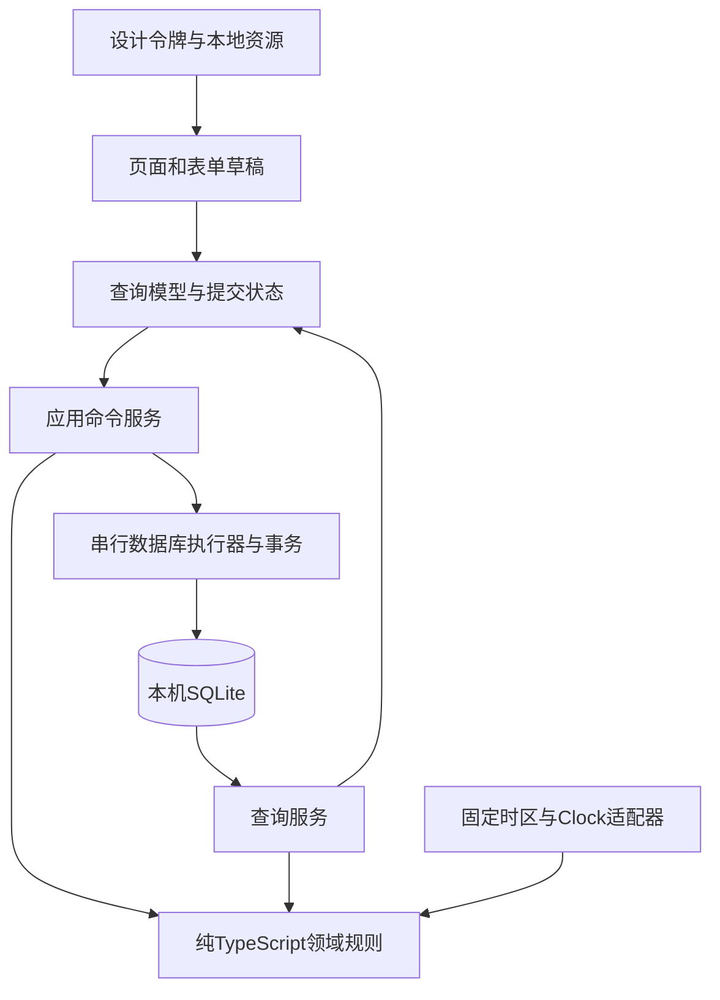

# 计划打卡 Android V1｜技术设计文档

> 版本：0.8 已确认技术基线；日期：2026-10-09，Asia/Shanghai  
> 依据：[已确认PRD/UI v1.1](设计需求文档-计划打卡-Android-v1.md)、[图文需求对照](design/preview.html)、[UI/UX规格](UIUX-计划打卡-Android-v1.md)  
> 已确认：Windows本机构建、普通SQLite、禁用系统备份/迁移、Android10+、SDK57稳定组合、长期release签名  
> 整体确认：T15，用户回复“确认技术0.8（推荐）”；T1–T14与Q28/Q29均已明确  
> 应用仍处技术方案阶段；resource/review保存评审清单及锁文件，未创建应用工程、安装应用依赖、生成签名或构建APK；独立安卓AI验收环境已按授权配置并实测，见环境配置记录

## 1. 目标与约束

首版实现免登录的个人计划闭环：创建三类计划 → 今日确认记录 → 日历和全部历史回顾。所有核心读写在本机完成，SQLite是唯一持久化事实来源。设计必须落实PRD中的日期、权限、统计及生命周期，不能根据某个画板的样例反推规则。

技术设计需要交付可解释的数据模型、可测试的规则函数、原子写入流程、页面与组件边界、安卓运行配置和验收路径。云端API、账号、同步、远程埋点、提醒、照片、备份入口和应用商店发布不进入首版。

详细实现约定集中在以下附件，本文保留架构与需求追踪：

- [数据结构与迁移契约](technical/数据结构与迁移契约.md)：9张表、JSON规则、revision、外键、全链迁移；[可执行DDL原型](technical/schema-v1.sql)。
- [命令与查询契约](technical/命令与查询契约.md)：11个命令、统一信封、幂等/错误、快照与分页、路由/testID。
- [日期生命周期与统计决策表](technical/日期生命周期与统计决策表.md)：执行阶段、归档边界、显示期间、固定/周统计、每日集合U(d)。
- [验收与构建证据规范](technical/验收与构建证据规范.md)：G0–G5门槛、夹具/矩阵/性能、正式签名、覆盖升级、交付报告。

执行编排见[实施计划 checklist](实施计划-checklist-计划打卡-Android-v1.md)，详细场景、预期断言与证据见[BDD验收 checklist](BDD验收-checklist-计划打卡-Android-v1.md)。两份1.0文档当前为评审稿，保持技术0.8已确认基线；其文档检查不等于应用P1–P4验收。新建固定星期默认未选已由本轮P1明确并同步PRD与创建契约。

| 约束 | 技术落实 | PRD |
| --- | --- | --- |
| 免登录、离线、重启保留 | 应用私有目录SQLite；提交成功才反馈；release内置资源 | FR01、10、30、32 |
| 仅普通当日记录可改 | 命令执行时按固定时区重新判定；结果和备注一起受限 | FR11–13 |
| 补记永久只读、不撤回 | 保存记录类型；更新入口和应用服务都校验；不提供单条删除命令 | FR11–13 |
| 暂停/恢复次日生效 | 保存待生效事件，按业务日期解释；不依赖后台午夜任务 | FR24–27 |
| 规则不追溯 | 按字段保存生效版本；历史日期查询当时版本 | FR16、23 |
| 删除先归档，再永久删除 | 两个命令、两套确认；归档只读；永久删除事务清理关联数据 | FR26、29 |
| 首次固定时区 | 全局IANA时区与UTC时间戳分开保存；所有日期经统一适配器 | PRD§4、FR14 |
| 金属视觉 | 原生渐变、低圆角、边缘高光和阴影；支持字号与安全区 | PRD§12 |

## 2. 技术决策与事实依据

### 2.1 决策状态

| ID | 决策 | 状态 |
| --- | --- | --- |
| T1 | Windows本机Expo CLI＋Gradle构建开发包和独立APK | 用户已确认 |
| T2 | 普通SQLite＋Android应用私有目录，不启用SQLCipher | 用户已确认 |
| T3 | 关闭Android系统云备份与设备迁移 | 用户已确认 |
| T4 | 最低Android10 / API29 | 用户已确认 |
| T5 | Expo SDK57稳定组合、Node24 LTS、JDK17和依赖锁定 | 用户已确认 |
| T6 | 固定包名、长期release签名、覆盖升级保数据 | 用户已确认 |
| T7 | 同一尚未生效字段以最后保存为准，保留被替代版本 | 用户已确认 |
| T8 | API29/36、360/393dp、100/200%字号及性能数据集/预算 | 用户已确认 |
| T9 | 循环结束日/未终结一次性截止日保存后立即生效 | 用户已确认 |
| T10 | 明细完成绿✓、失败红×、取消独立灰⊘；日期格单摘要 | 用户已确认；多符号日期格被本轮要求取代 |
| T11 / Q29 | 未终结一次性仅当前截止日计项；终态只计结果业务日，替代旧安排 | 用户已确认 |
| T12 | 保存回当前生效规则即取消该字段待生效变更；未触及字段保留 | 用户已确认 |
| T13 | 运行/暂停截至当前业务日；归档按结束/归档边界冻结；未开始不显示倒置区间 | 用户已确认 |
| T14 | 名称计划打卡；正式com.xiang.plancheckin，开发com.xiang.plancheckin.dev | 用户已确认 |
| T15 | 技术0.8及四份详细附件作为后续实现基线；原生运行按P1–P4验证 | 用户已整体确认 |
| Q28 | 周目标只有当天已有记录计入日历总数 | 用户已确认 |

用户已通过T15整体确认本文及四份详细附件，作为后续实现基线。方案确认与运行验证分别记录：确认不表示接口、原生构建或APK已经通过实测。

### 2.2 工具链基线

| 项目 | 基线 | 核对与固定方式 |
| --- | --- | --- |
| Expo / RN / React | expo57.0.27 / RN0.86.3 / React19.2.3 | 已核对发布包SDK57映射；精确版本进入评审清单，不独立升级RN |
| Node | 独立开发用Node24.21.0 LTS | RN要求24.x至少24.3.0；声明>=24.3.0 <25并另固定工具补丁；评审内置Node仅用于调查 |
| 包管理 | pnpm10.28.2、nodeLinker=hoisted | packageManager＋pnpm-lock.yaml；strictPeerDependencies=true，autoInstallPeers=false；首个锁文件生成后冻结安装 |
| JDK | 17 | JAVA_HOME明确指向；保存java -version结果 |
| Android | minSdk29 / compileSdk36 / targetSdk36 | 已选Android10+；通过expo-build-properties固化最低版本 |
| Gradle / AGP / Kotlin | SDK57发布模板Wrapper9.3.1；RN0.86.3目录AGP8.12.0 / Kotlin2.1.20 | 发布源码已核实；不独立覆盖模板，prebuild后保存最终解析版本及构建结果 |
| Build Tools / NDK | RN0.86.3源码默认36.0.0 / 27.1.12297006 | 安装与生成工程比对；发布源码默认值不代替实际构建证据 |
| 原生架构 | 使用SDK默认New Architecture / Hermes | 在development/release都验证，不使用浏览器引擎结果替代 |

以上版本已按2026-10-09的[Expo兼容表](https://docs.expo.dev/versions/latest/)、发布包bundledNativeModules及[SDK57发布说明](https://expo.dev/changelog/sdk-57)核对。SDK57早期补丁出现过Hermes内存和开发启动回归，本候选使用已包含修复的57.0.27 / RN0.86.3；不使用next/canary标签。Windows采用[JDK17与SDK设置](https://docs.expo.dev/workflow/android-studio-emulator/)；Gradle/AGP等发布源码证据见[依赖可行性核查](依赖可行性核查-20261009.md)，最终组合还需原生编译确认。

原生工具链保留一项明确验证点：RN Gradle插件实际声明AGP8.12.0，Expo模板Wrapper为9.3.1；该组合满足AGP最低Gradle/JDK要求，但[Gradle9.3.1兼容矩阵](https://docs.gradle.org/9.3.1/userguide/compatibility.html)明确测试的AGP范围从8.13起，不包含8.12。不能据此直接判定不可用，也不能写为矩阵已认证；P1必须核对buildEnvironment并通过Debug/Release原生构建，失败时调查SDK57路径，不擅自跨主版本升级AGP。

### 2.3 运行依赖基线

| 能力 | 选型 | 使用边界 |
| --- | --- | --- |
| 语言与类型 | TypeScript strict | 领域模块不导入React、Expo或数据库实现 |
| 导航 | Expo Router的稳定Stack/JS Tabs | 三个主入口；表单/详情/确认在Stack；入口expo-router/entry；支持包全部列入候选清单 |
| 数据 | expo-sqlite | 所有SQL经DatabaseExecutor；用户文本使用绑定参数 |
| 日期 | Luxon3.7.2＋DateAdapter、expo-localization | 首次读取getCalendars()[0].timeZone，验证后固定；日期运算全部显式时区；@types/luxon独立列入 |
| 表单校验 | Zod4.6.5、TypeScript5.9.3 strict | Zod4要求TS>=5.5；提交重验；长度契约明确为Unicode码点 |
| 状态 | React Context＋useSyncExternalStore的轻量应用状态 | 持久数据不复制到多个可写store；草稿留在页面会话 |
| 材质与安全区 | expo-linear-gradient、react-native-safe-area-context | 渐变读取设计令牌；系统栏和键盘不通过固定高度猜测 |
| 原生构建配置 | expo-build-properties＋自有config plugin | 固定minSdk29、备份排除、正式签名；重建可复现 |
| 字体与图标 | expo-font静态嵌入＋react-native-svg Svg/Path组件 | SDK57只选静态TTF；400/600/700真实文件；不直接import .svg，不额外引入transformer |
| UUID | expo-crypto | 命令与对象标识，避免按名称或时间戳作为唯一键 |
| 版本 | expo-application | nativeApplicationVersion/nativeBuildVersion允许null；无法取得时明确显示不可用，不伪造版本 |
| 初始化与开发 | expo-splash-screen、expo-dev-client | splash覆盖初始化，失败隐藏后展示错误；development build验证真实原生模块 |
| 工具与测试 | babel-preset-expo、@babel/core、@types/react、@types/node、react-refresh | 应用用Expo Babel/Metro；Node类型只给评审和领域测试的独立tsconfig，不污染移动端 |

精确版本、SDK匹配、peer及Node范围见[核查报告](依赖可行性核查-20261009.md)和[候选清单](review/dependency-resolution/package.json)。Expo模块使用SDK57映射；Router相关的react-native-screens、safe-area-context、expo-linking、constants和status-bar不遗漏。完整peer解析还需处理Router传递依赖声明的react-dom、gesture-handler、reanimated；候选以SDK57版本补齐，并配套worklets及其Babel/Metro peer，不通过关闭严格检查隐藏冲突。这些包不增加网页、抽屉等产品功能；导航仍按稳定Stack/JS Tabs实现。

项目Metro配置以expo/metro-config为入口；@react-native/metro-config仅满足worklets的发布peer，不替换Expo配置。Reanimated/Worklets采用Expo Babel预设的自动插件配置，不重复叠加旧Reanimated插件，原生依赖变化后重建。Luxon的[RN支持](https://github.com/moment/luxon/blob/master/docs/install.md)与[IANA模型](https://github.com/moment/luxon/blob/master/docs/zones.md)已有依据，目标Hermes仍需验证Intl、SQLite及这些原生模块。发布元数据和锁解析不能代替原生运行。

## 3. 总体架构与目录



页面负责输入、导航与展示，不执行原始SQL，不自行判定补记权限。应用命令负责取最新事实、调用规则、提交事务；查询模型负责将同一组事实投影成今日、日历、详情和统计。领域规则接受显式的今天与规则快照，测试不读取系统当前时间。

SQLite为事实来源；内存查询缓存只是可丢弃投影。每次写入成功递增dataRevision并重新查询受影响页面；失败不发布新revision。页面上的“已保存”不能先于数据库commit。

拟定应用源码直接位于当前项目目录，保留已有resource：

```text
android-plan-checkin/
  app/                         # Router入口、Tabs和Stack，保持薄层
  src/
    domain/                    # Plan、Record、Rules、Lifecycle、Statistics
    application/               # commands、queries、bootstrap、错误结果
    infrastructure/
      database/                # connection、executor、SQL、migrations
      date/                    # Clock、Luxon DateAdapter
      android/                 # 平台配置与安装元数据
    features/                  # today、calendar、plans、record、settings
    ui/                        # MetalSurface、ResultChoice、DateCell等
    state/                     # revision、加载状态、导航会话状态
  assets/fonts/                # 许可与实际打包字体
  assets/icons/
  plugins/                     # 备份排除、签名等可重建原生配置
  tests/                       # 规则、SQLite集成、核心页面流程
  resource/                    # PRD、技术设计、Pen与截图
  app.config.ts
  package.json
  pnpm-lock.yaml
```

这是拟定结构，当前没有创建这些应用文件。android目录由prebuild生成；需要保留的原生配置写入app.config和config plugin，不能只手工改生成目录后让重建丢失配置。

## 4. 本机数据模型

### 4.1 基本约定

- 标识用UUID；业务日期用合法的YYYY-MM-DD文本；时间戳用UTC毫秒整数。
- 名称/说明/备注的80/1000/2000上限按Unicode码点计算，不按JS字符串length或UTF-8字节数计算。
- 规则与生命周期是事实；未记录、空白、逾期、完成率、连续数是查询时的派生结果，不批量插入伪记录。
- 除明确可改字段和取消标记外，不覆盖历史规则值、原提交时间和记录业务日期。
- 参数绑定贯穿名称、说明、备注、日期等输入。固定DDL可以execAsync，用户输入不得拼入SQL。

长度规则作为领域契约明确实现与复用，例如[...value].length；不凭印象判断某个Zod版本的.max语义。Zod4.6.5发布源码已采用码点计数，schema与领域校验仍用补充平面汉字、emoji及组合字符样本核对：一个补充平面字符计1，基础字母加组合附加符计2，不将码点与用户看到的字形簇混用。[Zod检查源码](https://github.com/colinhacks/zod/blob/main/packages/zod/src/v4/core/checks.ts)

### 4.2 表与字段

| 表 | 关键字段 | 约束与用途 |
| --- | --- | --- |
| app_meta | key PK、value | app_timezone、首次初始化时刻等；schema版本以PRAGMA user_version为准 |
| plans | id PK、type、direction、name、description、created_at_ms、created_on、starts_on、revision | type固定为fixed/weekly/one_time；一次性方向只能do；循环开始日不可变 |
| rule_versions | id PK、plan_id FK、kind、effective_on、revision、value_json、created_at_ms、cancelled_at_ms | 按字段保存weekday_mask/weekly_target/end_on/due_on；值用判别schema解析；取消不覆盖旧值 |
| lifecycle_events | id PK、plan_id FK、kind、source_key、effective_on、effective_at_ms、reason、requested_at_ms、cancelled_at_ms | UNIQUE(plan_id,source_key)；pause/resume为次日日期；archive为即时或明确自然归档边界 |
| cycle_records | id PK、plan_id FK、business_on、result、note、entry_kind、submitted_at_ms、modified_at_ms、revision | UNIQUE(plan_id,business_on)；result为success/failure/skip；entry_kind为ordinary/backfill |
| one_time_results | id PK、plan_id FK UNIQUE、business_on、outcome、actual_completed_on、due_rule_version_id FK、note、entry_kind、submitted_at_ms、modified_at_ms、revision | outcome为completed/failed/cancelled；完成时actual_completed_on等于固定business_on；引用终结时截止版本 |
| cycle_record_originals | record_id PK/FK、original_result、original_note | 首次修正保留原值；真实外键ON DELETE CASCADE；不生成完整审计界面 |
| one_time_result_originals | result_id PK/FK、original_outcome、original_note | 首次修正保留原值；真实外键ON DELETE CASCADE |
| command_receipts | command_id PK、plan_id FK可空、kind、payload_digest可空、result_code、object_id可空、issued_at_ms、committed_at_ms、expires_at_ms | 幂等提交凭据，无名称和备注；同事务提交；永久删除后仅保留短期防重放标记 |

原值表分为循环和一次性两张，直接引用各自记录，避免无法由数据库保证的多态外键。规则、生命周期、记录的plan_id外键均ON DELETE CASCADE；原值表随对应记录级联。receipt的plan_id采用ON DELETE SET NULL，永久删除事务先清除其object_id/payload_digest和目标关联，只保留短期不可重放标记。其他业务关联行从计划根行级联，并检查均已清除。

一次性结果的(plan_id,due_rule_version_id)复合外键引用rule_versions(plan_id,id)，后者建立对应唯一键；命令还需验证kind=due_on。该引用采用NO ACTION、DEFERRABLE INITIALLY DEFERRED，避免删除计划时因级联顺序阻塞，提交时仍要求没有悬挂引用。

| 索引 | 目的 |
| --- | --- |
| cycle_records(plan_id,business_on) UNIQUE | 拒绝同计划同日重复记录 |
| cycle_records(business_on,plan_id) | 全局月历范围查询 |
| one_time_results(plan_id) UNIQUE | 一次性仅一个当前结果 |
| rule_versions(plan_id,kind,effective_on,revision) | 查询某日生效字段版本 |
| lifecycle_events(plan_id,effective_on,requested_at_ms) | 重建有效执行阶段和待生效状态 |
| lifecycle_events(plan_id,source_key) UNIQUE | 对账重复启动或重复命令不重复生成事件 |
| plans(created_at_ms,id) | 稳定排序，创建同毫秒时由id补充顺序 |

名称允许相同，不建立名称唯一约束。索引不能代替日期合法性、计划类型、阶段权限和跨日校验；这些由同事务内的应用命令检查。

### 4.3 字段版本与执行阶段

初始规则从计划创建业务日生效，执行资格另受starts_on限制，避免未来开始的初始版本覆盖创建后提前编辑的版本。按字段分流，固定星期次日、每周N下周一、名称说明即时更新；T9已确认结束/截止保存后立即生效，新日期只能今天或未来，旧版本保留。未终结逾期任务延后截止后立即转待完成；终态不能改截止。

resolveRule(plan,date)对每个字段取未取消、effective_on≤date的最近版本；同生效日按revision确定最后一次有效变更。相同生效日的尚未生效版本被后续编辑替代时保留旧行及取消标记，不能删除旧版本。

T7/T12已确认：本周3、周三拟改5、周五改4，则下周一只执行4。编辑页同时显示当前生效值和具体日期的待生效值；输入初值优先采用待生效值，只有字段真正变更才替代待生效版本，修改名称不能顺带把待生效目标覆盖成旧值。保存回当前有效值时取消该字段待生效变更，不生成多余无效版本。

执行阶段由未取消生命周期事件派生，不额外建立独立可写状态副本：初始阶段 → 暂停关闭阶段 → 恢复建立新阶段。补记只能属于当前运行阶段；阶段开始之前的日期永久禁止新增。取消未生效暂停不会关闭阶段。

对象revision、字段revision与dataRevision的分配、STRICT/CHECK边界、复合外键及永久删除顺序以[数据契约](technical/数据结构与迁移契约.md)为准。DDL只检查日期形状，合法公历日期和跨行权限仍由领域层验证；宿主原型验证不能替代安卓SQLite测试。

## 5. 日期、状态与统计算法

### 5.1 统一日期层

```typescript
interface Clock { nowMs(): number }
interface DateAdapter {
  today(nowMs: number, zone: string): BusinessDate;
  addDays(date: BusinessDate, count: number): BusinessDate;
  weekday(date: BusinessDate): 1 | 2 | 3 | 4 | 5 | 6 | 7;
  weekStart(date: BusinessDate): BusinessDate;
  nextMondayAfter(date: BusinessDate): BusinessDate;
  startOfDayMs(date: BusinessDate, zone: string): number;
}
```

业务日期与时间戳使用不同的品牌类型，避免将submittedAt传给日期函数。首次初始化用expo-localization的getCalendars读取timeZone，以Luxon验证IANA可用及isValid后与app_meta原子保存；取不到或无效时阻断初始化并重试，不静默猜测时区。已有app_timezone不被设备换区覆盖。不采用设备firstWeekday或其他历法改变PRD规定的公历、周一开始。[Expo Localization](https://docs.expo.dev/versions/v57.0.0/sdk/localization/)

nextMondayAfter严格表示下周一：周一修改也等到下一周一；偏移量为8−weekday。开始/结束/截止的包含关系由领域函数处理，数据库保存原日期，不偷换成UTC午夜。输入仅名称去首尾空白，说明和备注保留用户换行与文字；空备注归一为空串。

日期加一天使用plus({days:1})日历运算；跨DST不能直接加86400000毫秒。fromISO/fromMillis显式传zone；真实时刻换区不使用keepLocalTime:true；周一边界不启用useLocaleWeeks。[Luxon日期运算](https://github.com/moment/luxon/blob/master/docs/math.md)。Hermes支持Intl，首版不预先引入Intl polyfill，目标安卓验证结果决定是否需要；电脑日期测试不能替代原生结果：[Hermes Intl](https://github.com/facebook/hermes/blob/main/doc/IntlAPIs.md)。

前台期间安排到下一个业务午夜的重算计时器；启动、AppState返回前台、所有最终保存前都重算。应用被杀死时不会执行计时器，恢复后通过reconcile补齐到期状态，不依赖后台服务。

### 5.2 资格和结果函数

| 函数 | 输入 | 返回与规则 |
| --- | --- | --- |
| resolveEffectiveState | plan、events、now | 当前阶段、当前状态、未生效申请、归档边界 |
| getRecordPermission | plan、规则、阶段、已有记录、目标业务日、today | allowed/reason；普通当日可改，补记/历史/归档锁定 |
| isFixedOccurrence | plan、某日字段版本、执行阶段、archive信息 | 合法应执行日；手动归档当日只保留已有记录 |
| classifyCycleDate | 日期资格、已有记录、today | success/failure/skip/past_unknown/today_pending/blank |
| classifyOneTime | 任务、结果、today、冻结截止版本 | pending/overdue/on_time/late/failed/cancelled |
| getCurrentStageBackfill | 当前阶段、date、today | 仅运行中当前阶段的合法历史空日允许 |

未知与失败分别表示未申报和明确失败。周目标空白不生成past_unknown。终态一次性不可退回pending，修正结果不移动business_on；失败/取消转完成时完成日为原业务日期。

### 5.3 固定统计

候选S包含早于今天的有效应执行日期，以及今天已有记录的有效日期；跳过排除分母，成功进入分子。手动归档当天取消无记录要求，保留已有记录；自然结束归档保留结束日要求。没有分母显示暂无可计算记录，百分比显示四舍五入整数，内部保留精度。

连续成功按应执行日期序列计算；失败、跳过、已结束未记录和实际暂停中断。今日未提交保留昨日日终值，今日提交后立即更新。非每日计划展示次数，不把没有安排的星期当漏做。查询只显示当前连续，不计算最长纪录。

T13已确认统计显示区间与分母集合分开：循环起点startsOn，运行/暂停截至today，循环自然到期冻结endOn，其余归档冻结归档业务日；未来尚未开始显示“尚未开始”。暂停空档/今日未提交不因显示截至today就计入分母。一次性起点createdOn，结果日与归档日分别展示。[详细期间和零分母决策表](technical/日期生命周期与统计决策表.md)

### 5.4 周目标统计

按固定时区的周一至周日分组，成功业务日期数/N；同日唯一，4/3保留实际4，进度条截到100%。完整有效周的判断检查整周是否在执行期及连续运行阶段内，不仅看是否存在记录。历史达标率只纳入已结束完整周，分母零显示暂无完整周。

周中开始、结束、实际暂停或恢复造成部分周；部分周保留进度、显示原因、排除达标率。连续达标仅扫描已结束周；部分周结束时中断，未结束前保留此前连续值。N变更只在周一生效，不把完整周内的一个合法周界变更误判为部分周。

Q32：整周暂停不属于完整有效执行周，不进入周达标率分母，但在该自然周结束时中断连续；暂停周未结束时保留此前值。连续计算按自然周时间轴和执行阶段扫描，不能只过滤完整有效周后累计相邻行。达标A→整周暂停B→恢复后完整达标C，C结束显示1。尚未开始及归档后的无执行期不凭空建立新要求。

初始执行期按starts_on的业务日边界建立；自然结束日为周日、次周一00:00自然归档，则该周可完整。手动归档采用真实effective_at_ms：周日17:00归档也属于部分周，即使已有3/3；必须运行至次周一边界才可能完整，不能只因结束日期是周日便判完整。

### 5.5 一次性与生命周期对账

完成结果按actual_completed_on与提交时冻结的截止版本判定。actual_completed_on范围为created_on至today。历史完成补报立即归档；普通结果次日自动归档；逾期不是失败，也不会自动终结。

截止版本由one_time_results引用，修正结果仍用同一个截止版本和业务日；完成改失败/取消时actual_completed_on置空，业务日不变。普通首次完成日等于今天；首次选择过去完成日时entry_kind=backfill，提交后立即只读并归档。

reconcile(now)在数据库写队列执行，按业务时间顺序处理已经到期的事件；同一归档原因使用唯一来源标识，重复启动不产生重复归档。长时间未打开应用时，自然归档边界仍为结束日次日或普通终态次日，不能改成重新打开当天。

source_key具体为end:<结束版本ID>:<归档业务日>、terminal:<结果ID>:<归档业务日>，手动事件用command:<commandId>；数据库唯一约束与已有归档判断共同防重复。同一边界的处理优先级为归档→尚可执行的暂停/恢复→字段规则投影；归档取消生效点等于归档边界及更晚的未执行申请，不把同刻暂停记成已经实际发生，也不开放同刻恢复。归档时未生效字段版本标为取消，历史值保留。

归档优先于未生效申请，取消其未来暂停/恢复；不清历史，不允许恢复。命令执行前先reconcile，避免已自然到期的计划借旧页面继续写入。时间模型依赖设备系统时间，不承诺防篡改时钟。

## 6. 写命令、事务与错误处理

### 6.1 唯一数据库执行器

DatabaseExecutor持有唯一原生连接；初始化、迁移、查询与写命令统一调度。任何模块不能拿到连接后绕过执行器。内部事务上下文不得再次排队或启动嵌套事务；业务事务内不等待网络、导航或用户输入。

采用单连接串行执行：所有SQL必须经同一队列，在withTransactionAsync期间禁止外部异步SQL进入连接。Expo明确该API会包含同连接上的并行查询，不能仅靠回调边界隔离；本版不使用withExclusiveTransactionAsync，不启用并行读连接、额外SQLiteProvider或外部数据库查看连接。[SDK57 SQLite事务说明](https://docs.expo.dev/versions/v57.0.0/sdk/sqlite/#executing-queries-within-an-async-transaction)

连接初始化在事务外设置journal_mode=WAL、synchronous=FULL、foreign_keys=ON，并读回wal/2/1，不符阻断初始化；重开连接也初始化。迁移期间阻断业务入口；不以WAL代替串行写入。用户输入采用绑定参数，prepared statement在finally释放。FULL选择以无备份本机记录的提交持久性为依据。[SQLite同步设置](https://sqlite.org/pragma.html#synchronous)

发布包expo-sqlite57.0.4内置SQLite3.50.3，未包含2026年的WAL-reset修复；官方描述触发需要同文件多连接同时写入/checkpoint。严格单连接是当前方案的必要约束，P1需记录实际sqlite_version/source_id；未来改多连接前先验证SDK兼容修复版。[SQLite官方说明](https://sqlite.org/wal.html#the_wal_reset_bug)、[发布版本核查](依赖可行性核查-20261009.md)

### 6.2 通用提交流程

1. 所有命令携带commandId、kind、issuedAtMs及完整payload；重试同一内容复用冻结信封，输入变化生成新命令。摘要由应用服务计算。
2. 进入写队列先查receipt，TARGET_REMOVED优先；有效窗口同ID同内容返回既有成功，不同内容拒绝复用。
3. 捕获一个Clock.now/today快照，先在独立对账事务提交已经到期的合法状态，发布其revision；队列任务中不插入其他业务命令。
4. 用户事务读取最新计划、规则、阶段和记录；重验日期确认、权限与plan/record revision；另一入口已有记录返回冲突。
5. 同一用户事务写业务行、必要原值/修改时间、生命周期、receipt及dataRevision。异常回滚本次命令，不撤销上一步合法对账。
6. commit成功后发布用户事务revision并刷新相关查询；返回来源页，显示保存到本机。

首次记录命令携带confirmedToday（确认页所确认的业务今天）。在已提交receipt查询之后、首次写入之前核对它与当前固定时区today；不同则返回DAY_CHANGED，不写业务行或成功receipt，保留输入并导航到日期变化状态。合法历史日重新进入补记确认，显式接受只读/适用的立即归档，再生成新commandId及新的confirmedToday提交。暂停/归档/旧阶段造成不可补记时只说明原因；一次性失败/取消必须重新确认新当日结果，不补报过去失败/取消。已成功receipt跨日重试仍返回原成功，避免把成功伪装成未保存。Q31；图23、AT09/12。

receipt不保存用户文本。命令自issued_at_ms起7×24小时内允许重试；超过窗口返回COMMAND_EXPIRED，即使receipt已清理也不重新执行，在启动/空闲时每批最多200行清理过期凭据。唯一性保护仍由各业务表承担，不能宣称永久无限重放。摘要编码、返回对象与错误类别见[公共信封与重放契约](technical/命令与查询契约.md)。

CreatePlan首次提交即固定planId，重试复用同一ID；已存在时核对对应创建命令，不能再次创建同名新对象。永久删除把该计划关联receipt转为TARGET_REMOVED标记，清除plan/object关联及payload摘要；7天窗口内旧创建命令也不能把已删除计划重新建出。短期标记不是历史记录，不保存名称、备注或规则。已不存在目标的重复删除返回已删除。

### 6.3 命令契约

下表列出业务重点；全部命令均使用统一信封。更新/管理命令携带expectedPlanRevision，修改记录另带expectedRecordRevision；具体payload、CAS及确认日期详见[11个命令的完整契约](technical/命令与查询契约.md)。

| 命令 | 必要输入 | 校验/持久化结果 |
| --- | --- | --- |
| CreatePlan | 固定planId、公共字段、类型字段、commandId、issuedAt | 校验今天/未来；计划＋初始字段版本同事务；同一创建重试不生成新ID |
| SubmitCycleRecord | planId、businessOn、confirmedToday、result、note、commandId | 先查成功receipt；首次执行跨日返回DAY_CHANGED；显式普通/合法补记分类、唯一性、提交时间 |
| ModifyCycleRecord | planId、recordId、expectedPlanRevision、expectedRecordRevision、result、note | 普通当日且未归档；首次实际修正保留原值；修改时间；业务日不可变 |
| SubmitOneTimeResult | planId、outcome、confirmedToday、actualCompletedOn适用时、note | 首次执行跨日返回DAY_CHANGED；完成日范围、截止判定；明确确认的历史补报同事务归档 |
| ModifyOneTimeResult | planId、resultId、expectedPlanRevision、expectedRecordRevision、outcome、note | 固定业务日；当日三结果切换；不撤回 |
| EditPlan | planId、expectedPlanRevision、changes、ruleConfirmations | 运行中白名单；即时/次日/下周一分流；T7最后值、T12取消；确认具体日期不能跨日漂移 |
| RequestPause / RequestResume | planId、expectedPlanRevision、confirmedEffectiveOn | 类型和状态合法；最新次日生效；确认过期重确认 |
| CancelPendingState | planId、expectedPlanRevision、eventId | 尚未生效；保留取消时间，当前阶段不变 |
| ArchivePlan | planId、commandId | 立即归档；取消今日未记录要求和未来申请；所有记录只读 |
| PermanentlyDeletePlan | archivedPlanId、commandId | 归档前置；所有相关行事务清理，不留下名称/备注 |

返回统一Result类型，包含success / validation / permission / conflict / storage / migration，不把数据库内部错误文本直接展示给用户。

### 6.4 异常与升级

| 错误 | 界面 | 数据行为 |
| --- | --- | --- |
| 初始化/读库失败 | 阻断数据页，显示无法读取本机数据及重试 | 不伪装空态，不清库 |
| 校验/权限拒绝 | 字段旁错误或明确日期/只读原因 | 不写；原记录保留 |
| 并发版本冲突 | 显示现有记录，允许明确重新进入修改 | 不静默覆盖 |
| 首次提交DAY_CHANGED | 图23保留输入，显示已换日期；合法时进入补记确认，不能直接保存 | 原提交不写；新确认后新命令；失败/取消显式确认新的当日结果 |
| 保存失败/空间不足 | 原页保留输入，继续编辑/重试 | 事务回滚；不发布成功revision |
| 迁移失败 | 专门升级错误，保留原库，阻断业务写 | 所有待执行迁移在一次事务，末尾设置目标user_version；失败全部回滚，不删库重建 |
| 应用数据库版本高于本代码支持 | 不兼容版本说明 | 禁止旧代码写入新结构；不自动降级迁移 |

迁移SQL和版本清单进源码，每次升级验证旧schema数据、进程中断及失败回滚。迁移安全性不通过“失败后重新安装”解决，因为首版无数据恢复功能。

无实际变化的修改不生成原值或“已修改”；带具体生效日的管理确认若过期返回CONFIRMATION_STALE。拒绝用户命令不创建其记录/成功receipt，但可以保留此前独立提交的合法到期对账。

## 7. 查询模型与性能

| 查询 | 输入 | 输出和缓存边界 |
| --- | --- | --- |
| TodayQuery | today、dataRevision | 四分区；保存后的就地反馈由会话状态管理，下次刷新归已记录 |
| CalendarMonthQuery | 月份、选中日、dataRevision | 每格completedCount/totalCount及唯一marker；选日同集合明细、额外合法周补记候选 |
| PlansQuery | 当前筛选、dataRevision | 运行/暂停/归档；明确未开始和未归档终态 |
| PlanDetailQuery | planId、today、dataRevision | 历史起止、规则、状态、统计、月历、允许动作 |
| RecordQuery | recordId、today、dataRevision | 当日修改/只读理由、原提交、最近修改、补记/已修改标签 |

月历一次查询完整可见日期范围，不为42个格子分别读库。历史记录按范围和索引读取；长列表虚拟化/分页。全局日期格汇总运行、暂停、归档的保留历史；永久删除后相关查询失效。固定未知要求由规则生成；周目标空白不进入未知数量。

今日提交成功后查询事实立即更新，但渲染层仅用“本次会话保留位置的planId集合”将原卡片留在原分区、显示结果并关闭新增按钮；同一项不再同时出现于已记录分区。刷新/离开再返回清除此位置集合，按最新TodayQuery归类。位置集合不保存记录内容，不影响统计，也不将未落盘结果显示为成功。

派生缓存键必须包含dataRevision、today、固定时区和查询范围。跨业务日即使没有写记录也使查询失效。首版优先按事实重算；只有测量证明瓶颈才引入统计持久化缓存，其更新必须与记录一致，不建立第二套统计口径。

T8已确认性能数据集、矩阵与预算：100个计划、每计划3年历史，标准API36模拟器4核/4GiB，release冷启动至可交互≤3秒、切月/详情≤1秒。它是验收数据量，不是计划数量或保存年限硬上限；超出后的实际性能仍需测量。具体测量步骤见§10.2。

### 7.1 日历每日集合与单一下标（Q28/Q29、本轮变更）

先生成CalendarItem集合，再按(planId,businessOn)去重，最终数量直接由该集合派生。不得把已记录行和同一固定要求各计一次。固定计划使用所属日期字段版本、生命周期及归档来源判断资格；保留暂停/归档前历史，手动归档当天的未记录要求取消，自然结束日要求保留。

| 来源 | item归属与计入条件 | completed |
| --- | --- | --- |
| 固定执行项 | 当时规则的有效日；已有记录覆盖同一要求，未记录也计1项 | result=success |
| 周目标记录 | 只有当天已有记录计1项；有效空日列为额外补记候选，不进入items | result=success |
| 未终结一次性 | 未归档时当前截止日1项；手动归档仅保留早于归档日的截止项，取消归档当日/未来项；不展开到每天 | false |
| 已终结一次性 | 结果business_on1项，完全替代未终结截止安排；完成实际日、失败/取消固定业务日 | outcome=completed |

对每个业务日，C=completed项数，T=items.length。marker按优先级：businessOn=today先返回none；否则T=0为none；T>0且C=T为complete（绿色✓）；其余fraction（C/T）。今天DateCell浅色填充$primarySoft、加粗日号，无实心点或进度。C/T仍计算供筛选选项计数/明细核对。失败、跳过、未记录/待处理、取消均false；未来安排显示0/T且无提交资格。

今天与选中是两种独立状态：填充表示今天，边框表示选中；同时成立时都保留，不能选中别日就丢掉今天填充。业务日变化使投影失效，原今日按历史结果恢复下标、新今日隐藏下标；不强制移动用户选中日期。一次性没有暂停/恢复；手动归档取消当日及未来空安排，过去截止项保留回顾。

分数下标样式固定映射design-tokens：日期12sp，C/T为10sp、600字重、calendarProgress金黄色#866500；完成勾继续success绿。系统字号缩放作用于两者，保持分数小于日期；数值换行后仍使用同一颜色，不用绿色分数暗示部分完成已全完成。

选日列表添加完成状态下拉筛选，CalendarProjection.items仍为完整集合，UI会话状态filter=all/completed/incomplete；filteredItems只从items按completed布尔值派生，C/T、标题总数与选项计数均先于筛选计算。未完成包括未来安排、失败、跳过、未记录/待处理和取消；额外eligibleWeeklyBackfills不进入筛选集合。切选中日期重置all，记录返回同日恢复筛选，dataRevision变化重算计数并重新应用筛选。移除月历下含义介绍与标题下独立进度行；选择框48dp，弹层Back/外部关闭、选项语义与空列表依FR15。

选日返回completedCount、totalCount、incompleteCount及items，界面日期/T标题与全部/已完成/未完成状态筛选框；各项保留语义：成功/完成绿✓、失败红×、循环跳过橙—、过去固定未记录灰○、一次性取消灰⊘，今天/未来空项用文字。另返回eligibleWeeklyBackfills，明确未计入总数并复用FR12权限。结果计业务日，提交时间不影响日历位置。

一次性截止10/10、实际完成10/9、10/11补报后：10/9增加完成项，10/10删除旧安排投影；未终结延期至10/15：旧安排只保留版本追溯，日历项移动至10/15。receipt/记录不移动。保存、修改、截止变更、生命周期对账及永久删除均使相关日历缓存失效；即使旧月不可编辑，其派生汇总也可因合法新事实更新。

日历T与fixedStatistics分母必须使用不同函数。2成功+1跳过在日历显示2/3，固定历史率显示2/2并列跳过1。周达标不为其余日期添加completed项。`CalendarProjection={days:[{businessOn,items,C,T,marker}],eligibleWeeklyBackfills}`，不再返回用于日期格的statusSet。

## 8. 页面、组件与Pen落地

三Tabs位于根导航；创建/编辑/记录/详情/设置在Stack。路由只传ID、日期及预选结果，不传完整可写对象。返回时恢复来源的月份、选中日、筛选和合理滚动位置；进程重启不恢复未提交表单草稿。

| 组件 | 责任 | 设计来源 |
| --- | --- | --- |
| MetalSurface / MetalButton | 渐变、多层边缘与阴影；交互态和禁用态 | design-tokens.gradients/effects |
| ResultChoice | 绿✓/红×/橙—＋文字；选中状态；无自动写入 | 图07、08、09、10 |
| CalendarGrid / DateCell | 七列、单个✓或C/T、选中/今日、48dp命中 | 图11、FR14、PRD§12 |
| CalendarStatusFilter | 全部/已完成/未完成；筛选前计数、会话筛选、明细空态；不改变投影总数 | 图11、FR15 |
| StatisticFraction | 起止日期、分子/分母、零分母、跳过数量 | 图12、13 |
| PlanCard / StateBadge | 类型方向、状态/待生效说明、稳定排序 | 图02、03 |
| RecordForm / ReadOnlyRecord | 字段错误、会话草稿、只读理由、跨日重新确认 | 图07–10、21–23 |
| ConfirmationSheet | 暂停/恢复/归档/永久删除适用文案 | 图16–18 |
| StorageErrorView | 按错误类别呈现，不把失败作为空态 | 图20 |

设计令牌转换为类型化theme，不从截图采样重写第二套颜色。Pen角度根据容器宽高转换为LinearGradient起止坐标，不直接套用CSS角度字符串；colors至少2项、locations与颜色数量相同且在0–1升序排列。在模拟器对照渐变方向和反光带。组件外层绘制阴影、内层裁切渐变，避免overflow:hidden把外影截掉。[Expo LinearGradient](https://docs.expo.dev/versions/v57.0.0/sdk/linear-gradient/)

RN boxShadow外影要求Android9+、内影要求Android10+，并要求New Architecture；已确认minSdk29，统一采用boxShadow内外影，不维护Android7/8降级。[React Native0.86样式支持](https://reactnative.dev/docs/0.86/view-style-props#boxshadow)。边缘高光可用装饰层且pointerEvents=none，不遮住控件。页面标题700、常规两侧20、卡片内16、圆角1–3，命中区至少48dp。

字体采用@expo-google-fonts/noto-sans-sc@0.4.4发布包中的静态400Regular、600SemiBold、700Bold三份TTF作为本地资源候选。已核查无fvar/CFF2、OS/2实际字重及SHA-256；三份未压缩合计约30.19MiB，实际APK增量由构建测量。首版不引入该包的运行时加载包装，实施时仅取这三份文件和LICENSE_FONT，保留OFL版权及许可。SDK57采用expo-font config plugin的Android fontDefinitions注册统一family对应400/600/700；不直接使用Google Fonts的变量字体，不伪造粗体。[Expo字体版本限制](https://docs.expo.dev/develop/user-interface/fonts/)、[字体证据清单](review/字体资源核查.json)

日期输入复用CalendarGrid＋RN Modal，处理YYYY-MM-DD，不额外加入未选定的原生DateTimePicker；选择范围使用同一DateAdapter和领域权限。图标使用明确Svg/Path TSX组件；新增直接.svg导入前必须同时选择transformer、Metro配置及类型声明，不把普通SVG文件当作已经可导入的React组件。

安全区由SafeAreaProvider和明确的页面edges处理；Stack/Tabs已处理的边距不再次叠加。键盘采用RN KeyboardAvoidingView＋可滚动表单，并核对Android窗口resize配置，不用safe-area-context代替键盘避让。API36按edge-to-edge处理系统栏，背景由页面绘制，不能依赖已失效的statusBar backgroundColor/translucent控制。[Expo键盘处理](https://docs.expo.dev/guides/keyboard-handling/)

字号跟随系统；大字号时表单、卡片和详情采用弹性高度与滚动，不把整张长画板缩成屏幕。DateCell下标使用单个Text；C/T超过可用宽度时在斜杠后换行，整个月所有日期行按最大内容统一增高；分子/分母均完整，不采用省略号、缩小到不可读或关闭字体缩放。TalkBack朗读完整日期、今天/选中/未来语义；非今日格可读完成C项/共T项、零项无执行项；今日格不读隐藏进度，选择后从筛选选项计数读取。键盘出现后焦点与保存按钮可达；Back先关闭键盘/弹层，未保存内容放弃前确认。

## 9. 安卓配置、安全与构建

### 9.1 本机数据边界

T2确认不启用SQLCipher或数据库口令；记录放在应用私有目录，不写外部公共存储。release日志不包含名称、说明、备注、SQL参数或数据库内容；不接入远程错误采集/OTA服务。私有目录隔离不承诺防御已取得root权限或解锁取证的设备。

T3确认同时关闭云备份与设备迁移。app.config设置android.allowBackup=false，并用config plugin生成旧版fullBackupContent和Android12+ dataExtractionRules，分别排除cloud-backup/device-transfer。不能只改manifest就声称所有厂商迁移已关闭。[Android Auto Backup](https://developer.android.com/identity/data/autobackup)

排除规则覆盖file、database、sharedpref及使用到的device-protected域；必须包含实际SQLite目录和WAL/SHM文件。Expo默认Android数据库当前位于filesDir/SQLite，仅排除database域会漏掉它：[Expo数据库路径源码](https://github.com/expo/expo/blob/main/packages/expo-sqlite/android/src/main/java/expo/modules/sqlite/SQLiteModule.kt)。安装后核对databasePath及最终APK manifest/XML；不以模板中的预期路径替代实测。

两份XML各分段对file/database/sharedpref/root/external/device_file/device_database/device_sharedpref/device_root使用`path="."`完整目录排除，递归包含file/SQLite及WAL/SHM；不使用`*.db*`通配符。插件替换自己的规则资源并检查最终合并结果，不能保留遗漏的旧include规则。

不请求通知、照片、位置权限。使用系统时区不需要定位权限。release运行不依赖网络；开发包的Metro权限与release配置分开审查，不用删权限破坏开发调试。完整许可、包配置和依赖扫描在实现阶段执行。

### 9.2 原生构建与签名

Windows使用Expo CLI生成开发原生包，Gradle Wrapper生成release APK；EAS --local并非Windows官方支持路径。[Expo EAS本地限制](https://docs.expo.dev/build-reference/local-builds/)

首次工程建立先从评审清单生成应用依赖，完成pnpm install、SDK匹配及原生小样后提交应用锁文件；review中的锁文件是依赖图证据，不是已经就绪的应用工程。后续重现构建步骤（尚未执行）：

```powershell
pnpm install --frozen-lockfile
pnpm exec expo install --check
pnpm exec expo prebuild --platform android
pnpm exec expo run:android
# 独立APK：配置release签名后，在生成的android目录执行
.\gradlew.bat :app:assembleRelease
```

SDK57的prebuild默认重新生成原生目录；执行前确认原生变更已经转为config plugin并保存/评审。需要保留现有目录时明确采用--no-clean并检查合并结果，不能沿用“只有额外写--clean才会清理”的旧假设。[SDK57行为变更](https://expo.dev/changelog/sdk-57)。生成模板的release仍可能使用debug签名，必须核对最终证书和非debuggable属性；任务名叫release不等于正式签名已配置。

expo-build-properties@57.0.22发布源码仍支持minSdkVersion，并映射到android.minSdkVersion。通过其插件android配置设置minSdkVersion:29、compileSdkVersion:36、targetSdkVersion:36；不将minSdkVersion写成未受支持的AppConfig直接字段。保存生成后的gradle.properties、Wrapper及Gradle dependency报告核对实际版本；AGP8.12的JDK17要求有[Android官方依据](https://developer.android.com/build/releases/agp-8-12-0-release-notes)，源码组合尚未本机编译。

预期产物为android/app/build/outputs/apk/release/app-release.apk，最终以构建metadata确认路径。RN Gradle Plugin将JS打入release，仍需实测字体、图标和资产都内置：[RN Release APK](https://reactnative.dev/docs/integration-with-existing-apps.html)。Gradle版本使用项目Wrapper，Windows命令遵循[Android构建文档](https://developer.android.com/build/building-cmdline)。

T6/T14已确认长期release签名与覆盖升级；名称计划打卡，正式applicationId=com.xiang.plancheckin，开发包com.xiang.plancheckin.dev，以免调试包覆盖日常数据。本轮不生成签名；release密钥在仓库外由用户保管，口令不进文档、Git、日志或命令行回显。每次versionCode递增；同包名同签名覆盖安装验证历史保留。签名材料备份不属于应用数据备份功能。

### 9.3 当前环境与准备条件

| 项目 | 2026-10-09配置后状态 | 处理 |
| --- | --- | --- |
| 系统/内存 | Windows11 64位；约31.7GiB RAM；两套AVD串行启动成功 | 单个4核/4GiB模拟器已验证；并行编译前重查空闲内存 |
| Node/npm/pnpm | 独立24.21.0/11.19.0/10.28.2已准备；全局Node保留22.12.0 | 本项目终端加载Use-AndroidAI.ps1，再安装应用依赖 |
| Android/JDK | JDK17.0.1复用；CLI22、ADB37.0.1、Emulator37.2.12、Build Tools36/API36及API29/36镜像已安装 | 环境变量仅在任务终端生效；NDK/CMake随实际原生工程准备 |
| 磁盘 | 删除指定归档后复查C37.33GiB、D10.82GiB、F36.60GiB空闲；工具/AVD在D | 原F盘空间阻碍解除；应用继续在当前F盘项目准备，原生编译前重查新增占用 |
| 虚拟化/自动化 | WHPX实际可用；两套AVD启动、Appium3.8.0/UiAutomator2 8.7.0原生操作均PASS | 产品测试仍NOT_RUN；验收工具独立于APK依赖 |

SDK、AVD、独立Node、Appium与工具npm缓存已配置到D:\xiang\CX_application\1_Configuration_Files\Android-AI；源码、设计和交付文档仍在当前项目。缓存外置不能消除应用node_modules、生成原生目录和构建产物的空间需求。实施前再次测量空间并给出具体路径；本次工具安装不代表应用实现或技术整体方案已确认。

最新就绪状态见[模拟器与AI自动化验收就绪评估](模拟器与AI自动化验收就绪评估-20261009.md)；精确版本、脚本、界面树及截图见[环境配置记录](安卓AI验收环境配置记录-20261009.md)。自动化工具已独立配置，不加入应用锁文件或APK依赖。

## 10. 测试分层与交付门槛

本轮发布版本/peer/Node元数据及评审锁文件解析结果单独记录在[依赖核查](依赖可行性核查-20261009.md)；以下应用测试仍为NOT_RUN。纯规则测试采用TypeScript编译＋Node内置node:test与可注入Clock，配套@types/node和独立测试tsconfig；不会在Node中伪称测到原生SQLite。AndroidSQLite集成用development build内的验证入口；页面流程采用已配置Appium/UiAutomator2，按验收矩阵保存断言、截图和结果；release安装验证独立运行。Jest及网页DOM测试不列为首版必需依赖。系统设置的控制链路小样仅证明测试环境可用。

| 层级 | 必测内容 | 对应验收 |
| --- | --- | --- |
| 类型/静态 | 严格TS、依赖兼容检查、无页面原始SQL | 工程检查 |
| 领域规则 | 日期资格、补记/只读、生命周期、统计/连续 | AT03–AT17、AT21–AT23 |
| SQLite集成 | 唯一约束、事务回滚、幂等、迁移、永久删除关联清理 | AT09、AT20、AT23–AT24 |
| 安卓UI | 创建→确认→历史；单摘要月历及逐项明细；字号/触控/Back/TalkBack | AT01–AT12、AT18–AT19、AT25–AT27 |
| 独立release | 关闭Metro、飞行模式、冷启动、重启、覆盖升级 | AT01、AT24、AT28 |

关键固定样本包括：10/9普通记录跨午夜拒改；10/9补10/6立即只读；暂停前历史恢复后仍不能补；6/8今天成功变7/9；跳过排除分母；达标→部分→达标连续1；当前部分周未结束暂保留旧连续；截止10/10、10/9完成、10/11提交仍按时。

日期适配器增加上海、纽约DST23/25小时、闰年/月底/跨年、设备换时区、周日改N下周一生效样本。日期测试不靠生产界面创建过去开始日，不通过修改真实历史绕过权限。

### 10.1 功能到实现的追踪

| PRD | 主要实现模块 | 设计图 | 验收 |
| --- | --- | --- | --- |
| FR01 | bootstrap、TodayQuery、空态 | 01 | AT01 |
| FR02 | 表单schema、CreatePlan | 04–06 | AT02–03 |
| FR03 | 固定规则与isFixedOccurrence | 04 | AT03–04 |
| FR04 | 每周规则与进度 | 05、13 | AT05、16–17 |
| FR05 | 一次性规则 | 06、14、21 | AT06–08 |
| FR06 | TodayQuery、排序、就地反馈 | 02 | AT09、14 |
| FR07 | RecordForm、SubmitCycleRecord | 07 | AT09 |
| FR08 | 不要做文案与同日修正 | 08 | AT10、12 |
| FR09 | OneTimeForm、实际完成日 | 21 | AT06–08 |
| FR10 | CommandService、Executor、幂等凭据、DAY_CHANGED | 07、20、23 | AT09、12、24 |
| FR11 | ModifyRecord、revision与原值 | 09 | AT12、14 |
| FR12 | 当前执行阶段补记资格 | 10 | AT04、11–12、22 |
| FR13 | RecordQuery、只读页 | 22 | AT12 |
| FR14 | CalendarMonthQuery、CalendarGrid | 11 | AT13、18、25 |
| FR15 | 日期明细与逐项权限 | 11 | AT11、18 |
| FR16 | 历史范围查询、字段版本 | 12–14 | AT18、21 |
| FR17 | fixedStatistics | 12 | AT14–15 |
| FR18 | fixedCurrentStreak | 12 | AT15 |
| FR19 | weeklyStatistics、部分周/整周暂停、自然周连续 | 13 | AT05、16–17 |
| FR20 | OneTimeDetailQuery | 14 | AT06–08 |
| FR21 | PlansQuery、状态筛选 | 03 | AT19 |
| FR22 | PlanDetailQuery、允许动作 | 12–14 | AT18–22 |
| FR23 | EditPlan、字段版本与生效日 | 15 | AT21 |
| FR24 | RequestPause、次日边界 | 16 | AT22 |
| FR25 | RequestResume、新执行阶段 | 16 | AT22 |
| FR26 | ArchivePlan、当日取消要求 | 17 | AT23 |
| FR27 | CancelPendingState、跨午夜检查 | 16 | AT22 |
| FR28 | reconcile、自然/终态归档 | 03、14 | AT19、23 |
| FR29 | PermanentlyDeletePlan、关联清理 | 18 | AT23–24 |
| FR30 | Settings、安装元数据、数据边界 | 19 | AT01、27 |
| FR31 | 会话草稿、退出确认、提交状态 | 07–10 | AT09、24、26 |
| FR32 | 初始化/迁移/读写错误与release资源 | 20 | AT24、28 |

实现证据分别记录静态检查、规则测试、原生构建、模拟器和独立APK；不能以设计截图、文档排版或开发包运行替代release通过。工程矩阵与预算已通过T8确认，精确测量步骤如下。

### 10.2 设备矩阵和性能测量步骤（尚未执行）

功能兼容矩阵覆盖API29和36、360/393dp、100%/200%字号的8种组合；每种走三类计划创建、确认、日历、只读与状态变更核心流程，并覆盖手势/三键Back、键盘和TalkBack。记录实际AVD镜像版本、视口dp、字号配置、CPU/RAM、宿主机与构建证书/版本。

性能标准机为API36 AVD，4个vCPU、4GiB内存、393dp、100%字号，正式签名非debuggable正式APK，关闭Metro。固定随机种子，按测试业务today预置100个计划、3年合法历史窗口；40固定、40周目标、20一次性，记录分布含成功、失败、跳过/取消、历史空项、规则变更和暂停阶段。一次性仍最多一条结果，不为凑数据制造每天的终态。Clock注入与故障入口仅在.dev验证变体，正式包排除；性能夹具仅在可丢弃AOSP AVD、应用停止后由测试工具载入，载入链路在P1实测。保存生成器版本、区间及各表行数；AT25另测99/100。完整方法见[验收规范](technical/验收与构建证据规范.md)。

冷启动前force-stop且保留已提交库，从启动Activity到首屏完成初始化/到期对账、事实读取并能执行主操作计时；不能把空骨架显示当结束。首装初始化另测，不混入已有数据的启动样本。APK内测试计时使用单调时钟/原生启动标记，发布日志只含时间与错误码，无用户文本。使用固定模拟器状态，先作1次不计入的准备运行，再测10次独立冷启动，报告原始值、中位数、P95和最大值；门槛为P95≤3秒。

切月/详情从点击处理开始，到相应网格/明细按最新revision呈现且可交互结束；每项20次，覆盖不同月/计划的首次查询和重复查询，分别保留原始值与缓存状态，总体P95≤1秒，不以预热缓存样本掩盖首次读取。每个计时同时核对结果数量/分数，快但错误仍失败。超标需定位I/O、日期展开或渲染原因，优化后重跑同数据集；预算调整必须另获需求决策，不能自动降低门槛。

报告保存APK摘要、配置、数据集行数、测试日期/时区、每次时长、汇总、截图/日志及PASS/FAIL/NOT_RUN。模拟器结果和后续真机结果分别记录。

## 11. 实施顺序与技术评审出口

| 阶段 | 输出 | 进入下一阶段的条件 |
| --- | --- | --- |
| P0 技术设计 | 本文、决策树、版本和环境事实 | 已完成；技术0.8通过T15整体确认 |
| P1 环境与最小原生验证 | 工程、独立Node/JDK/SDK、development及release小样 | 严格安装、Expo版本检查、Metro Android打包、原生构建；SQLite/Intl/路由/手势动画/渐变阴影/字体及离线小样通过 |
| P2 数据与规则 | schema、迁移、Clock、命令与统计 | 核心权限、生命周期及事务测试通过 |
| P3 完整页面闭环 | 三Tab、23页对应状态与未画出的错误/加载 | 三类计划核心流程、跨日确认、Back/字号/日历通过 |
| P4 Release验收 | 正式签名APK、测试记录、构建清单 | 关闭Metro、离线、重启、覆盖升级验证及AT门槛 |

本轮已补齐DDL、命令/查询、日期决策表与验收/构建证据规范，T12–T14均已回答。2026-10-09用户通过T15回复“确认技术0.8（推荐）”，技术整体共同理解已确认，P0完成。此前已授权的工具配置保留，当前未创建应用工程、安装应用依赖或生成签名。

## 12. 本轮评审结果与剩余验证

主架构与32FR逐项追踪保持一致；SQL原型13项检查通过，覆盖9表建表/参数、唯一约束、延迟复合外键、级联清理、防重放标记、原值和全链迁移回滚。宿主SQLite为3.53.1，非expo-sqlite；[SQL核查结果](review/SQL原型核查结果.json)与[技术文档检查](review/技术文档检查结果.json)分开记录。

依赖元数据/严格锁解析和模拟器控制环境已有PASS证据；应用真实安装、Gradle9.3.1/AGP8.12原生构建、SDK57 SQLite/Hermes及正式APK离线/升级/性能均NOT_RUN。这些是P1–P4必须执行的工程门槛，不能由文档确认代替实测。技术0.8已整体确认，后续实现按此基线和验证门槛推进。
