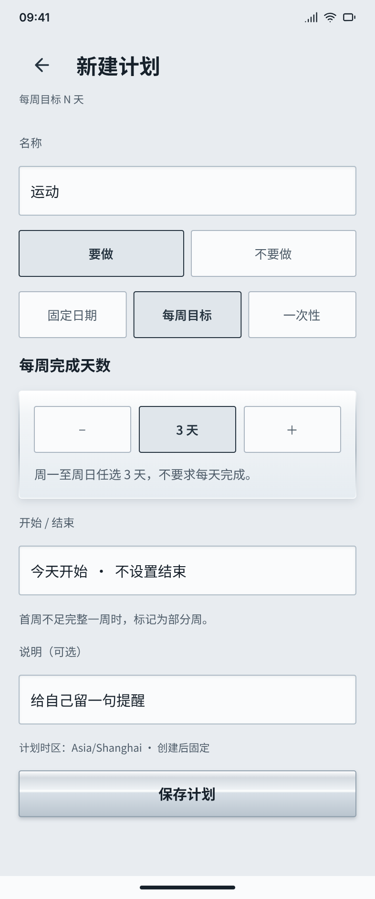
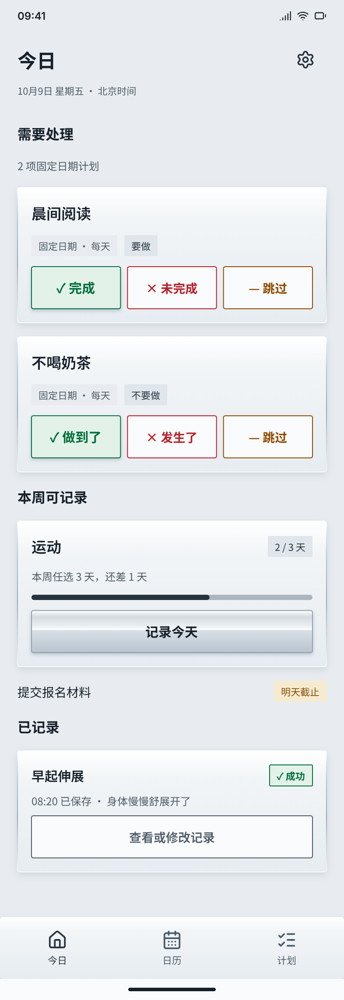
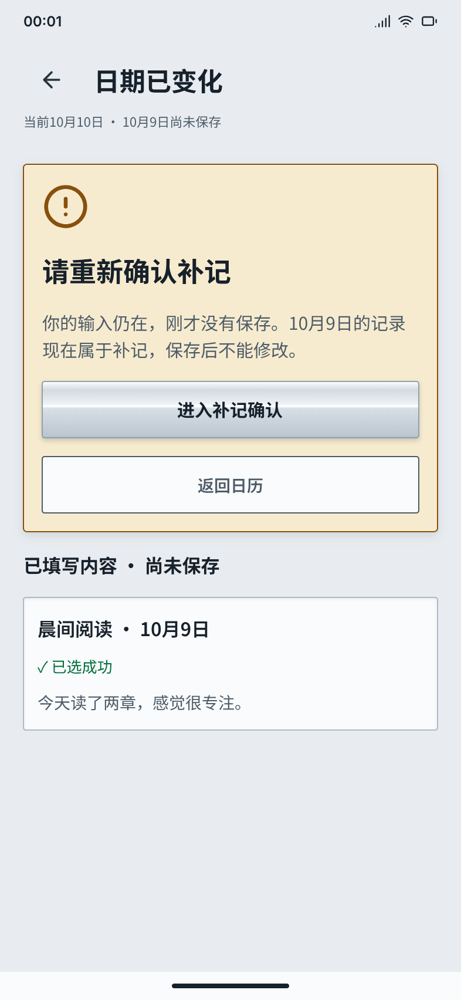
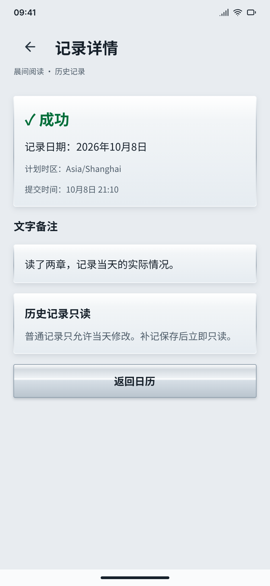
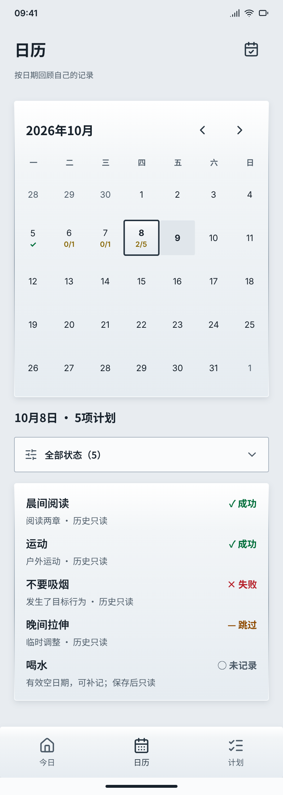
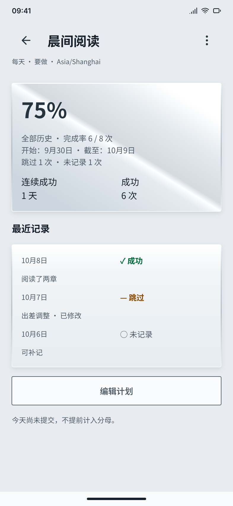
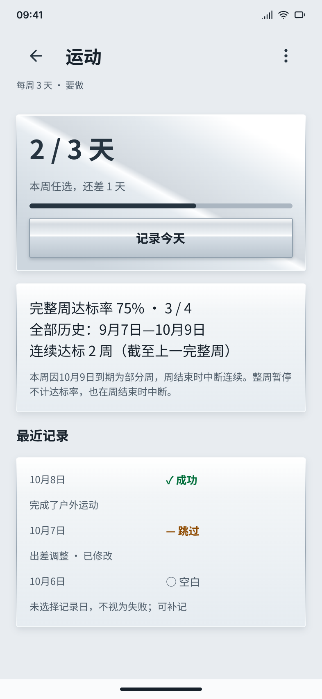
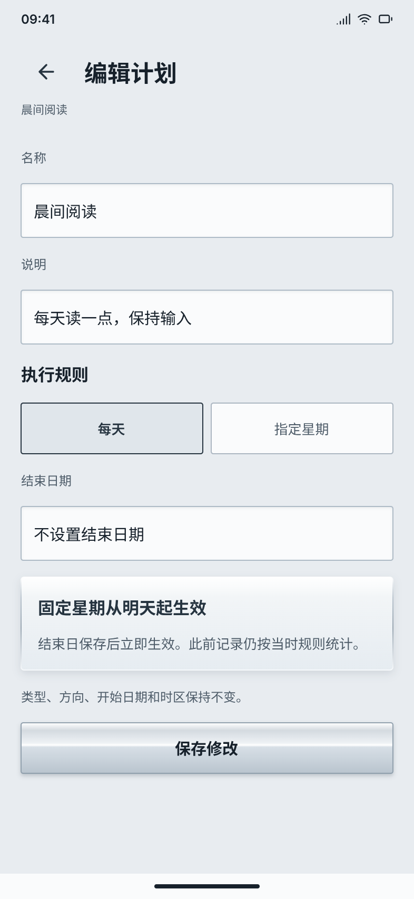

# 计划打卡 Android V1｜详细设计需求文档

> 版本：1.1 已确认；日期：2026-10-09，Asia/Shanghai  
> 产品：免登录、本机保存的个人计划与执行记录工具  
> 技术方向：React Native/Expo；交付目标：Windows 安卓模拟器验证＋独立 APK  
> 当前交付：需求、Pen UI/UX、设计截图与审查记录；应用实现、构建和运行验收均尚未开始  
> 决策状态：1.1已通过Q33整体确认，含日历规则、Q28/Q29及Q31/Q32边界；1.0/Q27历史保留。T1–T14工程选择已明确，技术0.8已通过T15整体确认。

## 1. 文档使用方式

本文是本目录的产品与交互规格，开发者无需依赖其他项目。配套资料：[需求分析与待确认项](需求分析与待确认项.md)、[UI/UX规格](UIUX-计划打卡-Android-v1.md)、[Windows验证方案](Windows安卓模拟器验证方案.md)、[设计令牌](design/design-tokens.json)、[页面映射](design/page-map.json)、[截图预览](design/preview.html)、[Pen文件](ui.pen)。

规则标记保留来源：**C**＝逐项确认；**B**＝原稿既有产品规则；**P**＝落实方案。1.0的C/B/P产品内容由Q27确认，1.1本轮产品与交互修订由Q33整体采纳；变更继续单独追踪，技术架构提案不因产品确认而自动定版。**Dxx**＝审查问题编号，**Txx**＝技术决策编号。功能编号FR定位需求，AT定位验收。

**阅读编排：** 截图紧邻对应功能正文；[按页面定位](#screen-index)或打开[左图右文的图文对照预览](design/preview.html)。各页同时列出关联需求和验收编号，共用规则仍沿用唯一的FR编号。

Pen截图是视觉与状态示例，不是已运行的应用。不同截图可展示同名计划在不同状态下的独立情景；不能把它们拼成同一条真实操作时间线，也不能把示例记录预置进用户数据库。

## 2. 定位、用户与目标

### 2.1 产品定位

帮助个人回答三个问题：今天有哪些计划可以执行？今天实际结果是什么？一段时间内执行情况怎样？核心闭环为：创建计划 → 查看今日 → 确认结果并保存 → 日历/详情回顾。

目标用户是希望自行记录习惯、每周目标和截止事项的人。产品用于记录本人申报的事实，不自动证明用户完成目标，不通过排名、勋章或社交比较催促。V1侧重清楚、可靠、离线可用的个人记录。

典型场景：

| 场景 | 用户动作 | 产品应解决的问题 |
| --- | --- | --- |
| 固定执行 | 设置周二/周四运动，执行后记录结果 | 只在合法日期产生要求，未操作不误判成功 |
| 避免行为 | 设置每天不吸烟，晚间申报做到了/发生了 | 正反方向文案明确，允许当天纠正申报 |
| 灵活周目标 | 每周运动3天，自选哪天完成 | 同一天不重复计数，不把空白日当失败 |
| 截止任务 | 创建10月10日截止的报名材料 | 完成日期与录入时间分开，迟补报不等于迟完成 |
| 历史回顾 | 查看月历和计划详情 | 区分成功、失败、跳过、未记录、补记，清楚表达统计分母 |

### 2.2 首版目标与判断标准

| 目标 | 成功条件 | 对应验收 |
| --- | --- | --- |
| 进入即可用 | 首次打开无登录，空态可以创建；已有数据直接进入今日 | AT01 |
| 完成核心闭环 | 三类计划各自创建、记录、查看历史可走通 | AT02–AT08、AT18 |
| 记录可信 | 显式确认后落盘、同日唯一、历史权限准确、失败不假报成功 | AT09–AT12、AT24 |
| 日期可解释 | 业务日期、提交时间、实际完成日各有明确用途 | AT06、AT11–AT13 |
| 统计可复核 | 显示分子/分母与期间，今天计入口径一致 | AT14–AT17 |
| 本机可日常使用 | 关闭开发服务器、飞行模式、重启后记录仍在 | AT01、AT24、AT28 |
| 设计可落实 | 金属感、低圆角、彩色状态、合理边距，同时支持安卓系统交互 | AT25–AT27 |

V1不以日活、留存或付费转化作为功能验收标准。未来若需要行为分析，另行明确统计目的和数据采集；当前核心不依赖分析服务。

## 3. 范围与边界

### 3.1 首版功能

| 范围 | 要求 | 状态 |
| --- | --- | --- |
| 个人核心 | 创建、今日记录、日历与统计回顾 | C |
| 三类计划 | 固定星期循环、每周N天、一次性任务 | 当前范围；详细规则B/P |
| 方向 | 循环支持要做/不要做；一次性仅要做 | B |
| 记录 | 成功/失败/跳过、可选文字备注、合法历史补记、当日修改 | C＋B |
| 修改权限 | 按计划业务日期，仅普通当日记录可改；补记保存后立即只读 | C |
| 数据 | 免登录、本机持久化、断网可用、重启保留 | C |
| 管理 | 编辑、次日暂停/恢复、删除立即归档、归档后永久删除 | C生命周期＋B/P编辑细则 |
| 导航 | 今日、日历、计划；今日右上角本机设置 | C |
| 视觉 | 简约高级、银色金属感、少圆角、渐变阴影、标题加粗 | C |
| 最终产物 | 模拟器实测与可脱离开发服务器的APK | C |

### 3.2 延期能力

账号/手机号/云同步、朋友/分享/鼓励、分组、提醒/通知、照片、数值、数据导出、手动备份/恢复、应用商店上架均不在首版。本机设置说明数据只保存在本设备；卸载或清除数据会移除记录。T3已确认关闭Android系统云备份与设备迁移；原生配置和实际效果仍待验证，不提供首版恢复功能。

延期能力不显示不可用入口，不请求对应运行时权限。深色主题作为UI提案延期；首版不做搜索（C），列表采用运行中、暂停、归档三个筛选；未归档终态须明确显示结果，不能误称待完成。

## 4. 术语与日期模型

| 术语 | 定义与用途 | 状态 |
| --- | --- | --- |
| 操作时刻 | 用户点击/提交的真实时间，保存为时间戳 | B |
| 计划今天 | 操作时刻按应用首次使用固定时区换算的日期，所有计划相同 | C |
| 业务日期 | 循环记录所属日期；用于资格、唯一性和修改权限 | C |
| 实际完成日期 | 一次性任务实际完成的日期，用于按时/迟完成判断 | C |
| 提交时间 | 记录最终保存的真实时刻，与上述日期分开 | C |
| 普通记录 | 记录所属业务日期等于该计划今天的首次记录 | C/P定义落实 |
| 补记 | 过去合法业务日期的首次记录；一次性登记过去完成日同样按历史记录权限处理 | C权限，实际完成日不得早于任务创建日（C） |
| 有效日期 | 当时规则/有效期/执行阶段允许的日期；手动归档当天仅保留已有合法记录 | C日期边界＋B规则模型 |
| 未记录 | 已结束的固定应执行日无记录；不是本人申报失败 | B |
| 空白 | 非固定执行日，或周目标当天没有选择记录 | B |
| 部分周 | 周中开始/结束/暂停/恢复等导致不完整；排除周达标率并中断连续 | C |
| 暂停 | 暂时停止生成后续要求，之后可恢复 | C次日生效 |
| 归档 | 运行/暂停计划删除后立即停止继续执行、保留历史；所有记录只读，不可恢复 | C |
| 删除 | 清除计划及关联记录，无法在应用内撤销 | B |
| 自然结束 | 循环结束日期包含当日，次日起自动归档 | C |

C：首次使用固定设备对应的IANA时区，所有计划共用，之后不随设备时区变化；周一至周日为自然周；开始/结束/截止包含当日。日期字段保存日期值，时间戳保存实际时刻，不能用UTC截断替代计划业务日期。

跨天时重新计算页面状态和保存资格。设备换时区不改变旧计划的业务日期，但首版不支持每个计划单独选择时区；全局今日和月历均采用这一个固定时区。首版依赖设备系统时间；离线状态没有远程校时，不能承诺防止用户调时钟。

## 5. 导航与完整用户流程

### 5.1 三个入口

| 入口 | 默认内容 | 可进入页面 | 返回要求 |
| --- | --- | --- | --- |
| 今日 | 当前有效执行项、周进度、截止任务、已记录 | 创建、记录确认、详情、本机设置 | 二级页返回今日，保留合理滚动位置 |
| 日历 | 当前月、今天选中、日期摘要 | 日期列表、已有记录查看、合法空日补记 | 返回选中日期和月份 |
| 计划 | 按状态筛选的计划列表 | 创建、详情、管理确认 | 返回原筛选和列表位置 |

二级页显示返回按钮；安卓Back先关闭键盘或弹层，再按页面返回。表单有未保存变更时显示“继续编辑/放弃修改”；草稿是否重启恢复见FR31/D26。首次无计划时进入今日空态，不把读取数据库中的短暂状态显示为无计划。

### 5.2 记录主流程（C）

1. 今日点击“✓完成 / ×未完成 / —跳过”，只预选结果并进入确认页。
2. 确认页显示计划、方向、业务日期、预选结果和可选备注。用户可换结果。
3. 点击最终保存，重新校验资格与权限，再一次性提交。
4. 落盘成功后返回来源页并显示“已保存到本机”；跨页状态、统计同步刷新。
5. 失败留在编辑页，输入保留，提供重试；取消不产生记录。

一次性完成另有实际完成日期，默认计划今天，保存前预览“按时完成/迟完成”；补记必须在最终保存前显著提示“保存后不能修改”。

### 5.3 历史查看与补记

选历史日期 → 逐计划判断是否有效、是否已有记录 → 已有记录只读；有效且无记录可进入补记（暂停/归档及恢复后的资格按FR12） → 确认日期/结果/备注 → 最终保存 → 显示补记标签、提交时间及只读状态。

## 6. 功能需求：启动与计划创建

下表每一项均须由界面行为与持久化结果共同验证；仅画出按钮不算实现。

### FR01｜首次启动与今日空态

<!-- page-context:start -->

**图01｜今日空态**

> 对应FR01。真正无数据时展示创建入口；读取失败不能用此状态。

**本页需求：** [FR01](#fr01)、[FR02](#fr02)、[FR32](#fr32)

**本页验收：** AT01，步骤和期望见[验收场景](#acceptance)；也可在[图文对照预览](design/preview.html#screen-01)中就地展开。

<!-- page-context:end -->

- 目的/入口：安装后直接进入今日，免登录；数据库读取完成且计划数为0才展示空态。
- 展示：应用定位、一句本机说明、“创建第一个计划”按钮；不预置样例计划。
- 操作结果：进入统一新建页，默认类型为固定日期循环（P）；已存在数据直接显示真实内容。
- 异常：读库失败显示FR32错误状态，不显示“开始使用”伪空态。
- 验收：AT01。设计图01。

### FR02｜创建公共字段与校验

<!-- page-context:start -->

**关联截图：** [图01 今日空态](#screen-01)、[图04 新建固定星期](#screen-04)、[图05 新建每周N天](#screen-05)、[图06 新建一次性任务](#screen-06)、[图15 编辑计划](#screen-15)。

<!-- page-context:end -->

| 字段 | 输入/默认 | 校验与反馈 | 状态 |
| --- | --- | --- | --- |
| 名称 | 必填；默认空 | 去首尾空白后非空，上限80；错误贴近字段 | B；计数口径P |
| 类型 | 固定/每周/一次性 | 切换后只提交当前类型字段；不把隐藏旧值写入新类型 | B/P |
| 方向 | 循环要做/不要做，默认要做 | 一次性固定要做，无方向切换 | B |
| 说明 | 可选，默认空 | 上限1000，可换行；空值合法 | B |
| 时区 | 使用首次使用固定时区，只读 | 所有计划共用；获取失败禁止不明日期保存 | C/P异常 |
| 循环开始 | 默认计划今天 | 只允许今天/未来 | C |
| 循环结束 | 可空 | 有值时≥开始，包含当日 | B |
| 结果备注 | 可空 | 上限2000，无备注也可保存 | B |

C：长度按Unicode码点计数，避免UTF-16将常用emoji拆成两个字符；组合emoji可能包含多个码点。标题单行，内部换行拒绝；同名计划允许，由规则/方向辅助辨认。输入限制与错误文案一致，不仅靠客户端截断。标题单行、限制与同名政策均按本版执行。

保存按钮仅在必填合法时可提交；保存中禁用，失败保留所有输入。取消有变更需确认。成功后进入新计划详情（P），返回今日/列表时计划立即可见；未来开始的循环暂不进入今日。类型切换保留共通字段，清除不适用字段前提示（P，D26）。

### FR03｜固定星期循环

<!-- page-context:start -->

**图04｜新建固定星期**

> 对应FR02–03。新建时默认不选星期，必须手动选择至少一天；本图为已选择后的操作示例。开始今天/未来；必填与错误反馈见字段规格。

**本页需求：** [FR03](#fr03)、[FR02](#fr02)、[FR12](#fr12)、[FR31](#fr31)

**本页验收：** AT02、AT03、AT04，步骤和期望见[验收场景](#acceptance)；也可在[图文对照预览](design/preview.html#screen-04)中就地展开。

<!-- page-context:end -->

- 输入：星期一至星期日多选，新建默认全部未选（本轮P1已确认），须用户手动选择至少一天才可保存；“每日”快捷选择七天，取消其中一天后不再标每日。全部取消时再次禁止保存，不静默恢复默认选项。
- 资格：业务日期在开始/结束内、当时规则选择该星期、生命周期有效；只对这些日期产生应执行项。
- 展示：要做/不要做、明确星期、日期区间、时区；每日与选定星期不能显示相互矛盾摘要。
- 异常：未选星期、结束早于开始、开始过去时不保存；未来日期不能提前打卡。
- 示例：周二/周四计划，周三业务日期不可记录；周三操作可以补记有效周二，不能记录未来周四。
- 验收：AT02–AT04、AT11。设计图04。

### FR04｜每周N天

<!-- page-context:start -->

**图05｜新建每周N天**

> 对应FR02、04。N为1–7，自选记录日，空白不等于未记录。

**本页需求：** [FR04](#fr04)、[FR02](#fr02)、[FR19](#fr19)、[FR31](#fr31)

**本页验收：** AT02、AT03、AT05、AT16、AT17，步骤和期望见[验收场景](#acceptance)；也可在[图文对照预览](design/preview.html#screen-05)中就地展开。

<!-- page-context:end -->

- 输入：整数N为1–7，默认3（P）；循环开始/结束采用FR02规则。
- 资格：有效期和有效生命周期内，自选当天记录，不要求每天完成；同一业务日期最多计一个成功日。
- 进度：本周成功日期数/N；4/3保留实际数4，进度条最高100%；失败/跳过不增加成功天数。
- 空白：未选择记录的日子是空白，不能渲染成每天未记录。
- 部分周：保存记录并标记原因，不套用完整周结果；周达标率和连续统计仅纳入已结束完整周，部分周中断连续。
- 验收：AT05、AT16–AT17。设计图05、13。

### FR05｜一次性任务

<!-- page-context:start -->

**图06｜新建一次性任务**

> 对应FR02、05。截止今天/未来，固定要做。

**本页需求：** [FR05](#fr05)、[FR02](#fr02)、[FR09](#fr09)、[FR31](#fr31)

**本页验收：** AT02、AT06、AT07、AT08，步骤和期望见[验收场景](#acceptance)；也可在[图文对照预览](design/preview.html#screen-06)中就地展开。

<!-- page-context:end -->

- 输入：必填截止日期，默认计划今天（P），只允许今天/未来（B）；没有循环星期、每周目标或不要做方向。
- 结果状态：待完成、逾期、按时完成、迟完成、失败、取消；逾期是未终结时的时间状态，不自动变成失败。
- 判定：实际完成日期≤截止为按时，>截止为迟完成；提交时间不参与该判定（C）。
- 限制：未来实际完成日期禁止；实际完成日必须在创建日到今天之间（C）；不允许撤回；普通当天可修正完成/失败/取消，记录业务日期不移动（C）。
- 验收：AT06–AT08。设计图06、14、21。

## 7. 功能需求：今日与记录

### FR06｜今日分区与展示

<!-- page-context:start -->

**图02｜今日有计划**

> 对应FR06–10。四分区和结果入口；点结果先确认，不直接保存。分区排序已固定，全部计划共用首次使用固定时区。

**本页需求：** [FR06](#fr06)、[FR07](#fr07)、[FR08](#fr08)、[FR09](#fr09)、[FR10](#fr10)、[FR31](#fr31)

**本页验收：** AT09、AT10、AT14，步骤和期望见[验收场景](#acceptance)；也可在[图文对照预览](design/preview.html#screen-02)中就地展开。

<!-- page-context:end -->

B：今日包含“固定待处理”“本周可记录”“截止事项”“已记录”。固定只显示今天有效且无记录的项；周目标即使本周已达标仍可记录合法今天，不每日催促；一次性未终结且逾期仍保留。

每张卡片显示名称、方向/类型、适用日期或截止、周进度或记录结果。全部计划共用首次使用固定的时区，今日日期统一。今日展示全部未终结一次性任务，包括未来截止与逾期（C）。

固定按创建先后稳定排列（Q27确认）；周目标按创建先后；截止事项逾期优先、截止升序、同日按创建先后。保存后原位置立即反馈，离开/刷新后进入已记录分区，避免点完突然跳动；就地反馈、下次刷新归入已记录已确认（C）；同分区排序按上述已确认规则。设计图02。

### FR07｜要做循环确认

<!-- page-context:start -->

**图07｜要做确认记录**

> 对应FR07、10。结果、可选备注和最终保存；绿色成功、红色失败、橙色跳过。

**本页需求：** [FR07](#fr07)、[FR10](#fr10)、[FR31](#fr31)

**本页验收：** AT09、AT24、AT26，步骤和期望见[验收场景](#acceptance)；也可在[图文对照预览](design/preview.html#screen-07)中就地展开。

<!-- page-context:end -->

- 入口：今日结果按钮或合法当天日期；已有普通当日记录进入FR11。
- 内容：计划名、完整业务日期、规则/方向、三种结果、可选文字备注；今日传入的结果必须显示已选。
- 语义：成功＝本人确认目标已完成；失败＝本人确认未完成；跳过＝主动不参与本次考核（不进入固定完成率分母，并单独显示数量）。
- 保存：必选一个结果，按FR10提交；空备注合法；页面返回或换选项都不能提前写入记录。
- 反馈：结果文字与绿色/红色/橙色一致，不只依赖颜色。验收AT09。设计图07。

### FR08｜不要做循环确认

<!-- page-context:start -->

**图08｜不要做确认记录**

> 对应FR08、10。区分没有发生与发生目标行为，当天可修正。

**本页需求：** [FR08](#fr08)、[FR10](#fr10)、[FR11](#fr11)、[FR31](#fr31)

**本页验收：** AT10、AT12、AT24，步骤和期望见[验收场景](#acceptance)；也可在[图文对照预览](design/preview.html#screen-08)中就地展开。

<!-- page-context:end -->

沿用FR07，但文案表达行为是否发生：“✓做到了，没有发生目标行为”“×发生了目标行为”“—跳过”。不要把“未完成”解释成成功；未知不自动成功。

B：允许当天提前确认成功，后来发生行为可在同一个业务日改为失败；跨日后不可再修改（C）。保存前提示这是对截至当前情况的主动申报；不提供自动监测或午夜自动成功。验收AT10、AT12。设计图08。

### FR09｜一次性登记完成、失败与取消

<!-- page-context:start -->

**图21｜一次性实际完成日**

> 对应FR09。实际完成日与提交时间分开，日期范围为创建日到今天；历史补报立即归档并只读。

**本页需求：** [FR09](#fr09)、[FR05](#fr05)、[FR10](#fr10)、[FR13](#fr13)、[FR28](#fr28)、[FR31](#fr31)

**本页验收：** AT06、AT07、AT08、AT12，步骤和期望见[验收场景](#acceptance)；也可在[图文对照预览](design/preview.html#screen-21)中就地展开。

<!-- page-context:end -->

- 完成入口：待完成或逾期任务点击“登记完成”，进入独立确认页，不直接终结。
- 完成字段：实际完成日期默认计划今天，可选合法过去日期；备注可空；页面同时展示截止日期和预判结果。
- 时间：保存实际完成日期与提交时间。10/10截止、10/9完成、10/11录入仍为按时完成，并标记历史补报。
- 历史权限：过去完成日的补报保存后立即只读；今天的普通记录仅当天可改。不能因10/11提交而开放修改10/9事实。
- 失败/取消：显式结果确认和可选备注，分别显示失败/取消；不是循环“跳过”。结果业务日期为提交当天；普通当日可在完成/失败/取消间修正，业务日期不移动；历史补报只读（C）。
- 终态显示：结果、截止、实际完成日（适用时）、提交时间、备注、补记/已修改标签；不计算固定计划历史完成率或连续打卡，结果仍按FR14进入日历每日完成集合。
- 验收AT06–AT08、AT12；设计图14、21。失败/取消共用确认行为，尚无独立完整画板。

### FR10｜最终提交、唯一性与并发

<!-- page-context:start -->

**图23｜跨日重新确认**

> 对应FR10、12。10/9首次记录页跨至10/10保存：阻止旧提交、保留输入；“进入补记确认”只进入确认页，不直接保存，合法补记最终保存后只读。

**本页需求：** [FR10](#fr10)、[FR12](#fr12)、[FR09](#fr09)、[FR13](#fr13)、[FR31](#fr31)

**本页验收：** AT09、AT12，步骤和期望见[验收场景](#acceptance)；也可在[图文对照预览](design/preview.html#screen-23)中就地展开。

**关联截图：** [图02 今日有计划](#screen-02)、[图07 要做确认记录](#screen-07)、[图08 不要做确认记录](#screen-08)、[图09 修改当日记录](#screen-09)、[图10 补记](#screen-10)、[图20 存储异常](#screen-20)、[图21 一次性实际完成日](#screen-21)。

<!-- page-context:end -->

同一循环计划＋业务日期最多一条有效记录，一次性任务最多一条当前有效结果。点击最终保存后：
1. 重新取得计划今天、有效规则和生命周期，校验日期资格与修改权限。
2. 固定本次提交标识，在本机事务内写记录和必要修订信息。
3. 提交成功才刷新来源页、日历、详情与统计，显示“已保存到本机”。
4. 保存中禁止重复；重试不能产生第二条或将成功天数多计一次。

若页面打开后另一个入口已保存同日记录，停止新增并加载现有记录；若现有记录可改，明确进入修改，不能无提示覆盖。保存失败不把内存状态显示为成功，保留输入和失败理由。验收AT09、AT24；设计图20。

**首次记录跨日（Q31）：** 确认页保存前校验所确认的计划今天与当前计划今天。若不同，阻止这次首次提交，不创建记录、不自动改成补记、不自动移动业务日期，保留当前会话的结果和备注，提示“日期已变化，请重新确认”。循环和一次性过去完成日可在重新校验资格后进入历史补记确认，明确保存后只读；一次性历史完成另提示保存后立即归档。进入确认页本身不落盘，最终保存才执行FR10事务。

若跨日后暂停、归档或执行阶段改变导致原日期不再可补记，不显示可保存的补记入口，说明原因并可返回查看。一次性失败/取消没有过去完成日补报，需明确重新确认新的当日结果，不能将旧日期伪装成历史补报。返回或放弃未保存输入沿用FR31。已经提交成功后的同一命令重试只返回原成功结果，不要求重新提交。已有记录的跨日修改继续按FR11拒绝。验收AT09、AT12；设计图23。

### FR11｜普通记录当日修改（C）

<!-- page-context:start -->

**图09｜修改当日记录**

> 对应FR11。示例业务日期10/9、今天10/9；仅未归档普通当日可改结果/备注，日期不移动、不撤回。

**本页需求：** [FR11](#fr11)、[FR10](#fr10)、[FR13](#fr13)、[FR31](#fr31)

**本页验收：** AT10、AT12、AT14、AT26，步骤和期望见[验收场景](#acceptance)；也可在[图文对照预览](design/preview.html#screen-09)中就地展开。

<!-- page-context:end -->

- 前置：非补记，记录业务日期等于该计划今天；已有记录可从今日/日历/详情进入修改。
- 可改：结果、文字备注；不可改：计划ID、业务日期、记录种类、原始提交时间。
- 展示：加载当前已保存的结果、备注；原提交时间与最近修改时间另列，修改后显示“已修改”。再次修改不得重新加载首次提交的旧值。
- 保存：按FR10重新检查权限，合法时原记录修订而非新增；统计立即重算。
- 跨日：10/9编辑页未关闭、10/10再点保存，必须拒绝，原记录保留并提示“已过记录当天，此记录只读”。
- 撤回：不允许撤回（C），只改结果/备注，不提供删除单条记录或恢复为空白的入口。
- 验收AT12、AT14；设计图09已改为10/9当天场景。

### FR12｜历史补记（C权限＋B资格）

<!-- page-context:start -->

**图10｜补记**

> 对应FR12。示例补10/6；提交前提示保存后不能修改，结果和备注一并锁定。

**本页需求：** [FR12](#fr12)、[FR10](#fr10)、[FR13](#fr13)、[FR16](#fr16)、[FR31](#fr31)

**本页验收：** AT04、AT11、AT12、AT22，步骤和期望见[验收场景](#acceptance)；也可在[图文对照预览](design/preview.html#screen-10)中就地展开。

<!-- page-context:end -->

- 前置：过去日期、当时有效、尚无记录；不得补未来、生效前、固定未选日、暂停无效日。
- 暂停/归档：当前暂停/归档均禁止补记；恢复后也不能补暂停前的日期。只有当前运行阶段内已过去的有效空日可补记（C）；已保存历史仍可查看。
- 表单：计划名、完整业务日期、当时规则、结果、可选备注；提交前明确“请确认，补记保存后不能修改”。
- 保存：同日唯一，提交时标记补记并保存实际提交时间；成功后只读，不能再次覆盖。
- 统计：使用补记所属业务日期和当时规则重新聚合；不能按提交日算成今天成功。
- 验收AT11–AT12、AT14；设计图10。

### FR13｜历史只读查看（C）

<!-- page-context:start -->

**图22｜历史记录只读**

> 对应FR13。保留业务日期、提交时间、结果和备注；无编辑入口，返回日历。

**本页需求：** [FR13](#fr13)、[FR11](#fr11)、[FR12](#fr12)

**本页验收：** AT12、AT18，步骤和期望见[验收场景](#acceptance)；也可在[图文对照预览](design/preview.html#screen-22)中就地展开。

<!-- page-context:end -->

已有普通历史记录及所有已提交补记，显示结果、业务日期、备注、原提交/最近修改时间、补记/已修改标签。无可编辑字段和保存按钮；解释“历史记录只读”或“补记保存后不能修改”。不能通过详情快捷入口、深层导航或持久化接口绕过限制。

只读限制包括备注纠错，不能仅锁结果。计划暂停/归档不删除这些记录；运行/暂停计划删除先归档；归档后再次永久删除才按FR29清除历史。记录仅只读，不限制合法未记录日期的新增补记，后者单独判断FR12。验收AT12；只读查看见图22；图12/13历史区域同样遵守权限。

## 8. 功能需求：日历与回顾

### FR14｜全局月历

<!-- page-context:start -->

**图11｜全局日历**

> 对应FR14–15。日期12sp、金黄色分数10sp；今天浅色无进度；月历下无含义介绍。10/8·5项计划下为状态筛选框，默认全部（5），可选已完成（2）/未完成（3），随后展示彩色明细。

**本页需求：** [FR14](#fr14)、[FR15](#fr15)、[FR16](#fr16)

**本页验收：** AT11、AT13、AT18、AT25，步骤和期望见[验收场景](#acceptance)；也可在[图文对照预览](design/preview.html#screen-11)中就地展开。

<!-- page-context:end -->

- 入口：日历tab；默认当前月、今天选中（P）；支持上/下月与回到今天。
- 网格：周一开头，七列星期与日期严格对齐；跨月日期弱化，选中态与结果态可同时辨认。
- 单一下标（本轮C）：除今天外，日期格最多显示一个汇总；全部完成显示绿色✓，否则显示“完成数量/全部数量”，例如2/5、0/3。失败、跳过、未标记/未记录、待处理、取消均不增加完成数。不再在日期格并列多个结果符号。
- 点击：每个日期均可选以查看摘要；可记录性由逐计划资格决定，不能禁用整个无记录日导致无法补记。
- 未来：可查看固定计划及一次性任务的未来安排；有安排时显示0/总数，明细明确“未来安排”，无记录动作，不把未来日期写成失败。
- 今天（用户本轮追加）：日期格使用浅色填充，只显示加粗日期；不使用实心点，不显示✓、C/T或其他完成进度，下标始终为空，包括全完成和零项。选中今天仍可展示下方任务明细与汇总；被选中的日期边框保留，今天填充同时可辨。
- 零项：全部数量=0时下标留空，不显示✓、0/0或100%。
- 下标样式（用户追加）：C/T为黄色，使用$calendarProgress=#866500金黄色，10sp/600字重，小于日期12sp；按系统字号同比缩放。✓保持绿色，不给失败/跳过各加日期格符号。筛选框与选日明细使用正文样式，不与日期格下标混同。
- 选日区域（用户追加）：移除月历下“✓全部完成、C/T完成/全部”的含义介绍行；保留“日期 · T项计划”标题，标题下面不再单列完成统计，改为FR15状态筛选下拉框。逐条明细保留成功、失败、跳过、未记录、取消的颜色/形状。
- 统一时区（C）：月份、选中日、今天均按首次使用固定时区；设备时区变化不转换旧日期。
- 月历尺寸与边距见§12；验收AT18、AT25。设计图11。

**每日总数的唯一口径（Q28/Q29）：** 对选中业务日期d建立集合U(d)，同一计划同一天最多1项；全部数量T=集合大小，完成数量C=其中成功/完成的数量。名称、备注、修改次数和提交次数不增加项数。按当时规则和保留事实计算，不能只按当前运行状态过滤历史。

| 计划类型/事实 | 进入U(d)的条件 | 完成数 |
| --- | --- | --- |
| 固定星期 | d是当时执行期、运行阶段及星期规则的有效执行日；当天/过去/未来均可构成安排；手动归档当日无记录要求取消 | 已保存成功+1；失败/跳过/空日+0 |
| 每周N天 | 仅d已有周目标记录时计1项（Q28）；未记录的有效日不计日历总数，不产生每日执行债务 | 成功+1；失败/跳过+0；周达标不替空白日加勾 |
| 未终结一次性 | 仅当前截止日计1项（Q29）；一次性没有暂停/恢复；手动归档取消归档当日及未来未记录安排，过去截止安排仍按保留历史回顾 | 尚无终态，+0 |
| 已终结一次性 | 仅结果业务日计1项，替代原截止安排（Q29）；完成日=实际完成日，失败/取消沿用既定结果业务日 | 完成+1，失败/取消+0；取消明细独立灰色⊘ |
| 暂停/归档保留历史 | 有效固定要求及已有记录按原规则保留；当前状态不抹去历史；永久删除才移除该计划全部项 | 依既有事实计算 |

一次性结果与安排不跨日重复：10/10截止、10/9实际完成、10/11补报后，10/9计1个完成项，10/10移除旧截止安排；未终结截止由10/10延至10/15，旧安排移到10/15。旧截止版本留作规则追溯，但不继续生成日历未完成项。补记计业务日，不计提交日。

**指标区别：** 日历C/T表达当天列入集合的任务完成情况，跳过属于未完成且保留在T；FR17固定历史完成率仍按Q11排除跳过，FR19仍只计算已结束完整周。例如2成功＋1跳过，日历2/3，固定历史完成率2/2并另列跳过1；不能共用一个分母函数。

### FR15｜选中日期明细

<!-- page-context:start -->

**关联截图：** [图11 全局日历](#screen-11)。

<!-- page-context:end -->

列表逐条显示计划、方向、当时规则、状态、备注摘要和补记/已修改标记（适用时）；当前记录结果与月历、详情一致。

主列表来源为FR14的U(d)，未筛选数量可从逐条明细核对：固定空日按今天/过去/未来显示待处理/未记录/未来安排；未终结一次性仅截止日出现；周目标已有记录显示真实结果。

**筛选框：** 放在“日期 · T项计划”下面，48dp高、低圆角，默认“全部状态（T）”。展开后为全部状态（T）、已完成（C）、未完成（T−C）；已完成仅成功/完成，未完成包含失败、跳过、未记录/待处理、未来安排、取消。点击选项只筛选主列表，不改日历格C/T、日期标题T、记录或统计；选项数量始终基于筛选前集合，不能越筛越小。

选择新日期/切月重新选日/回今天时重置全部；从记录页返回同一日保留筛选，数量重新读取。展开框支持Back/点击外部关闭且不改变原筛选，选择后关闭；TalkBack读出选中项和数量。结果为空时显示“该日没有已完成项/未完成项”，可切回全部；整日T=0则显示“该日没有执行项”，不创建伪记录。

仅历史有效且尚无记录的周目标日期可在独立“可补记的周目标”区提供入口，明确未计入总数、不受主列表状态筛选，不能显示失败；未来周目标可单独说明本周N而不创造每日任务。保存成功后该记录加入集合，更新日期格/筛选选项数量，再按当前筛选显示。

已有历史记录进入FR13；合法空日进入FR12；今天普通记录进入FR11。暂停/归档及旧执行阶段不给补记入口；已失效安排不提供提交入口。同日期按计划创建先后稳定排序（Q27确认）；日期使用统一固定时区。验收AT11、AT18。

### FR16｜单计划历史

<!-- page-context:start -->

**关联截图：** [图10 补记](#screen-10)、[图11 全局日历](#screen-11)、[图12 固定详情](#screen-12)、[图13 周目标详情](#screen-13)、[图15 编辑计划](#screen-15)。

<!-- page-context:end -->

按业务日期倒序（P）显示记录及固定应执行但未记录日；周目标只对有效日期明确空白，不生成每日失败。显示当时规则和状态；跨规则版本回顾不改写旧日期资格。分页或虚拟列表避免长历史导致页面无法操作（工程P）。

暂停/归档计划仍可回顾；统计按相同日期模型计算。详情若使用月历日期格，也按FR14单下标规则筛选该计划，不能重新并列多个状态；独立记录列表保留结果符号。验收AT18、AT21。设计图12、13、14。

### FR17｜固定计划完成率

<!-- page-context:start -->

**图12｜固定详情**

> 对应FR16–18。全部历史起止与6/8；跳过1、未记录1单列；10/7跳过、10/8成功，今天未提交，连续1。

**本页需求：** [FR17](#fr17)、[FR16](#fr16)、[FR18](#fr18)、[FR22](#fr22)

**本页验收：** AT14、AT15、AT18、AT21，步骤和期望见[验收场景](#acceptance)；也可在[图文对照预览](design/preview.html#screen-12)中就地展开。

<!-- page-context:end -->

C：今日已提交立即进入计算，未提交的今天不进入。C：跳过排除分母并独立展示数量；统计期间为全部历史（C），明确显示开始日、截至日和分子/分母。

统计显示区间（T13已确认）：开始日为既定startsOn；运行/暂停截至当前业务日；自然到期归档截至结束日，其他归档截至归档业务日。显示区间与实际分母分开，暂停空档及今日未提交不因此计入；未来未开始显示“尚未开始”，开始前即归档显示开始日/归档日与“尚未开始即归档”，不显示倒置执行期间。

设T＝计划今天，E＝按历史规则与生命周期生成的有效固定应执行日期集合，R＝已有记录：
- 统计候选集合 S ＝ E中早于T的日期 ＋ E中等于T且已有有效记录的日期。手动归档当天，已有合法记录保留为有效；无记录的当天要求从E取消。自然到期归档保留结束日要求。
- 分母 D ＝ S中结果不是跳过的日期数；早于T未记录仍在D。
- 分子 N ＝ S中成功日期数；完成率＝N/D，D为0显示“暂无可计算记录”。
- 显示成功N/分母D、跳过数、未记录数、统计起止日期；P显示整数百分比四舍五入，内部不截断。
- 不把未来纳入、不把操作日期替代业务日期、不让同一天重复计数；范围或跳过政策改变须同步所有页面。

| 例子（历史已有6/8） | 保存后的值 | 含义 |
| --- | --- | --- |
| 今天未提交 | 6/8＝75% | 未提交今天排除 |
| 今天成功 | 7/9≈78% | C今日立即计入 |
| 今天失败 | 6/9≈67% | C今日提交，进入分母 |
| 今天跳过 | 6/8＝75%，跳过数+1 | C跳过不计分母 |
| 历史未记录补成功 | 对原分母日期分子+1 | 不新增应执行次数 |
| 今天成功改失败 | 分子减1，分母不变 | 当日修订立即更新 |

原公式“只统计已结束”已被C今日计入修正。验收AT14–AT15。设计图12。

### FR18｜固定连续成功

<!-- page-context:start -->

**关联截图：** [图12 固定详情](#screen-12)。

<!-- page-context:end -->

B：按有效应执行日期序列连续成功；失败、跳过、过去未记录中断。七天全选才称“连续成功天数”；否则称“连续成功次数”，星期间隔不是漏做。

C：未提交今天不立即打断昨日日终值；今天成功后延长，失败/跳过后打断；跨日无记录则中断。只显示当前连续，最长连续延期；暂停实际生效时中断，恢复从新执行阶段累计（C）。例：10/7跳过、10/8成功、10/9未提交，显示连续1。验收AT15，设计图12样例已更正。

### FR19｜每周进度与周达标率

<!-- page-context:start -->

**图13｜周目标详情**

> 对应FR16、19。当前2/3与已结束完整周3/4分开；当前部分周未结束，连续保留2周，周结束时中断。

**本页需求：** [FR19](#fr19)、[FR04](#fr04)、[FR16](#fr16)、[FR22](#fr22)

**本页验收：** AT05、AT16、AT17、AT18，步骤和期望见[验收场景](#acceptance)；也可在[图文对照预览](design/preview.html#screen-13)中就地展开。

<!-- page-context:end -->

B：周一至周日、每个成功日期计1天、失败/跳过不加成功天数；同一天重试不重复，4/3仍显示4/3，进度条最多100%。

C：本周进度随记录立即更新；历史周达标率仅算已结束完整有效周：达标周数÷已结束完整有效周数。完整周无记录时目标未达成；未结束周不提前宣告失败；分母0写暂无完整周。

全部历史的显示开始/截至日沿用FR17与T13；截至当前业务日不代表当前未结束周进入历史分母。归档的显示截至日冻结，归档造成的部分周仍在自然周结束时中断连续。

部分周保留实际成功数，标注原因，排除周达标率（B）。部分周结束时中断连续达标（C）；连续周仅统计已结束周，未结束的完整/部分周均暂时保持之前已结束周的连续值；部分周结束后归零，下个完整达标周重新累计。目标N从下周一生效，固定星期次日生效（C）。验收AT16–AT17；设计图13。

**整周暂停（Q32）：** 整个自然周均处于暂停时，该周不是完整有效执行周，不进入周达标率分母；在该周结束时中断连续，结束前保留此前已结束周连续值。达标完整周A → 整周暂停B → 恢复后完整达标周C，C结束后连续为1周，不能跳过B累计为2。尚未开始或已归档后的周不创建执行要求；不能扫描有效周集合并忽略执行阶段间的暂停空档。验收AT17。

### FR20｜一次性回顾

<!-- page-context:start -->

**图14｜一次性详情**

> 对应FR20。独立逾期状态样例，与其他画板同名任务不是同一数据时间线。

**本页需求：** [FR20](#fr20)、[FR05](#fr05)、[FR09](#fr09)、[FR22](#fr22)、[FR28](#fr28)

**本页验收：** AT06、AT07、AT08、AT19、AT20，步骤和期望见[验收场景](#acceptance)；也可在[图文对照预览](design/preview.html#screen-14)中就地展开。

<!-- page-context:end -->

仅显示任务状态、截止、实际完成日（完成时）、提交时间、备注和必要修订/补报标记。逾期未终结显示“逾期X天”（P，按计划日差）；按时/迟完成明确来源是实际完成日。失败/取消不伪造完成日期，不显示循环完成率或连续天数。验收AT06–AT08，设计图14、21。

## 9. 功能需求：管理与生命周期

### FR21｜计划列表与筛选

<!-- page-context:start -->

**图03｜计划列表**

> 对应FR21。展示状态分类。采用运行中、暂停、归档三个筛选；循环到期次日归档，一次性普通终态次日、历史补报立即归档。

**本页需求：** [FR21](#fr21)、[FR22](#fr22)、[FR28](#fr28)

**本页验收：** AT19，步骤和期望见[验收场景](#acceptance)；也可在[图文对照预览](design/preview.html#screen-03)中就地展开。

<!-- page-context:end -->

B：运行中、暂停、已归档三个入口，各显示名称、方向/类型、规则摘要、有效期和当前状态。同状态按创建时间稳定排列（Q27确认）；无数据空态说明筛选条件并提供切回运行中。创建入口始终可达。

未来开始仍归未归档运行列表并标未开始；循环到期次日自动归档（C）。一次性普通终态次日归档，历史补报保存后立即归档（C）；首版不做搜索（C）。验收AT19，设计图03。

### FR22｜计划详情

<!-- page-context:start -->

**关联截图：** [图03 计划列表](#screen-03)、[图12 固定详情](#screen-12)、[图13 周目标详情](#screen-13)、[图14 一次性详情](#screen-14)、[图15 编辑计划](#screen-15)。

<!-- page-context:end -->

入口为今日卡片标题、计划列表或日历明细。显示名称、说明、方向/类型、时区、有效区间/截止、当前状态、对应统计、历史；右上角管理菜单进入允许的操作。

未开始、运行中、明日起暂停/恢复等状态要有文字区分；不能在次日生效前就按新状态撤销今天资格。暂停/归档不开放新增补记（C）；查看已有记录仍允许。数据尚未读取/失败、计划已被删除时要有明确状态，不呈现旧缓存作为可保存内容。验收AT18–AT22；设计图12–14。

### FR23｜编辑基本信息与规则

<!-- page-context:start -->

**图15｜编辑计划**

> 对应FR23。仅运行中可编辑规定字段；固定星期明天、每周N下周一，结束/截止即时；暂停/归档不可编辑。当前图为固定计划编辑示例。

**本页需求：** [FR23](#fr23)、[FR02](#fr02)、[FR16](#fr16)、[FR22](#fr22)、[FR31](#fr31)

**本页验收：** AT02、AT17、AT21，步骤和期望见[验收场景](#acceptance)；也可在[图文对照预览](design/preview.html#screen-15)中就地展开。

<!-- page-context:end -->

| 字段 | 基线/提案 | 历史影响与开放点 |
| --- | --- | --- |
| 名称、说明 | 仅运行中允许修改（C） | 历史结果不改变，历史列表显示新名称 |
| 方向、类型、时区、既定开始日 | 首版不可修改（C） | 页面只读说明；要改变则新建 |
| 固定星期 | 允许修改并留规则版本 | 次日生效（C），旧日期仍按旧版本 |
| 每周N | 允许修改 | 下周一生效（C），一周使用一个目标值 |
| 循环结束日 | 运行中可修改（C） | 保存后立即生效（T9）；新值不能早于今天/开始；不追溯否定历史，结束包含当日 |
| 一次性截止日 | 未终结且未归档才可修改（C） | 保存后立即生效（T9）；新值不早于今天；逾期延后可立即转待完成，终态后截止只读 |

编辑页按字段展示生效时间：名称/说明和结束/截止保存后立即，固定星期次日，每周N下周一。待生效规则多次编辑仅最后保存生效（T7），同时显示当前值与待生效值；只改名称不覆盖已有待生效规则。T12已确认：将该字段保存回当前生效值即取消该字段待生效申请，未触及字段保留；输入初值优先显示待生效值，避免无意取消。保存前比较旧值，无变化可直接返回（P）。规则变化不会移动或删除已有记录；补记仍按旧日期对应版本判合法，统计按FR17–19重聚合。已归档仅查看或永久删除（C），不提供编辑；暂停不能编辑任何字段，仅可改状态；未终结一次性任务可编辑截止，归档全部不可编辑（C）。验收AT21；设计图15。

### FR24｜暂停（C生效日）

<!-- page-context:start -->

**图16｜暂停与恢复确认**

> 对应FR24–25。并列确认暂停、恢复说明、待生效可取消三种状态样例；实际页面只呈现当前适用状态。

**本页需求：** [FR24](#fr24)、[FR25](#fr25)、[FR27](#fr27)、[FR28](#fr28)

**本页验收：** AT17、AT22，步骤和期望见[验收场景](#acceptance)；也可在[图文对照预览](design/preview.html#screen-16)中就地展开。

<!-- page-context:end -->

- 前置：当前运行中的循环；一次性任务不提供暂停入口（Q27确认）。
- 确认：显示“从计划时区的明天暂停；今天仍可记录，已有记录保留”及具体生效日期。
- 结果：保存生命周期事件，生效前展示“明日起暂停”；生效后停止新要求，列表归暂停。
- 补记：实际处于暂停时不能新增补记（C）；暂停之前已保存补记依旧只读。
- 重复：已有同类待生效申请时不再新增；生效前可取消，取消后仍按原状态。
- 验收AT22；设计图16（并列确认、恢复说明和待生效申请样例；实际页面只展示适用状态）。

### FR25｜恢复（C生效日）

<!-- page-context:start -->

**关联截图：** [图16 暂停与恢复确认](#screen-16)。

<!-- page-context:end -->

暂停循环可申请恢复，从计划时区明天生效；恢复当天仍按原暂停状态，不立即产生今天执行资格。生效后按当时有效规则生成后续日期，不把暂停期间空白补成漏做。

恢复后不能补记暂停前的任何日期（C），暂停期间无效日期同样不能补记。恢复只开启新的执行阶段；新阶段内过去的合法空日可补记。周内恢复产生部分周（B，统计D14）。确认页展示生效日与恢复后的规则摘要。验收AT22；设计图16。

### FR26｜删除后立即归档（C）

<!-- page-context:start -->

**图17｜删除并保留历史**

> 对应FR26、29。运行/暂停删除后立即归档，保留历史，所有记录只读；不可恢复，未记录当日要求取消。

**本页需求：** [FR26](#fr26)、[FR27](#fr27)、[FR28](#fr28)、[FR29](#fr29)、[FR32](#fr32)

**本页验收：** AT23、AT24，步骤和期望见[验收场景](#acceptance)；也可在[图文对照预览](design/preview.html#screen-17)中就地展开。

<!-- page-context:end -->

运行中或暂停的计划选择删除，只移入归档，不清除计划、打卡、备注和统计。确认页明确“删除后移入归档，保留全部历史”，主按钮“确认移入归档”，不能提供直接清库的旁路。归档当日已有记录计入历史，尚未记录的要求取消（C）。

确认并成功落盘后立即归档：从今日移除，取消未生效的暂停/恢复等后续执行申请，不再产生新要求；列表可在已归档找到。归档当日已有普通记录也变为只读，不能继续改或补记。

归档后不恢复，不提供名称/规则编辑和新增记录；只能查看历史或进入归档计划的永久删除。暂时停用使用暂停。因归档导致本周不完整，标部分周、排除周达标率，并在该部分周结束时中断连续（C），不在归档瞬间提前归零。失败时仍保留原状态与数据，不假报归档成功。

验收AT23，设计图17。

### FR27｜同日待生效状态变更

<!-- page-context:start -->

**关联截图：** [图16 暂停与恢复确认](#screen-16)、[图17 删除并保留历史](#screen-17)。

<!-- page-context:end -->

因暂停/恢复均次日生效，当天必须区分当前有效状态与已申请状态。C：生效前可取消申请；同一计划同一生效日只保留一个有效状态申请（Q27确认），取消后沿用原状态。取消暂停不叫恢复，不能借取消改写已经生效的暂停历史。

表单若在午夜跨入生效日，重新读取有效状态；已生效的申请不能取消。验收AT22。

### FR28｜自然结束与一次性终态归类

<!-- page-context:start -->

**关联截图：** [图03 计划列表](#screen-03)、[图14 一次性详情](#screen-14)、[图16 暂停与恢复确认](#screen-16)、[图17 删除并保留历史](#screen-17)、[图21 一次性实际完成日](#screen-21)。

<!-- page-context:end -->

循环结束日期当天仍可执行，次日自动归档（C）。此后历史只读、不能补记、不能恢复或续期；归档前可按FR23编辑合法结束日期。

一次性普通终态移入今日已记录，保留到当天结束，次日自动归档；历史补报保存后立即归档（C）。未归档普通当天可修正三种结果，但不撤回、不移动记录日期；归档或历史补报只能查看。未归档列表须明确标结果，不能把列表归类写成仍待完成。验收AT19、AT23。

### FR29｜归档后永久删除（C）

<!-- page-context:start -->

**图18｜归档后永久删除**

> 对应FR29。只有已归档计划可永久删除，明确清除计划及全部记录、备注；取消继续保留。

**本页需求：** [FR29](#fr29)、[FR26](#fr26)、[FR32](#fr32)

**本页验收：** AT23、AT24，步骤和期望见[验收场景](#acceptance)；也可在[图文对照预览](design/preview.html#screen-18)中就地展开。

<!-- page-context:end -->

- 两阶段入口：运行/暂停计划的删除走FR26；只有已归档计划才显示“永久删除”。
- 确认：显示计划名称及记录数量（P），说明“计划和全部历史打卡、文字备注将永久删除，不能撤销”；取消继续保留归档数据。
- 提交：再次显式确认后，以一个事务删除计划、规则、生命周期、记录及修订信息；落盘成功才返回已归档列表。
- 异常：失败保留整套归档数据，提示重试；不能只删计划、留下关联记录，也不能提前从界面假移除。
- 影响：永久删除后今日、日历、详情、列表和统计均不再包含该计划。归档不会清除这些历史。
- 边界：不能直接永久删除运行/暂停计划，不提供单条历史记录删除、撤回或清空全部数据库入口。
- 验收AT23–AT24，设计图18。

## 10. 功能需求：本机设置与可靠性

### FR30｜本机设置

<!-- page-context:start -->

**图19｜本机设置**

> 对应FR30。本机保存、无备份/云同步；首次使用固定时区且全部计划共用。版本为样例。

**本页需求：** [FR30](#fr30)、[FR01](#fr01)、[FR32](#fr32)

**本页验收：** AT01、AT13、AT27，步骤和期望见[验收场景](#acceptance)；也可在[图文对照预览](design/preview.html#screen-19)中就地展开。

<!-- page-context:end -->

今日右上角进入。显示应用版本、数据保存在本设备、无账号/云同步、无手动备份、卸载/清除数据后记录消失、时区与结果规则说明。不能显示“已同步”或虚假的恢复按钮。需要能查到“归档＝停止执行但保留历史”的解释。

设置不承担计划删除入口；V1无整库重置按钮（P）。版本信息来自安装包，不能把设计样例“1.0.0”硬编码成所有构建版本。验收AT01/AT27，设计图19。

### FR31｜草稿、取消与保存反馈

<!-- page-context:start -->

**关联截图：** [图02 今日有计划](#screen-02)、[图04 新建固定星期](#screen-04)、[图05 新建每周N天](#screen-05)、[图06 新建一次性任务](#screen-06)、[图07 要做确认记录](#screen-07)、[图08 不要做确认记录](#screen-08)、[图09 修改当日记录](#screen-09)、[图10 补记](#screen-10)、[图15 编辑计划](#screen-15)、[图20 存储异常](#screen-20)、[图21 一次性实际完成日](#screen-21)。

<!-- page-context:end -->

C：首版草稿只保留在当前编辑会话，进程退出/被系统杀死后未提交内容不保证恢复；已提交数据必须持久化。不能将“保存失败保留输入”宣传为草稿自动备份。失败保留输入不等于退出后保存草稿。

取消、系统Back、类型切换造成丢失输入时明确提示；继续编辑不清空；放弃只丢弃未提交变更，不影响原记录。保存中主按钮禁用并读出状态，成功反馈只在事务提交后出现。进入只读页没有未保存退出提示。验收AT09、AT24、AT26。

### FR32｜读写、升级与异常

<!-- page-context:start -->

**图20｜存储异常**

> 对应FR10、32。此图为写入失败；初始化/读取/迁移错误需对应不同提示，不能清库。

**本页需求：** [FR32](#fr32)、[FR10](#fr10)、[FR31](#fr31)

**本页验收：** AT01、AT09、AT20、AT24、AT28，步骤和期望见[验收场景](#acceptance)；也可在[图文对照预览](design/preview.html#screen-20)中就地展开。

<!-- page-context:end -->

B：SQLite是本机权威数据源，关联更新使用事务；初始化、查询、保存、迁移失败分别处理：
- 初始化/读库失败：阻断正常数据页，显示“无法读取本机数据”，可重试，不伪装首次空态。
- 保存失败：保留表单输入，原已保存数据不变；“继续编辑/重试”可用，重试幂等。
- 迁移失败：保留原库，不悄悄清空重建，不声称升级成功；应用可显示恢复指引但无首版导入恢复功能。
- 存储空间不足/数据库不可写：明确失败，不内存假成功；可离开页面查看已有数据（能读取时）。
- 已确认采用普通SQLite和Android应用私有目录（T2），不引入数据库密钥错误流程；读取异常仍不能当作无记录。

独立APK内置JS、字体、图标与所需资产；关闭Metro后核心读写仍可用。验收AT24、AT28；设计图20。

## 11. 记录权限与状态矩阵

判定顺序：读取当前计划状态 → 校验当时日期是否有效 → 查看是否已有记录 → 判定普通/补记 → 判断当前计划业务日期 → 执行授权。不能只依赖前端隐藏按钮。

| 条件 | 新增 | 修改结果/备注 | 撤回 | 展示 |
| --- | --- | --- | --- | --- |
| 今天合法且尚无记录，计划运行中 | 普通记录允许 | 不适用 | 不适用 | 结果确认 |
| 今天已有普通记录 | 禁止第二条 | 当天且未归档允许 | 禁止 | 当日修改 |
| 历史已有普通记录 | 禁止第二条 | 禁止 | 禁止 | 历史只读 |
| 历史有效空日，计划运行中 | 补记允许 | 保存后禁止 | 禁止 | 提交前锁定提示 |
| 已保存补记，提交时刻是今天也一样 | 禁止第二条 | 禁止 | 禁止 | 补记只读 |
| 未来、生效前、固定未选日、暂停期间无效日 | 禁止 | 不适用 | 不适用 | 资格说明 |
| 当前处于暂停 | 禁止补记 | 有效当日记录的交叉情况按生效日判定 | 依上述行 | 历史可查看 |
| 当前处于归档 | 禁止补记 | 全部禁止（含归档当日） | 禁止 | 历史可查看 |
| 恢复运行后补暂停前空日 | 禁止，旧阶段已封存 | 禁止 | 禁止 | 不改变暂停期间无效性 |
| 循环结束后已自动归档 | 禁止 | 全部禁止 | 禁止 | 在归档查看历史 |
| 编辑页跨过计划午夜 | 重新判断资格 | 历史修改拒绝 | 历史撤回拒绝 | 提示日期变化 |

结果/备注都受限制。计划整体删除不属于修改记录权限。一次性实际完成日为记录业务日期；三种结果只可当日修正，不移动日期，不撤回。

## 12. UI/UX与安卓非功能需求

### 12.1 视觉落实

| 项目 | 规格 | 验证方式 |
| --- | --- | --- |
| 视觉定位 | 冷银灰底、银色金属反光带、石墨选择态；保留留白 | 对照Pen真实导出图 |
| 圆角 | 卡片/面板3、按钮2、标签1，单位按安卓dp映射 | 组件令牌与运行截图 |
| 渐变/阴影 | 金属多段渐变、边缘高光、轻外影；输入凹入层级 | 原生效果方案与真机/模拟器对比 |
| 字体 | 中文可读字体；页面/区块标题700；正文15、辅助12 | APK内置/回退与字号验证 |
| 状态 | ✓成功绿、×失败红、—跳过橙；同时提供文字和形状 | 色彩与TalkBack |
| 常规边距 | 两侧20，卡片内16，内容块间16 | 多页面对齐 |
| 月历 | 月份栏有效左右16，上下16；日期容器左右2，列间2 | 七列对齐，不压缩命中区 |
| 触控 | 可交互命中≥48×48dp | 运行测量，不能只看图标大小 |

393参考宽度下月历日期约48.14×48。P：360dp小屏将月历外侧边距收至4dp，保持七列最少48dp命中，其他卡片仍20dp；不能整体缩小UI来塞进屏幕。设计长画板表示滚动内容，不把整张1140高画板缩放到852。

### 12.2 可用性与兼容性提案

- 支持竖屏手机；参考393×852；最低360dp宽，字号100%与200%两档至少验证，长中文/emoji和多行备注不遮住主操作（P）。
- 内容滚动、底部导航和系统安全区独立；键盘弹出后焦点与保存按钮可到达。
- TalkBack读出计划名、完整日期、结果、只读/补记理由和动作；装饰图标不重复读。
- 正文对比度目标4.5:1，大字/图形状态3:1（P）；不得为金属高光牺牲文字清晰度。
- 核心流程不依赖网络；不要求通知、照片等延期功能权限。是否从release manifest去除INTERNET为工程决策，不拿开发包网络能力定义产品范围。
- 已确认验收矩阵（T8）：API29/36、360/393dp、100%/200%字号；性能在API36、4核/4GiB AVD的release包上，以100个计划、每计划3年记录测量冷启动至可交互≤3秒、切月/详情≤1秒。数据集不是功能数量或历史长度上限；步骤见技术文档§10.2，不能凭目测PASS。
- 最低Android10/API29（T4）；ExpoSDK57稳定组合、Node24 LTS、JDK17，依赖锁版（T5）。Gradle/AGP维护补丁在生成工程时核验。固定包名与长期release签名、覆盖升级保留数据已确认（T6），签名材料仓库外保管。
- 普通SQLite＋系统应用隔离（T2）；关闭Android系统云备份与设备迁移（T3），manifest/XML及实际数据目录共同验证；不提供手动备份恢复。

原产品与体验基线已在Q27整体确认，本轮日历修改另行追踪；工程设备矩阵及预算已确认但尚未执行。当前没有应用性能或兼容性测试结果。

### 12.3 跨日与状态优先级（Q27及Q31/Q32）

- 启动、返回前台、日期变化、最终保存前均重新判定；自动归档不依赖后台任务或通知，不需要应用在午夜保持运行。
- 暂停/恢复仅在生效前可取消；取消申请不算实际发生过暂停，不封存当前阶段。
- 归档优先于未生效的暂停/恢复和后续规则执行；归档后不允许借待生效事件恢复。
- 运行中保存的规则版本即使后来暂停，也保留版本记录；实际执行资格同时受暂停限制。暂停时不能发起新的字段编辑。
- 一次性普通终态可当日修改结果，日期不移动，次日归档；失败/取消转完成时以原记录业务日期作为完成日，按原截止判定。
- 全局日历包含运行、暂停和归档计划的保留历史；永久删除才移除其明细。○只代表过去固定应执行未记录，今天待处理不计为历史未记录；周目标空白不进入○数量。
- 手动归档当天已有记录保留并继续统计；尚未记录的要求取消，不进入分母或产生未记录。自然到期在结束日次日归档，结束日要求保留。部分周结束时才中断连续，归档也不提前改写这一时间规则。

## 13. 本机数据需求（逻辑字段）

| 对象 | 必要内容 | 不变性/一致性 |
| --- | --- | --- |
| 计划 | ID、名称、类型、方向、说明、固定时区、创建时刻 | ID不变；类型/方向等编辑政策FR23 |
| 规则版本 | 计划ID、生效业务日期、开始/结束、星期/N/截止适用字段 | 旧版本不覆盖；用所属日期查当时规则 |
| 生命周期 | 暂停/恢复/归档等、申请时刻、生效日期、取消状态 | 当前状态与待生效状态分开 |
| 循环记录 | ID、计划ID、业务日期、结果、备注、普通/补记、原提交/最近修改 | 计划＋日期唯一；补记只读 |
| 一次性结果 | 任务ID、状态、实际完成日适用时、结果业务日期、备注、提交/修改时刻 | 实际日和提交时刻分开，不能覆盖旧事实 |
| 修改信息 | 原/新结果与备注、修改时刻、已修改标记 | 界面仅原提交/最近修改/已修改，无完整审计列表（C） |
| 数据版本 | 数据库schema版本、迁移状态 | 迁移失败不清库，成功后才更新版本 |

以上是需求中的逻辑模型，不是最终表结构。派生统计应可以由规则与记录重新计算；若缓存统计，任何合法新增或当日修订必须使缓存一致。日期不以设备当前时区二次转换存储。

## 14. 可执行验收场景

所有应用验收当前为 **NOT_RUN**。以下是实现后需执行的步骤与断言，不是本轮测试通过记录。已确认期望不能按实现便利改写；本轮日历总数已按Q28/Q29补齐。

测试业务日使用2026-10-09（周五），时区Asia/Shanghai，除非用例另行指定。允许测试环境预置合法旧数据，以验证跨日与历史；正式用户界面仍禁止新建过去开始日。日期推进须通过可控测试时钟或实际跨日，不靠修改生产历史绕过权限。

| ID / 功能 | 前置及步骤 | 必须观察的结果 |
| --- | --- | --- |
| AT01 / FR01、30、32 | 清洁安装，飞行模式启动；创建每日计划，提交，关闭应用再启动 | 无登录；读取完才显示空态；最终保存后反馈本机成功；重启名称、结果和备注一致 |
| AT02 / FR02 | 名称全空白、81码点、80码点；空说明与超1000；一次性切回循环；首次固定星期未选、选择一天、全部取消 | 非法值字段提示；合法边界可保存；隐藏类型字段不混入；码点计数与边界如FR02；星期默认未选，至少手动选一天才能保存，全部取消再禁用 |
| AT03 / FR02、03 | 10/9新建，分别选10/8、10/9、10/10开始；结束早于开始 | 过去开始拒绝；今天/未来允许；结束早于开始拒绝；未来开始不出现在今日固定待处理 |
| AT04 / FR03、12 | 已有周二/四计划；10/7周三操作，选10/6、10/7、10/8业务日期 | 有效周二可补记并只读；周三非选日拒绝；未来周四拒绝；不把操作星期作为资格 |
| AT05 / FR04、10 | 完整周目标3天，三天成功；其中一天反复提交；第四天成功 | 3/3→4/3；同日不重复计数；条最大100%；其他空日不显示失败/未记录 |
| AT06 / FR05、09、20 | 截止10/10；10/11登记实际10/9完成 | 按时完成；实际日10/9、提交日10/11分开；历史补报标记，保存后不可改 |
| AT07 / FR05、09 | 同截止任务，实际10/11完成；实际未来10/12；不填写实际日 | 10/11迟完成；未来拒绝；日期必填；无提交成功则任务仍保持原状态 |
| AT08 / FR05、09、28 | 10/11查看未终结10/10任务，分别确认失败/取消 | 未操作显示逾期并仍可见；失败/取消分别成为显式终态，无伪造完成日；普通终态次日、历史补报立即归档 |
| AT09 / FR07、09、10、12、31 | 今日点成功，填备注后取消；再进入确认保存；重复点保存；首次循环/一次性完成页10/9跨至10/10保存 | 取消不落盘；正常最终保存仅一条；跨日旧提交不写、输入保留；合法日期显式重进补记确认，确认只读/一次性归档后才提交；暂停/归档后禁止；一次性失败/取消重新确认新的当日结果；已成功重试不重复 |
| AT10 / FR08、11 | 不要做计划当天先成功，后来修改失败；次日查看 | 方向文案准确；同一记录修订、标已修改；次日只读；无自动成功 |
| AT11 / FR12、15 | 运行中历史合法空日补记；生效前/非星期/暂停无效日尝试补记 | 合法一次保存并标补记/提交时间；非法无入口或明确拒绝；不移到提交日 |
| AT12 / FR11–13 | 当天普通记录改结果/备注；昨日普通记录修改；今天提交历史补记后改备注；编辑页跨午夜保存 | 仅普通当天允许；后三项拒绝，原值不变；所有入口权限一致；禁止撤回 |
| AT13 / §4、FR14 | 设备从上海切纽约，查看旧计划记录、截止和周边界 | 固定计划时区/业务日期不变；所有计划和全局日期仍按初次固定时区；不可静默移动历史 |
| AT14 / FR17 | 合法历史6成功/8分母，今天分别未提交/成功/失败；今天成功改失败；运行/暂停/归档/未来未开始查看起止 | 6/8→7/9或6/9；修订只变分子；截图、详情、全局状态一致；起止按T13，显示截至today不扩大分母，未开始不显示倒置区间；百分比格式按P |
| AT15 / FR17、18 | 10/7跳过、10/8成功、10/9未提交；全跳过数据；给历史未记录补成功 | 连续1；零分母无百分比；补记改变统计但不改旧资格；今天未提交保留昨日日终值，暂停中断 |
| AT16 / FR19 | 完整周成功3/3但周未结束；结束后再看；另一完整周0成功 | 进度即时3/3；当前未结束周不进入历史周达标率/连续周；空白日不逐日失败，完整周未达标可明确 |
| AT17 / FR19、23–25 | 周中开始/暂停/恢复，跨部分周前后两个达标完整周；达标A→整周暂停B→周一恢复并达标C；另测周中改N并下周一生效 | 部分周和整周暂停均不计达标率，周结束才中断；A→部分/暂停→C均连续1；暂停周结束前保留此前连续值；合法周一目标变更不令任一完整周变部分周；本周按旧N，下周按最后保存的N |
| AT18 / FR14–16、22 | 切月/回今天；历史混合5项；全成功/零项/未来/今天/跨午夜；切全部/已完成/未完成并返回；周空白新增；一次性提前完成/延期/取消 | 混合日仅2/5，其他全成功仅绿✓，零项空白，未来0/T无提交；今天浅色无点/✓/分数，跨日恢复历史下标；无含义介绍，筛选5/2/3项且标题/格子总数不变；切日重置、返回保留、空筛选有提示；周空白不计、已有失败/跳过计未完成；一次性按Q29替代安排/业务日归属，取消未完成；跳过两种分母分开 |
| AT19 / FR21、28 | 分别查看未来计划、暂停、归档、自然结束和一次性各种终态 | 每项可在明确分类找到；无数据说明筛选；循环结束次日自动归档；普通终态次日、历史补报立即归档 |
| AT20 / FR22 | 详情打开后计划被删除，或读库失败，继续操作 | 明确不可用状态；不从旧缓存提交新记录 |
| AT21 / FR16、23 | 星期/N多次修改、只改名称、保存回当前规则、查看旧日期并合法补记；结束改昨天/今天；逾期截止延后 | 星期次日、N下周一且最后保存生效；名称编辑保留待生效规则，保存回当前值取消该字段申请；结束/截止保存即生效，过去日期拒绝，逾期可转待完成；旧日期按旧版本，记录不移动，结束次日归档 |
| AT22 / FR24、25、27 | 10/9申请暂停；10/10看状态；暂停时补历史；申请恢复及次日看；同日取消变更 | 10/9仍按运行规则；10/10暂停无新要求且不能补记；恢复次日生效；恢复后旧阶段不能补；生效前可取消申请 |
| AT23 / FR26、29 | 运行/暂停计划删除；分别有/无今天记录；归档查看；归档计划永久删除取消再确认 | 立即归档且历史保留；已有今日继续统计、今日未记录要求取消；自然到期保留结束日；永久删除仅归档可达、取消保留、确认事务清除 |
| AT24 / FR10、29、31、32 | 注入写失败、空间不足、双击、并发同日新增、迁移失败和重启 | 不假报成功；输入保留；记录唯一；事务无半成品；迁移原库保留，不静默清库 |
| AT25 / FR14、§12 | 393与360dp宽；6行月份；单下标含0/1、2/5、99/100；100%/200%字号 | 合理边距、七列对齐、命中≥48dp；分数10sp/黄色小于日期12sp，完成勾绿，今天无下标；大数和大字号统一增高/换行，不截断分子分母；无横向溢出，阴影不挡触控 |
| AT26 / §5、FR31、§12 | 100%/200%字号、键盘打开、手势/三键Back、未保存返回、TalkBack | 主操作可达；先关闭键盘/弹层；退出确认准确；完整日期/状态/只读理由可读 |
| AT27 / §3、FR30 | 检查所有入口、权限弹窗与设置说明 | 无延期能力空按钮；无通知/照片权限请求；无备份承诺、无同步文案，版本真实 |
| AT28 / FR32、§12 | 安装独立APK、关Metro、飞行模式冷启动；基础数据量与支持系统矩阵 | 内置资源完整、核心读写可用、重启保留；性能按确定预算测量，不能用开发包替代 |

每次执行记录版本/构建类型、系统API、尺寸、字号、导航方式、测试日期/时区、步骤、期望/实际、截图或日志。源码静态检查、原生构建、模拟器、独立APK、真机分别报告。不能以设计布局PASS替代AT通过。

## 15. 截图与需求浏览索引

23张Pen截图已分别放在对应功能正文旁，阅读每个功能时可直接对照设计。多页共用的字段、提交、权限和生命周期规则通过FR链接串联；不再单独重复展示截图。

需要连续浏览时，打开[图文对照预览](design/preview.html)：宽屏左侧截图、右侧详细需求，小屏按图文顺序显示；每页可展开相关共用规则与验收场景。页面内容由本文和页面映射生成，所有应用验收仍为NOT_RUN。

| 设计图 | 页面与截图位置 | 对应需求 | 对应验收 |
| --- | --- | --- | --- |
| 图01 | [今日空态](#screen-01) | [FR01](#fr01)、[FR02](#fr02)、[FR32](#fr32) | AT01 |
| 图02 | [今日有计划](#screen-02) | [FR06](#fr06)、[FR07](#fr07)、[FR08](#fr08)、[FR09](#fr09)、[FR10](#fr10)、[FR31](#fr31) | AT09、AT10、AT14 |
| 图03 | [计划列表](#screen-03) | [FR21](#fr21)、[FR22](#fr22)、[FR28](#fr28) | AT19 |
| 图04 | [新建固定星期](#screen-04) | [FR03](#fr03)、[FR02](#fr02)、[FR12](#fr12)、[FR31](#fr31) | AT02、AT03、AT04 |
| 图05 | [新建每周N天](#screen-05) | [FR04](#fr04)、[FR02](#fr02)、[FR19](#fr19)、[FR31](#fr31) | AT02、AT03、AT05、AT16、AT17 |
| 图06 | [新建一次性任务](#screen-06) | [FR05](#fr05)、[FR02](#fr02)、[FR09](#fr09)、[FR31](#fr31) | AT02、AT06、AT07、AT08 |
| 图07 | [要做确认记录](#screen-07) | [FR07](#fr07)、[FR10](#fr10)、[FR31](#fr31) | AT09、AT24、AT26 |
| 图08 | [不要做确认记录](#screen-08) | [FR08](#fr08)、[FR10](#fr10)、[FR11](#fr11)、[FR31](#fr31) | AT10、AT12、AT24 |
| 图09 | [修改当日记录](#screen-09) | [FR11](#fr11)、[FR10](#fr10)、[FR13](#fr13)、[FR31](#fr31) | AT10、AT12、AT14、AT26 |
| 图10 | [补记](#screen-10) | [FR12](#fr12)、[FR10](#fr10)、[FR13](#fr13)、[FR16](#fr16)、[FR31](#fr31) | AT04、AT11、AT12、AT22 |
| 图11 | [全局日历](#screen-11) | [FR14](#fr14)、[FR15](#fr15)、[FR16](#fr16) | AT11、AT13、AT18、AT25 |
| 图12 | [固定详情](#screen-12) | [FR17](#fr17)、[FR16](#fr16)、[FR18](#fr18)、[FR22](#fr22) | AT14、AT15、AT18、AT21 |
| 图13 | [周目标详情](#screen-13) | [FR19](#fr19)、[FR04](#fr04)、[FR16](#fr16)、[FR22](#fr22) | AT05、AT16、AT17、AT18 |
| 图14 | [一次性详情](#screen-14) | [FR20](#fr20)、[FR05](#fr05)、[FR09](#fr09)、[FR22](#fr22)、[FR28](#fr28) | AT06、AT07、AT08、AT19、AT20 |
| 图15 | [编辑计划](#screen-15) | [FR23](#fr23)、[FR02](#fr02)、[FR16](#fr16)、[FR22](#fr22)、[FR31](#fr31) | AT02、AT17、AT21 |
| 图16 | [暂停与恢复确认](#screen-16) | [FR24](#fr24)、[FR25](#fr25)、[FR27](#fr27)、[FR28](#fr28) | AT17、AT22 |
| 图17 | [删除并保留历史](#screen-17) | [FR26](#fr26)、[FR27](#fr27)、[FR28](#fr28)、[FR29](#fr29)、[FR32](#fr32) | AT23、AT24 |
| 图18 | [归档后永久删除](#screen-18) | [FR29](#fr29)、[FR26](#fr26)、[FR32](#fr32) | AT23、AT24 |
| 图19 | [本机设置](#screen-19) | [FR30](#fr30)、[FR01](#fr01)、[FR32](#fr32) | AT01、AT13、AT27 |
| 图20 | [存储异常](#screen-20) | [FR32](#fr32)、[FR10](#fr10)、[FR31](#fr31) | AT01、AT09、AT20、AT24、AT28 |
| 图21 | [一次性实际完成日](#screen-21) | [FR09](#fr09)、[FR05](#fr05)、[FR10](#fr10)、[FR13](#fr13)、[FR28](#fr28)、[FR31](#fr31) | AT06、AT07、AT08、AT12 |
| 图22 | [历史记录只读](#screen-22) | [FR13](#fr13)、[FR11](#fr11)、[FR12](#fr12) | AT12、AT18 |
| 图23 | [跨日重新确认](#screen-23) | [FR10](#fr10)、[FR12](#fr12)、[FR09](#fr09)、[FR13](#fr13)、[FR31](#fr31) | AT09、AT12 |

## 16. 决策、依赖与交付状态

已确认答案详见[审查报告§2](需求分析与待确认项.md)。Q1–Q26及Q27构成1.0基线；日历变更、Q28/Q29每日集合、Q31跨日首次提交、Q32整周暂停已逐项明确。T1–T14工程选型、矩阵、待生效规则取消、统计显示期间和应用标识已确认，详见[技术决策](技术决策与待确认项.md)；技术0.8与四份详细规格已通过T15整体确认，维护补丁与实际构建验证在实现阶段完成。

| 交付 | 当前状态 | 后续完成条件 |
| --- | --- | --- |
| 当前需求与审查报告 | CONFIRMED | 1.1/Q33整体确认；1.0/Q27与各逐项回答保留 |
| Pen可编辑画布 | SAVED | 用户回复已保存；本轮文件463513字节、15:55:10写入，26根节点/23页已同步；未关闭重开验证 |
| PNG截图 | 23张已导出 | 随规则变化保持一致 |
| 设计树与重建脚本 | 已留存 | 用于恢复设计，不能直接当应用代码 |
| 应用源码/静态检查 | NOT_RUN | 后续按已确认基线实现 |
| 本机SDK/模拟器/AI控制环境 | PASS | [配置记录](安卓AI验收环境配置记录-20261009.md)：两API启动、定位/输入/Back/截图实测；后续检查运行状态 |
| 本应用原生构建/模拟器验收 | NOT_RUN | 环境已准备，应用工程与AT实测仍待执行 |
| 独立APK | NOT_RUN | 资源内置、关Metro实测与签名产物 |
| 真机无障碍/兼容性 | NOT_RUN | 按实际支持矩阵补充 |

[需求产物一致性检查](review/需求一致性检查结果.json)用于核对32项功能、28组验收、23个截图链接、23页映射和设计树一致性；应用测试仍为NOT_RUN。

Windows可以通过Android Emulator验证安卓应用；具体安装准备、环境调查和APK检查见[Windows验证方案](Windows安卓模拟器验证方案.md)。当前没有可安装APK，不把计划中的验收写成已通过。
